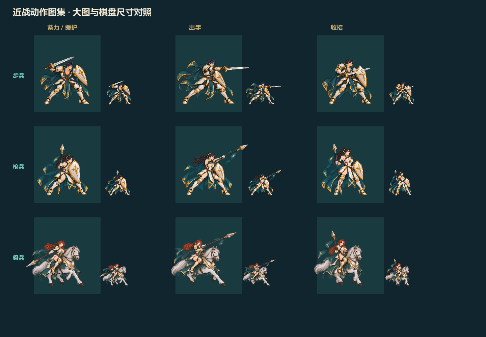
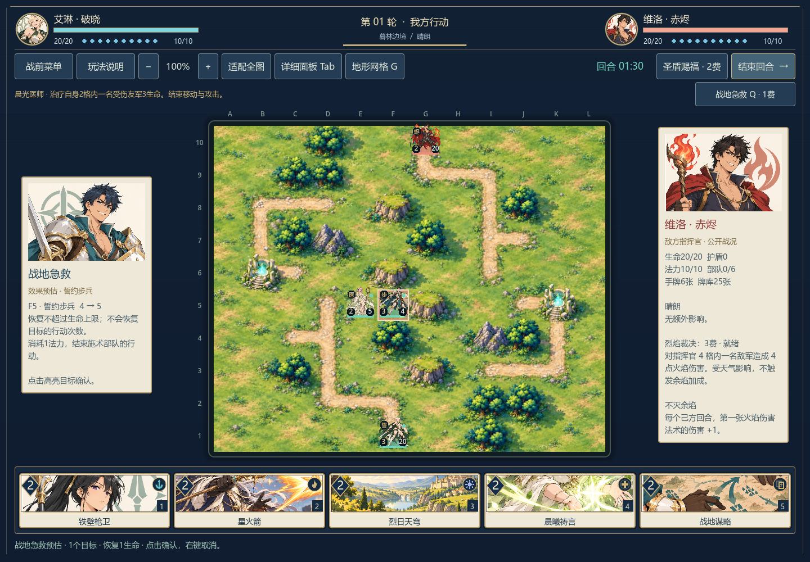
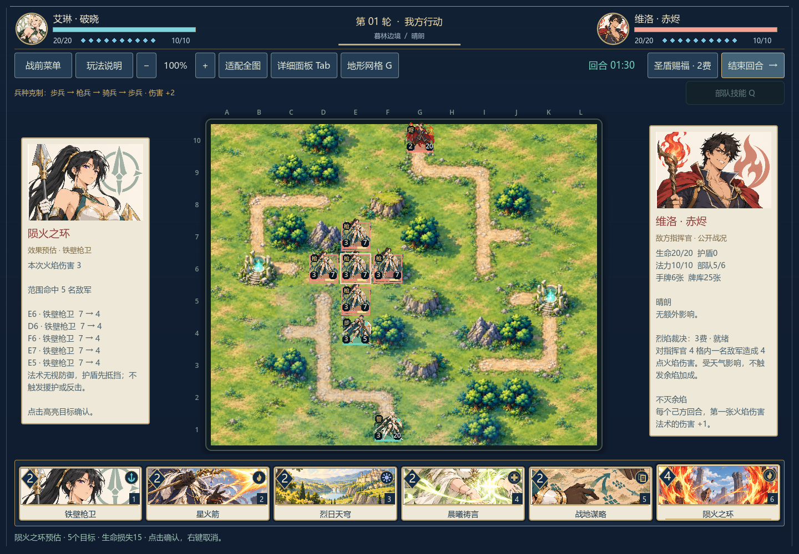

<p align="center"><strong>北邮 AI 学生个人实践项目</strong> · 欢迎 Follow 关注项目更新与共建进展</p>
<p align="center"><a href="README.md">简体中文</a> · <a href="README_EN.md">English</a></p>

<h1 align="center">纹章与誓约 · Sigils &amp; Oaths</h1>

<p align="center"><strong>把卡牌打进战场，让每一次部署都改变阵线。</strong></p>
<p align="center">用 Godot 制作的原创单机卡牌战棋：在友军身旁召唤部队，以站位、兵种克制、地形与天气争夺优势。</p>
<p align="center">   </p>

如果你也喜欢卡牌构筑与棋盘上的阵线博弈，欢迎点亮 ⭐ Star，也欢迎 Follow 关注后续更新。仓库暂不展示星数。

卡牌决定你手里有什么，棋盘决定它们能做什么。新部队可以部署在任意友军的上下左右相邻格，包括刚召唤的部队。你可以沿着阵线连续增援，抢桥、占领高地，也要防止突进过深，让对手找到反击的空隙。

玩法研究参考《炉石传说》的卡牌资源节奏与《梦幻模拟战》的地形、兵种和指挥官博弈。角色、卡面、美术与地图布局为本项目制作；未使用上述游戏的角色、图像、音频或其他素材。当前是可玩的 **0.12.2 开发版**，面向 Windows 桌面单机对战 AI。

## 实机画面

下面均为游戏窗口截图，包含真实棋子、手牌与界面。


<details>
<summary>查看战前部署与更多地图</summary>


</details>

## 你可以怎么玩

| 战场上的选择 | 当前实现 |
| --- | --- |
| 用卡牌向前增援 | 24种可组牌、三套30张预组牌、本地自定义套牌；友军身旁部署，新兵也能延伸阵线 |
| 让兵种互相掩护 | 步兵克枪兵、枪兵克骑兵、骑兵克步兵；弓手、法师、医师各有射程与功能 |
| 发动部队主动技能 | 六兵种各有1费主动：护盾、援护、再机动、精准射击、星火、急救；每单位每回合一次 |
| 抢到有价值的位置 | 六张12×10完整绘制地图；森林、高地、工事提供防御，军道与桥梁影响机动，遗迹恢复生命 |
| 选一个指挥官带队 | 艾琳保护阵线，维洛强化火焰，赛菈治疗与林地恢复；各有主动技能和被动能力 |
| 改变下一轮战局 | 暴雨、浓雾、烈日、寒潮影响双方；可替换或驱散天气，也可造路、筑垒、击退、定身与换位 |
| 在有限时间内决策 | 每个行动回合90秒；定向法术限定在友军3格内、法师4格内，天气影响全场 |

## 部队技能与战斗动画

选中己方普通部队，点击地图上方技能按钮或按 **Q**；需要选目标的技能会显示高亮，右键/Esc可取消。六技能均消耗1法力，每单位每回合一次，新兵不能使用。

| 部队 | 主动技能 |
| --- | --- |
| 誓约步兵 | 誓约坚守：自身护盾至少变为3，不叠加 |
| 铁壁枪卫 | 铁壁援护：至下次己方回合，替上下左右相邻友军承受普通攻击，包含指挥官 |
| 逐风骑士 | 疾风再动：已移动、未攻击时再走最多2点地形费用，保留攻击机会 |
| 暮林游侠 | 精准射击：普通攻击伤害+1，遵守射程、浓雾、援护与反击 |
| 星火术士 | 星火迸发：自身2格内单体3点火焰伤害，受天气影响，无视防御但不穿护盾 |
| 晨光医师 | 战地急救：治疗自身2格内一名受伤友军3生命，不能超过上限 |

除骑兵再机动外，技能会结束该单位的移动与攻击。定身阻止再机动和枪兵接应。援护不拦截法术或反击；多个守卫由较早部署者接应，不连锁。守卫使用自己脚下的防御地形，反击按原位射程判断，阵亡时不向被保护者溢出伤害。

攻击预估会指出实际承伤的守卫。战斗表现包含近战突进与斩击、箭矢和法术飞行、援护拦截、命中、克制提示及反击；规则只结算一次，动画不改棋子真实位置或重复扣血。步兵、枪兵、骑兵各有蓄力、出手、收招三张原创动作姿态，援护先举盾，反击也会切换姿态，并按对手方向翻转。其余角色暂用站姿配合特效；当前尚无完整行走循环或独立全屏战斗过场。



[查看近战姿态、左右出手与援护实机演示](docs/screenshots/melee-poses.mp4)


[查看实机技能与战斗动画演示](docs/screenshots/unit-skills-combat.mp4)

选择法师、医师或目标型数值法术时，悬停高亮目标可查看结算后的生命与护盾。治疗量按上限计算，并在生命条上显示绿色预估段；范围法术按坐标列出实际受影响的敌军。天气、指挥官火焰牌加成和护盾吸收都计入数值；法术不会触发枪兵援护或普通反击。

治疗采用绿色光迹与十字，防护采用盾形效果，火环显示实际五格十字范围。最后一击先完成命中和击破表现，再显示胜负面板；重开会清理旧效果。

[查看约20秒法术预估与终结一击演示](docs/screenshots/spell-feedback.mp4)

<details>
<summary>查看治疗与群体法术预估</summary>




</details>

## 快速开始

需要 **Godot 4.7.2 标准版**（无需 .NET）。仓库不包含引擎二进制、导出成品或本机缓存。

```bash
git clone https://github.com/yifanchen12/sigils-and-oaths.git
cd sigils-and-oaths
```

1. 从 [Godot 官方下载页](https://godotengine.org/download/windows/)获取引擎；当前工程验证版本及官方归档地址见 [`docs/engine-download.json`](docs/engine-download.json)。
2. 在 Godot 项目管理器中导入根目录的 `project.godot`，等待资源导入完成。
3. 按 **F5（运行项目）**，在战前页选择地图、指挥官与套牌，然后出征。

也可以用命令行启动，下面的 `godot` 表示你的 Godot 可执行文件：

```bash
godot --editor --path . --import
godot --path .
```

Windows 用户也可把官方压缩包内的图形版与控制台版引擎放入 `.tools/godot/`，保留 `Godot_v4.7.2-stable_win64.exe` 和 `Godot_v4.7.2-stable_win64_console.exe` 文件名，再双击 `play.cmd`；`edit.cmd` 打开编辑器。只下载仓库、没有安装引擎时，启动脚本不会自动下载。

## 第一局

1. 点击部队牌，再点击友军上下左右相邻的青框空格部署。每方最多6支普通部队，指挥官另外计算。
2. 新兵下个己方回合才能行动。选中部队，蓝点表示可移动位置，赤框表示可攻击目标；一般可先移动再攻击，攻击后不能移动。
3. 悬停可攻击敌军可看预计伤害、反击与双方剩余生命。存活且射程足够的目标会反击一次。
4. 每回合增加并回满法力，最多10点。用法术和英雄技能支援前线，在90秒内完成行动。
5. 击败敌方20生命的指挥官获胜。指挥官不能主动移动，但可被换位；牌库抽空后会受到递增疲劳伤害。

游戏内“玩法说明”包含完整规则。编辑军势可保存一个自定义套牌：30张、同名最多4张、至少1张部队；自定义己方对阵均衡AI。

| 操作 | 按键 / 鼠标 |
| --- | --- |
| 出牌、选择部队与目标 | 左键；1–8选择手牌 |
| 取消选择 | 右键 / Esc |
| 结束回合 | 空格 / 界面按钮 |
| 缩放地图 | 滚轮 / + / − |
| 拖动地图 | 中键 / Alt + 左键 |
| 适配全图 | Home |
| 查看精确地形网格 | G |
| 所选部队主动技能 | Q / 技能按钮 |
| 切换战场布局 | Tab |
| 键盘操作棋盘 | 方向键 / Enter |

图鉴、规则或战前菜单打开时，本地回合计时与AI暂停；战斗中更换地图、指挥官或套牌会开始新对局。

## 六张战场

| 地图 | 主要地貌 |
| --- | --- |
| 暮林边境 | 林地、迂回道路、岩山、高地与恢复遗迹 |
| 双桥河谷 | 横贯战场的河流与两条桥梁通路 |
| 日陨遗城 | 沙地、台地、稀疏树林与遗城工事 |
| 断脊隘口 | 岩山阻挡、狭窄缺口与松林 |
| 古堡棋庭 | 石铺装、堡垒、庭院高地与遗迹 |
| 碧潮港湾 | 中央水道、双桥、港口堡垒与岸线 |

地图绘制图与规则网格独立；精确通行、射程和选取以游戏规则与高亮为准。造路和筑垒会实时替换对应格子的地形外观。位置导图、源图提示词与人工核对记录见 [`docs/map-art-audit.md`](docs/map-art-audit.md)。

## 开发与校验

规则统一经过 `scripts/battle.gd`：界面和AI提交相同格式的合法动作。卡牌、英雄、套牌和地图使用Godot Resource配置；地图、卡面、棋子与HUD表现不负责修改规则。AI使用公开棋盘与自己的手牌，不读取敌方手牌内容或牌序。

```text
data/          卡牌、地图、指挥官与套牌配置
scripts/       规则、AI、界面与表现
scenes/        Godot主场景
assets/art/    角色、卡面、地图原图与来源清单
tests/         规则、完整AI对局及真实窗口交互检查
tools/         地图导图、核对图及诊断工具
docs/          实机截图、验收与开发记录
```

本机 **Godot 4.7.2 / Windows / Compatibility** 验证：0.12.2动作姿态160项、界面257项、法术反馈56项通过。0.12.1已验证效果预估134项、普攻预估113项和六技能窗口51项；六技能规则、完整AI对局和地图专项保留各自实际验证版本，详见 [`docs/validation.md`](docs/validation.md)。

```bash
godot --headless --path . --editor --quit
godot --headless --path . --script res://tests/test_battle.gd
godot --headless --path . --script res://tests/test_unit_skills.gd
godot --headless --path . --script res://tests/test_effect_forecast.gd
godot --path . --script res://tests/test_ui.gd --resolution 1440x1000 --audio-driver Dummy
godot --path . --script res://tests/test_forecast.gd --resolution 1440x1000 --audio-driver Dummy
godot --path . --script res://tests/test_map_art.gd --resolution 1440x1000 --audio-driver Dummy -- --complete
godot --path . --script res://tests/test_unit_skills_ui.gd --resolution 1440x1000 --audio-driver Dummy
godot --path . --script res://tests/test_feedback_polish.gd --resolution 1440x1000 --audio-driver Dummy
godot --path . --script res://tests/test_action_poses.gd --resolution 1440x1000 --audio-driver Dummy
```

界面、预估、地图和技能窗口检查需要真实图形窗口。初版规则与开发命令见 [`docs/development.md`](docs/development.md)；新增技能以本页及游戏内说明为准。

## 当前边界与美术来源

- 当前是单机开发版，尚未提供联机、触屏适配或打包发行版；macOS/Linux未完成验证。
- 远程攻击和法术目前不检查视线。AI对局诊断不能代替真人竞技平衡测试。
- 自定义套牌只有一个本地槽，保存于Godot的 `user://custom_deck.json`，不随仓库上传。
- 本项目使用AI辅助编程与原创图像生成。角色采用日式赛璐璐方向，全部设定为成年人；地图与卡面原图、完整提示词及生成来源见 [`assets/art/manifest.json`](assets/art/manifest.json)。美术源PNG保留原样，UI文字、数值、网格和高亮由Godot绘制。
- 欢迎通过Issue反馈复现步骤、窗口尺寸、地图、指挥官和遇到的问题；报告中无需附任何账号、密码或本机个人文件。

## 许可

MIT License，详见 [`LICENSE`](LICENSE)。Godot引擎遵循其[自身许可](https://godotengine.org/license/)，仓库不随附引擎二进制。
