<p align="center"><strong>A personal project by a BUPT AI student</strong> · Follow for updates and collaboration</p>
<p align="center"><a href="README.md">简体中文</a> · <a href="README_EN.md">English</a></p>

<h1 align="center">Sigils &amp; Oaths · 纹章与誓约</h1>

<p align="center"><strong>Play your cards onto the battlefield. Make every deployment reshape the front line.</strong></p>
<p align="center">An original single-player card tactics game built with Godot. Summon beside friendly units and fight for position with unit counters, terrain, commanders and weather.</p>
<p align="center">   </p>

If you enjoy deckbuilding and tactical positioning, a ⭐ Star is welcome. Follow for future updates. This README does not display a star count.

Your hand determines what you can field; the board determines what those cards can achieve. Deploy a new unit in an empty, passable cell orthogonally adjacent to any friendly unit, including one you just summoned. Chain reinforcements, contest bridges and claim high ground while keeping your advancing force covered.

The design studies card resource pacing from Hearthstone and terrain, unit counters and commanders from Langrisser. The project uses its own characters, cards, artwork and map layouts, with no assets from either game. Current source is **0.24.0-dev**, with seven chapters, branching encounters and cross-chapter saves. Chapter 7 follows residents moving from an old clinic, family inquiries, three separate camp stories and four new day/night backgrounds. The complete campaign, overall balance and 100,000-character target remain in development. The interface is Chinese; this README does not imply an English localization.

## In-game screenshots

The chapter-7 dialogue capture is from 0.24.0-dev; the battlefield captures below it are from 0.13.0 and earlier milestones.

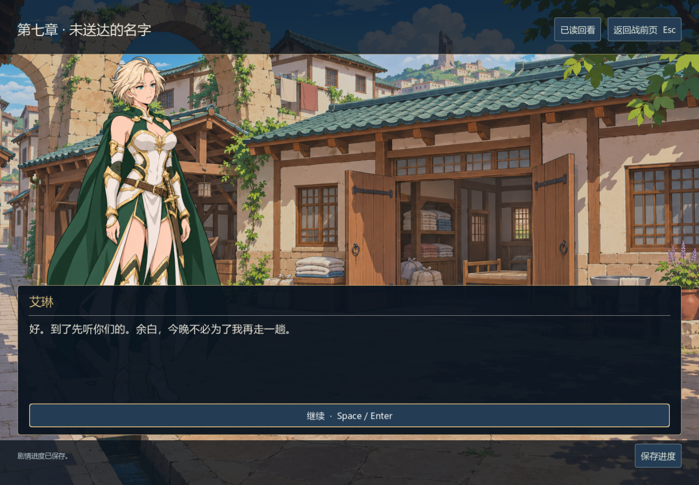

[Scene states, small-window choices, backlog and verification](docs/narrative-art-v020.md).

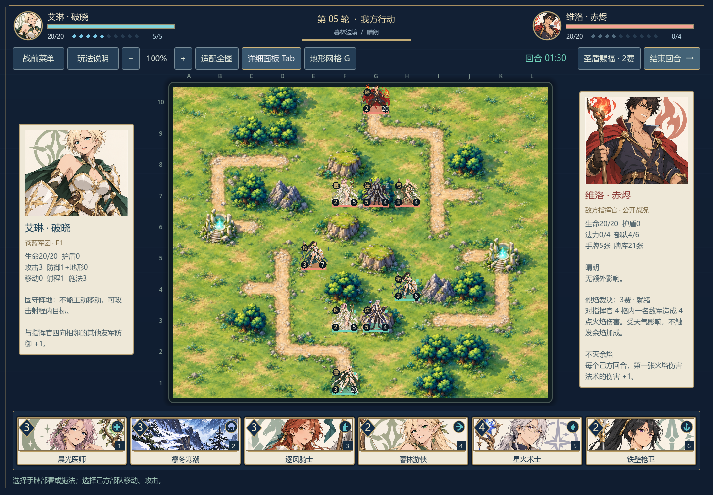
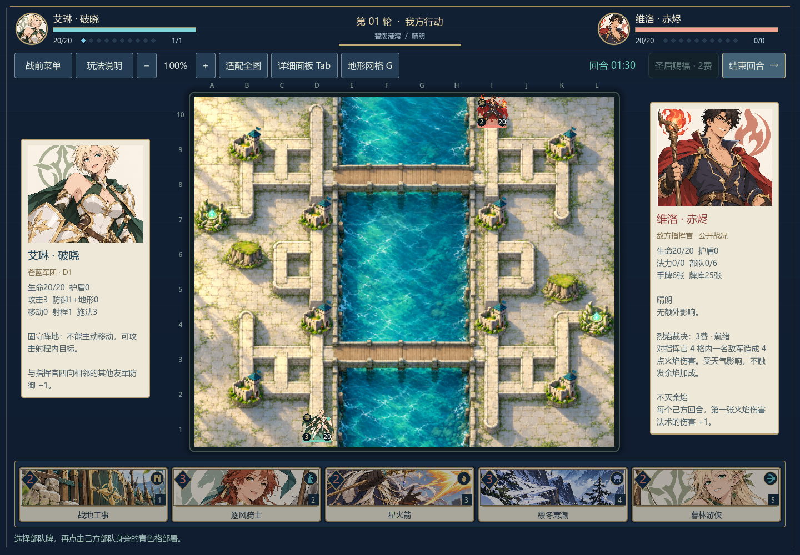

<details>
<summary>Preparation screen and more maps</summary>

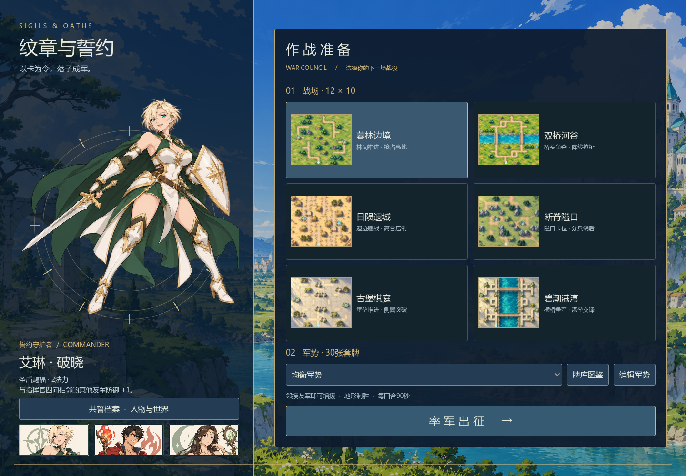
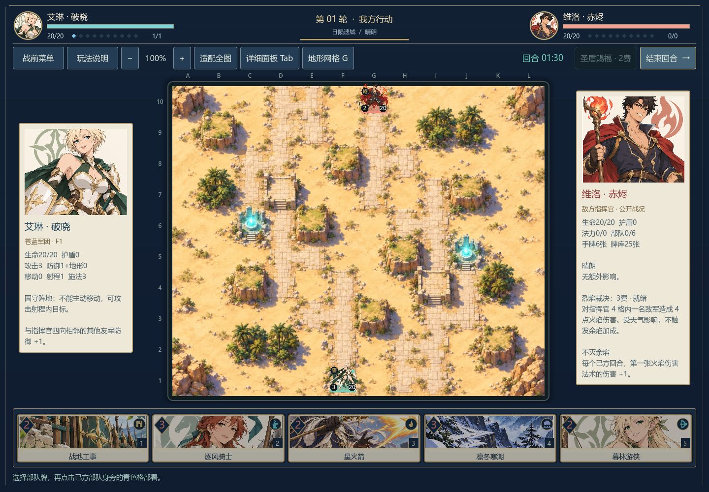
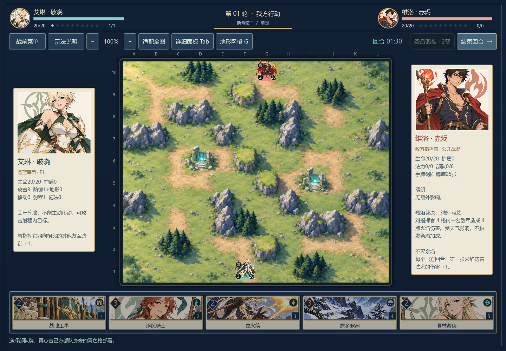
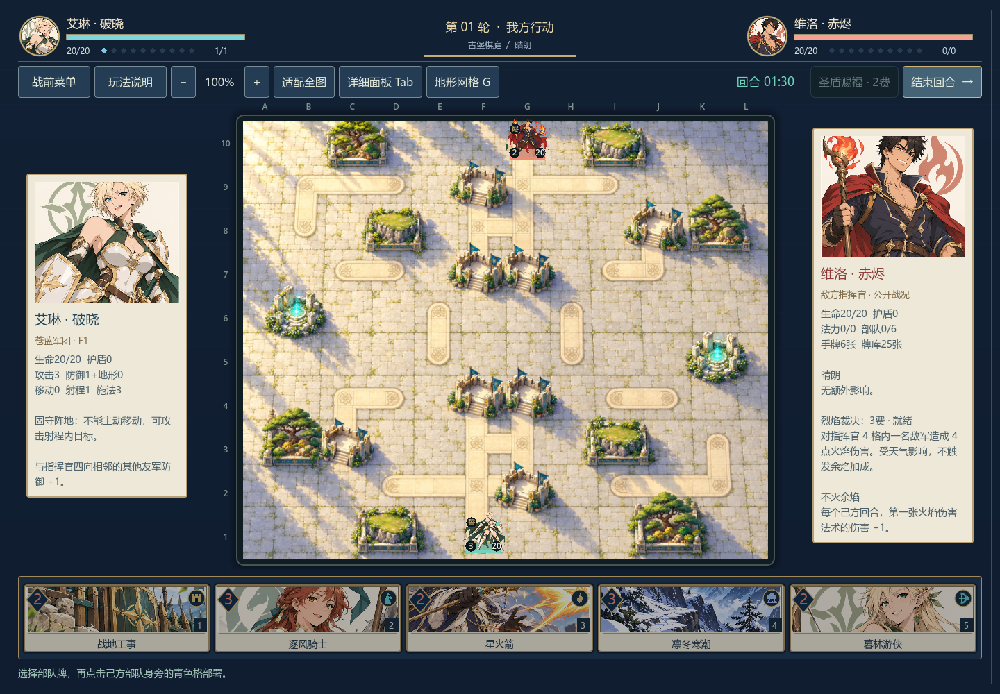

</details>

## What you can play

| Tactical choice | Implemented |
| --- | --- |
| Reinforce from cards | 24 collectible card types, three 30-card presets and one saved custom deck; adjacent deployment can extend from newly summoned units |
| Cover different unit roles | Infantry beats spears, spears beat cavalry, cavalry beats infantry; archers, mages and healers have distinct ranges and roles |
| Use active unit skills | Six one-mana abilities: shielding, interception, extra movement, a precise shot, fire damage and healing; once per unit per turn |
| Contest useful ground | Six fully illustrated 12×10 maps; defensive forests, hills and forts, roads and bridges for mobility, and healing ruins |
| Lead with a commander | Ailin protects the front, Velo strengthens fire, and Sera supports healing and woodland recovery; each has active and passive abilities |
| Change the next exchange | Rain, fog, sun and snow affect both sides; replace or dispel weather, build roads and forts, push, root or reposition units |
| Act under a clock | 90-second action turns; targeted spells require a friendly unit within 3 cells, or a mage within 4; weather is global |

## Chapter 7: Undelivered Names

Eileen reaches the old clinic hoping to ask about her father, but first has to help carry a bed through a narrow door. Once the residents reach the school, Yubai can tell her what he remembers. At night, choose the river steps with Loen and Frey, the temporary ward with Iser and Mire, or the gallery with Lishi and Ximi.

This chapter adds **10,143 Chinese body-text characters** and four original backgrounds. Seven chapters plus the archive total **52,624 authored characters**, with 24,576 cumulative choice paths and nine encounters per path. All 848 chapter paragraphs have native rendering checks; 66,154 related model checks and 8,896 native checks passed, including actual choices and disk reloads for all three camp routes. Continuous ordinary-difficulty completion, external reading and the full 100,000-character script remain pending. [Chapter-7 editorial, art and verification](docs/narrative/chapter-07-review.md).

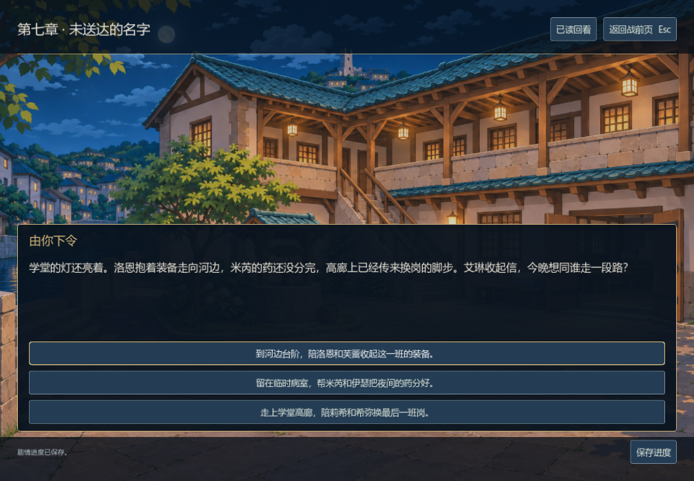

## 0.23: Position after moving

AI now evaluates vacated cells and newly blocked routes. All outcomes from 13 fixed-seed diagnostics are retained; 927 related regression checks and 15,189 independent replay checks passed. The current-policy seed bridge completed 88 legal actions across two native processes, with save/exit, reload, victory and story handoff verified in 268 checks. Long games and a roughly 0.52-second peak decision remain; this is not human balance or continuous campaign proof. [Changes and native evidence](docs/ai-occupancy.md).

## Historical objective and continuation evidence

AI captures and holds control points, using knockback, spells and guard to contest progress. It now weighs recruit exposure and prioritizes meaningful healing over chip damage. Both chapter-2 bridge routes have native victories from original resources: exit during an enemy turn, relaunch, resume AI, complete control, then enter and save the corresponding postbattle story.

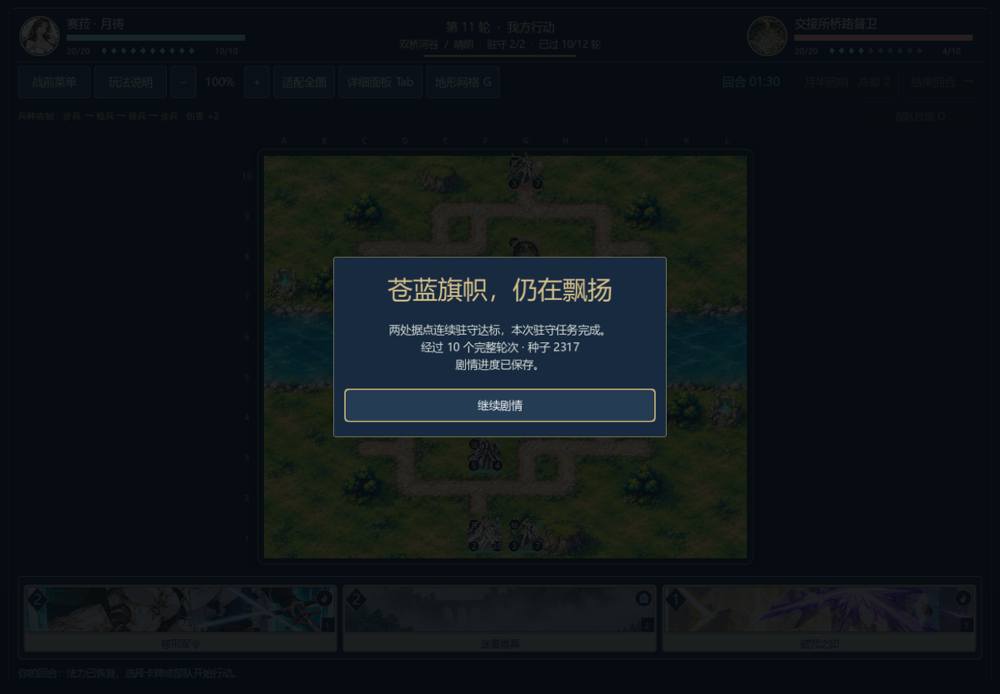

A test-only player strategy now wins the chapter-1 bridge by concentrating on the left crossing: 260 legal actions against unchanged production AI and original resources/card order, also verified through two native processes with exit/relaunch. Earlier encounters are still skipped by narrative fixtures, so this is not continuous campaign completion. All previous losing records remain available; ordinary battles still include long games. [Chapter-1 bridge evidence](docs/bridge-playthrough.md) · [Chapter-2 controls and historical diagnostics](docs/tactical-survival.md).

## Chapter 6: Old Seals of the Court

Eileen finally meets her teacher and sees her father's original suspension order. Roser explains his old decision while facing responsibility for the current water orders. Players choose immediate disclosure or a witnessed review with a next-morning deadline; both branches actually release their findings. Her father's private letter presents a different choice: read alone or ask her companions to stay.


At the 0.22 milestone, this chapter added **7,109 Chinese body-text characters**. Six chapters plus the archive totaled **42,481 authored characters**, with 8,192 cumulative choice paths and nine encounters per path. All 623 chapter paragraphs have native rendering checks; continuous ordinary-difficulty accessibility is still pending. This milestone passed 83,576 related model checks and 6,562 native checks. The new court diagnostic loses from normal resources; its complete trace is retained and passes 420 independent replay checks. [Chapter-6 editorial, art and verification notes](docs/narrative/chapter-06-review.md).

The 0.22.0-dev chapter-5 channel route also has a native victory from original resources, exit/relaunch continuation and postbattle handoff, with 421 checks across two independent processes. [Native channel encounter evidence](docs/channel-playthrough.md).

## Chapter 5: Where the Water Comes From

Syla returns to find her banner taken down. Preserving the hillside nursery requires another night of water hauling downstream; clearing the channel first costs damaged hillside crops. Her mother will not decide for her, and winning the canal encounter does not automatically restore her mandate. She can accept a limited term with local co-signatures or return the seal and travel as a witness.

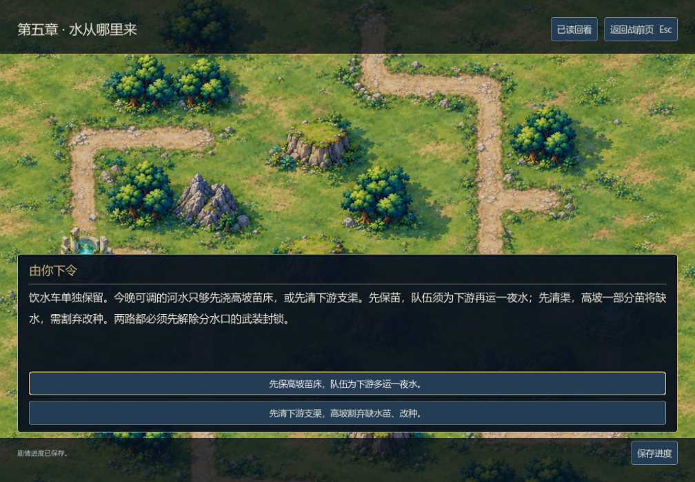

The chapter adds **7,290 Chinese body-text characters**, with 5,784–5,839 per route, two decisions and one branching encounter. The 0.21 milestone has five chapters and 2,048 cumulative choice paths and eight encounters per path; authored prose including the archive totals **35,372 characters**. All 493 chapter paragraphs have native rendering checks, but continuous ordinary-difficulty access remains pending and the conservative accepted count stays at 5,558. Related models passed 21,730 checks and native UI passed 4,716. Both new fixed-seed diagnostic traces are retained: one win and one loss, 252 legal actions independently replayed. These are not balance or full-campaign evidence. [Chapter-5 editorial and verification notes](docs/narrative/chapter-05-review.md).

## Unit skills and combat animation

Select a friendly troop and press **Q**, or click its skill button above the board. Targeted skills highlight legal cells; right-click/Esc cancels. Every skill costs one mana and is limited to once per unit per turn. New summons cannot use skills.

| Unit | Active skill |
| --- | --- |
| Infantry | Raise its shield to at least 3, without stacking |
| Spear guard | Intercept initiating normal attacks on orthogonally adjacent allies, including commanders, until its next turn |
| Cavalry | After moving but before attacking, move again for at most two terrain-cost points; keep the attack |
| Archer | A normal attack with +1 damage, obeying range, fog, interception and retaliation |
| Mage | Deal 3 fire damage within two cells; weather applies, armor is ignored, shields still absorb damage |
| Healer | Restore 3 health to a wounded friendly within two cells, capped at maximum health |

All skills except cavalry's extra movement end movement and attack for that unit. Root prevents extra movement and guard interception. Interception does not stop spells or retaliation and cannot chain; the earliest deployed eligible guard is chosen. Defense uses the guard's own terrain, retaliation uses its original position and range, and lethal damage does not spill into the protected ally.

Forecasts identify the actual defender. Combat includes melee lunges and slashes, arrows and magic projectiles, interception, impact, advantage labels and retaliation. Rules resolve once; animation does not move rule positions or deal damage again. All six troop types and three commanders now have three original preparation, action and recovery poses. Guards brace, retaliation has separate timing, and local spells animate an eligible friendly caster while weather uses the commander. Full walking cycles and a separate full-screen battle scene are not implemented.

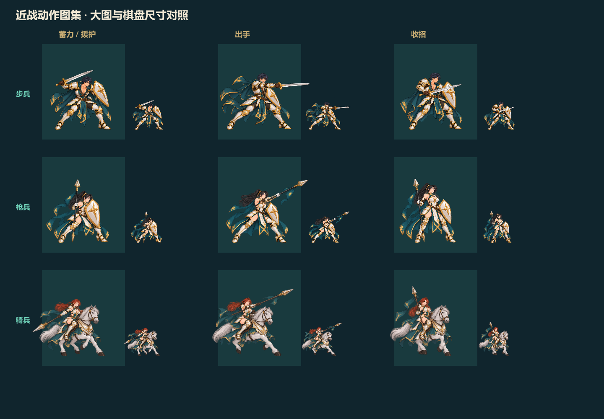

[Watch melee poses, attacks in both directions and interception](docs/screenshots/melee-poses.mp4)

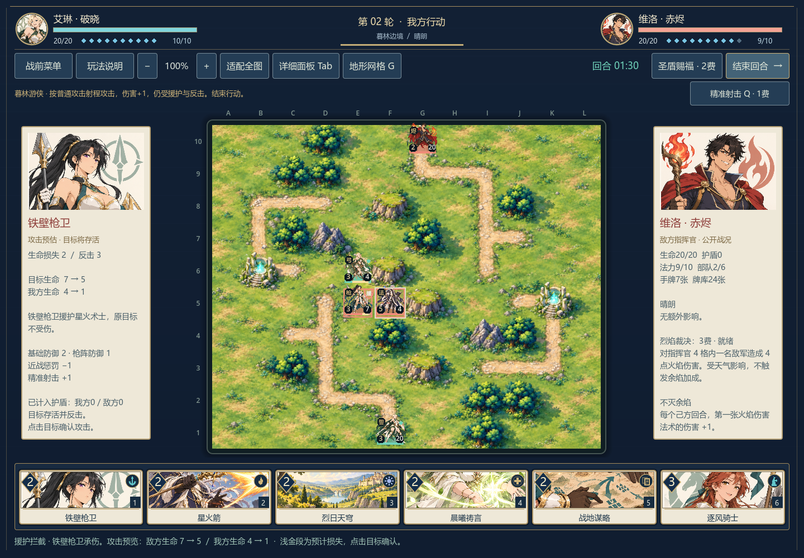

[Watch the in-game skills and combat demo](docs/screenshots/unit-skills-combat.mp4)

Hover a legal target for a mage, healer or supported numeric spell to preview remaining health and shields. Healing respects maximum health and adds a green preview segment to the health bar; area spells list actual enemies by board coordinate. Weather, the commander's fire-card passive and shield absorption are included. Spells bypass guard interception and do not provoke normal retaliation.

Healing uses green trails and a cross, protection uses a shield shape, and area fire marks its actual five-cell cross. The final hit and defeat effect finish before the result panel appears; restarting clears the previous presentation.

[Watch the approximately 20-second spell preview and final-hit demo](docs/screenshots/spell-feedback.mp4)

<details>
<summary>Healing and area-spell previews</summary>

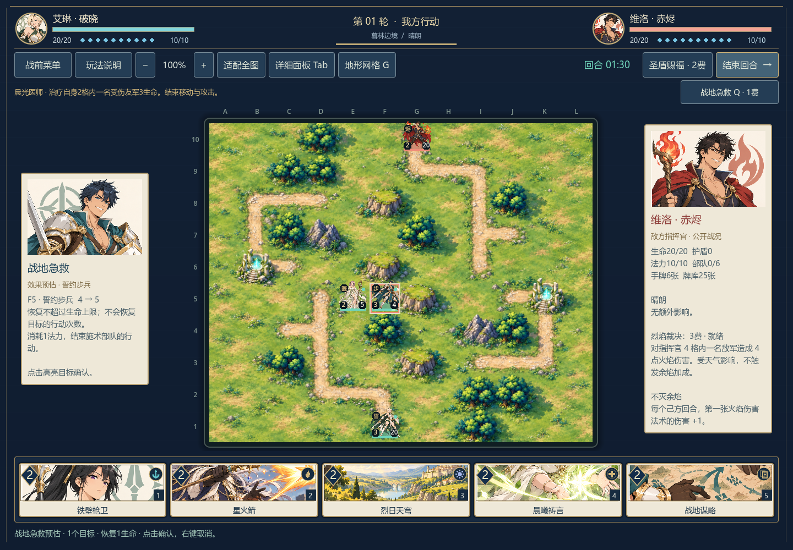
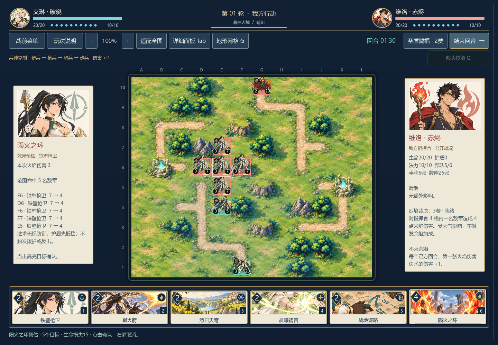

</details>

## World archive and campaign development

Open the archive from the war council to read profiles for three commanders and six troop captains, six battlefield histories, and the background of the oaths and the Long Day disaster. The reader reuses the original portraits and full-body artwork, pauses local combat and returns to the menu with Escape.

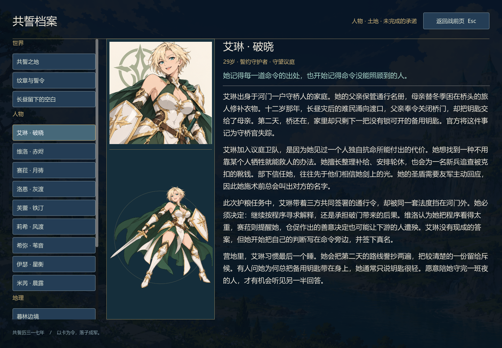

The archive contains 18 entries and 52 paragraphs: **5,558 distinct Chinese body-text characters**, excluding headings, summaries, UI, design documents and prompts. The planned game is an ensemble war story with relationships and optional romance, targeting at least 100,000 accessible Chinese characters.

Chapter 1 contains **5,820 body-text characters**, three decisions and eight route combinations. The road and riverside routes recover different evidence, with two encounters per route. Only victory grants its story facts; defeats retain a retry point. One route contains 4,065–4,197 characters. New/continue campaign, dialogue, choices, backlog and saving are wired into the UI. **Version 0.16.0-dev checks native pages, new-campaign/backlog/choice controls and chapter transitions. Victory fixtures reach later chapters; normal-difficulty playthroughs remain pending.** Chapter text stays separate from fully verified delivery totals.

Chapter 2 contains 4,914 Chinese body-text characters and carries the eight prior fact combinations into two new decisions: shipment priority and receipt inspection. Its 32 cumulative routes each contain two encounters. Relief priority uses Sera and the defensive deck; seed priority uses Ailin and the balanced deck. Hold both D5 and I5 at two consecutive player-turn starts within 12 full rounds, or defeat the opposing commander. Velo leads the dispatch-office encounter. Chapter transitions retain prior reading history and facts, and only commit after saving succeeds. Stable dialogue IDs survive inserted or reordered earlier lines. **Native chapter pages and transitions are checked. Both chapter-2 bridge routes now have actual victories, saving and postbattle continuation; the chapter-1 bridge and continuous campaign completion remain pending.**

Campaign autosaves now include **complete battle state**: board, card order, skills/guard/root, weather, resources, clock and RNG, alongside dialogue and choices. Completed actions are saved immediately; the active clock is saved every five seconds. Menu entry and normal exit are wired to save too. Cross-process recovery and continued actions pass pure-logic checks. Version 0.17.0-dev additionally exits during the vent encounter, loads it in a new native process, resumes enemy AI and plays through to victory and the saved postbattle dialogue. Failed writes preserve the previous save and report an error. Newer or incompatible rules versions are protected. The current v3 format accepts v1 story checkpoints and v2 full battles; files without a board resume at the briefing.

Switching to a skirmish retains the ongoing campaign battle. An unexpected termination may lose the latest unsaved clock interval; backups and flushing cannot guarantee the newest write survives a sudden power loss. Enemy guards still use separate names and temporary fort icons with existing rules classes; dedicated NPC artwork remains pending.

0.15.1-dev rewrites both chapters using the `chinese-novelist` editorial workflow: distinct motives, strained cooperation, old debts and an imperfect witness replace repeated procedural exposition. All 189 text IDs and branch mechanics remain stable. Chapter prose shrank from 13,321 to 10,734 Chinese characters; that revision brought authored prose including the archive to 16,292. Saves still resume, but backlog text uses the revision; existing readers should reread chapter 1. [Reading sample](docs/narrative/reading-sample.md) · [Editorial record](docs/narrative/editorial-review.md).

Chapter 3, “Wind over the Broken Ridge”, follows Frey’s mine-rescue history and Lishi’s letter to her sister. Preserve the upper maintenance passage by holding E6/H5 twice within ten full rounds with the defensive deck, or seal it and defeat the convoy commander with the assault deck. Both routes record distinct supply consequences. The chapter adds 5,766 Chinese body-text characters (4,805–4,851 per route). Three chapters now have 128 cumulative choice paths, five battles per path, and 22,058 authored characters including the archive.

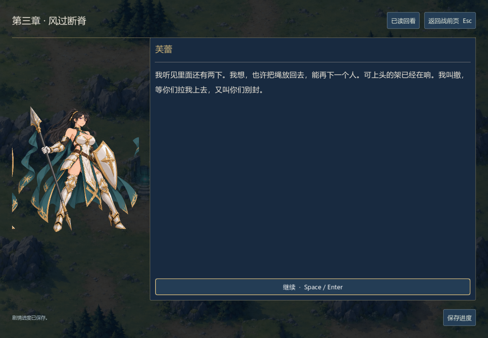

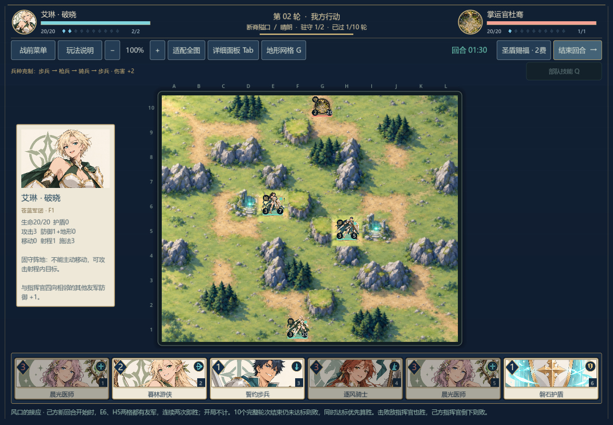

Version 0.16.0-dev passes 1,520 relevant model checks and 2,264 native UI checks, covering all 261 dialogue paragraphs and three endings. It fixes collapsed toolbar buttons and missing progress in the actually drawn HUD. Troops in the objective screenshot were placed by a test fixture; **this is not a normal-difficulty victory capture**. Playthroughs, balance, external editorial feedback and the full 100,000-character campaign remain incomplete. [Chapter 3 editorial and validation record](docs/narrative/chapter-03-review.md).

[Text audit](docs/narrative-audit.json) · [Narrative direction](docs/narrative-direction.md) · [Campaign acceptance plan](docs/plans/steam-campaign.md) · [Steam readiness](docs/release/steam-readiness.md)

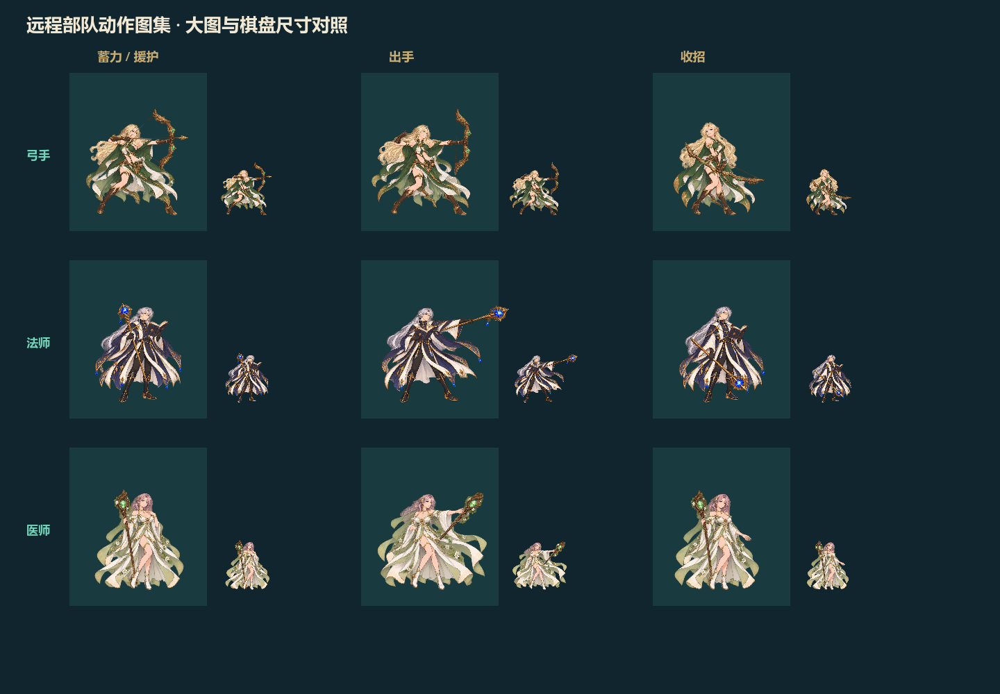
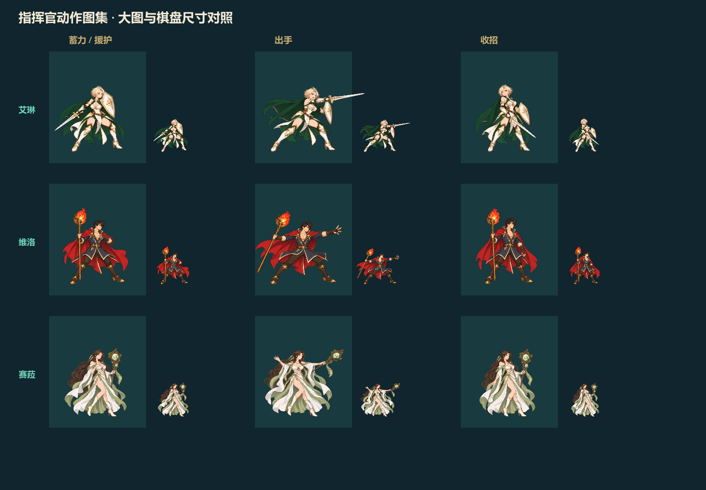

Chapter 4 adds **6,024 Chinese body-text characters**, two harbor encounters and separate choices about crew accommodation and unpaid wages. The crew leaves the locked ship, the old foundry pattern gets a concrete origin, and Velo must surrender assets or income while installment debts remain explicit. A chapter-4 route contains 5,147–5,258 characters. Four chapters have 512 cumulative choice paths with seven encounters per path; that milestone contained **28,082 authored characters** including the archive, with 360 chapter paragraphs / 22,524 characters rendered natively.


The chapter and related model suite passed 6,325 checks; native pages and controls passed 3,085. Harbor deployment is checked, but ordinary-resource harbor victories are still pending. Version 0.20.0-dev adds seven dedicated scenes, with 3,455 native page checks and 5,667 related model checks passing. NPC portraits, noncombat companion poses and dedicated backgrounds for chapters 1–3 remain pending. [Chapter-4 editorial and verification notes](docs/narrative/chapter-04-review.md).

## Quick start

Use **Godot 4.7.2 Standard**, without .NET. Engine binaries, exported executables and local caches are not included.

```bash
git clone https://github.com/yifanchen12/sigils-and-oaths.git
cd sigils-and-oaths
```

1. Get Godot from the [official download page](https://godotengine.org/download/windows/). The exact tested version and official archive URL are recorded in [`docs/engine-download.json`](docs/engine-download.json).
2. Import the root `project.godot` in Godot's project manager and wait for resource import.
3. Press **F5** to run the project. Select a commander, map and deck, then start the battle.

Alternatively, with your Godot executable available as `godot`:

```bash
godot --editor --path . --import
godot --path .
```

On Windows, you may place the official archive's GUI and console executables in `.tools/godot/`, keeping the filenames `Godot_v4.7.2-stable_win64.exe` and `Godot_v4.7.2-stable_win64_console.exe`. Then double-click `play.cmd`; `edit.cmd` opens the editor. These scripts do not download the engine automatically.

## Your first match

1. Choose a unit card and click an empty cyan-highlighted cell orthogonally adjacent to a friendly. Each side has at most six ordinary units, plus its commander.
2. New summons act on your next turn. Select a ready unit: blue dots mark movement and red frames mark attack targets. Normally you can move once and attack once; attacking ends movement.
3. Hover an attackable enemy to preview damage, retaliation and both units' remaining health. A surviving target retaliates once if the attacker is in range.
4. Maximum mana increases and refills each turn, up to ten. Use spells and commander skills to support your front within the 90-second limit.
5. Defeat the opposing 20-health commander to win. Commanders cannot move normally, but can be swapped. Drawing from an empty deck causes escalating fatigue damage.

Full rules are available in the game's rules panel. The deck editor saves one local custom deck: 30 cards, at most four copies of a card and at least one unit. Custom decks face the balanced AI preset.

| Action | Input |
| --- | --- |
| Cards, units and targets | Left-click; 1–8 select a card |
| Cancel | Right-click / Esc |
| End turn | Space / button |
| Zoom | Wheel / + / − |
| Pan | Middle mouse / Alt + left mouse |
| Fit map | Home |
| Exact terrain grid | G |
| Selected troop's active skill | Q / skill button |
| Toggle battlefield layout | Tab |
| Keyboard board navigation | Arrow keys / Enter |

The card library, rules and preparation menu pause the local clock and AI. Changing the map, commander or deck during a match starts a new one.

## Six battlefields

| Map | Main terrain |
| --- | --- |
| Greenwood frontier | Forests, winding roads, rocky blockers, hills and healing ruins |
| River crossing | A horizontal river with two bridge routes |
| Sunspire ruins | Sand, terraces, sparse groves and ruined fortifications |
| Ridge pass | Rocky barriers, narrow openings and pine groves |
| Citadel courtyard | Stone paths, bastions, garden terraces and ruins |
| Tidal harbor | A central canal, two bridges, shorelines and port forts |

Map paintings are separate from the rule grid. Rules and highlights define exact passability, range and selection; road-building and fortification cards update the corresponding terrain artwork. Position guides and visual review notes are in [`docs/map-art-audit.md`](docs/map-art-audit.md) (Chinese).

## Development and validation

All rules go through `scripts/battle.gd`; the UI and AI submit the same action format. Cards, commanders, decks and maps use Godot Resources. Rendering does not alter rules. The AI uses the public board and its own hand, without reading the opponent's hidden cards or deck order.

```text
data/          Card, map, commander and deck resources
scripts/       Rules, AI, UI and presentation
scenes/        Godot main scene
assets/art/    Character, card and map sources with provenance
tests/         Rules, full AI matches and actual-window interactions
tools/         Map-guide, audit-image and diagnostic utilities
docs/          Screenshots, validation and development records
```

Verified locally with **Godot 4.7.2 / Windows / Compatibility** for version 0.13.0: 274 melee-pose, 363 ranged/casting-pose, 122 archive-UI, 257 existing-UI, 56 feedback, 134 effect-forecast and 28 casting/clock checks passed (1,234 total). Unit rules, full AI matches and map-art results retain their actual validation versions in [`docs/validation.md`](docs/validation.md). These checks do not constitute a complete campaign playthrough or Steam approval.

0.14.0-dev adds headless checks for the chapter graph, storage, cross-process recovery and coordination with the real battle resolver, plus unit-skill, effect-forecast and clock regressions. Short fixture battles validate transitions, not normal-difficulty completion or balance. New UI verification is pending.

0.14.1-dev passes 485 new and related full-save checks: snapshot 190, storage 31, session 204, migration/mid-battle 41, and two independent processes with 2+17 checks. Subsequent draws, an AI decision and future RNG samples match an independent baseline. No new graphical or full AI balance validation is claimed. See the [full battle save plan](docs/plans/battle-save.md).

0.15.0-dev passes 1,533 windowless checks for story cursors, chapter continuity, objectives and related rules/saving, including two independent-process pairs. Main is parsed only. The two chapters contain 173 candidate prose paragraphs; native interaction and ordinary playthroughs remain pending. See the [chapter 2 acceptance scope](docs/plans/second-chapter.md).

```bash
godot --headless --path . --editor --quit
godot --headless --path . --script res://tests/test_battle.gd
godot --headless --path . --script res://tests/test_unit_skills.gd
godot --headless --path . --script res://tests/test_effect_forecast.gd
godot --headless --path . --script res://tests/test_story_runner.gd
godot --headless --path . --script res://tests/test_story_cursor.gd
godot --headless --path . --script res://tests/test_campaign_chapters.gd
godot --headless --path . --script res://tests/test_control_objective.gd
godot --headless --path . --script res://tests/test_chapter_resume.gd -- --write
godot --headless --path . --script res://tests/test_chapter_resume.gd -- --read
godot --headless --path . --script res://tests/test_campaign_store.gd
godot --headless --path . --script res://tests/test_campaign_store.gd -- --write
godot --headless --path . --script res://tests/test_campaign_store.gd -- --read
godot --headless --path . --script res://tests/test_campaign_session.gd
godot --headless --path . --script res://tests/test_battle_snapshot.gd
godot --headless --path . --script res://tests/test_battle_save.gd
godot --headless --path . --script res://tests/test_battle_save.gd -- --write
godot --headless --path . --script res://tests/test_battle_save.gd -- --read
godot --path . --script res://tests/test_ui.gd --resolution 1440x1000 --audio-driver Dummy
godot --path . --script res://tests/test_forecast.gd --resolution 1440x1000 --audio-driver Dummy
godot --path . --script res://tests/test_map_art.gd --resolution 1440x1000 --audio-driver Dummy -- --complete
godot --path . --script res://tests/test_unit_skills_ui.gd --resolution 1440x1000 --audio-driver Dummy
godot --path . --script res://tests/test_feedback_polish.gd --resolution 1440x1000 --audio-driver Dummy
godot --path . --script res://tests/test_action_poses.gd --resolution 1440x1000 --audio-driver Dummy
godot --path . --script res://tests/test_cast_poses.gd --resolution 1440x1000 --audio-driver Dummy
godot --path . --script res://tests/test_lore_book.gd --resolution 1440x1000 --audio-driver Dummy
python tools/audit_narrative.py
```

UI, forecast, map-art and skill-window checks require a graphical window. Earlier commands and rules are in [`docs/development.md`](docs/development.md) (Chinese); use this page and the in-game help for the new skills.

## Current limits and artwork

- Single-player development build; no multiplayer, touch adaptation or packaged release. macOS and Linux have not been validated.
- Ranged attacks and spells currently do not check line of sight. AI diagnostics are not a substitute for competitive human playtesting.
- One custom deck is saved locally at Godot's `user://custom_deck.json`; player data is not included in this repository.
- One campaign autosave and a last-good backup use `user://campaign_autosave.json`. Starting over asks for in-game confirmation before replacing progress; these files are not published.
- Development uses AI-assisted coding, original image generation and narrative writing. Narrative content is fixed during development; the game does not call a live generation service. The cel-shaded characters are all adults. Artwork sources, full prompts and generation provenance are recorded in [`assets/art/manifest.json`](assets/art/manifest.json). Source PNGs remain intact; Godot draws text, values, grids and highlights.
- Issues with reproduction steps, window size, map and commander are welcome. Do not attach credentials or unrelated personal files.

## License

MIT License; see [`LICENSE`](LICENSE). Godot is covered by its [own license](https://godotengine.org/license/); engine binaries are not bundled.
