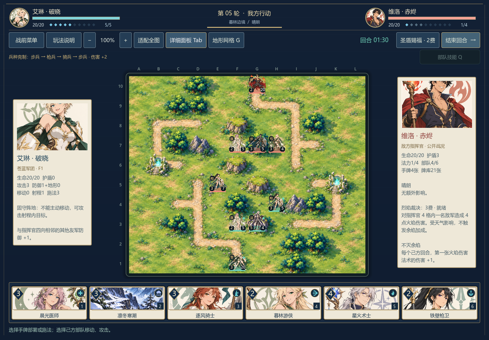
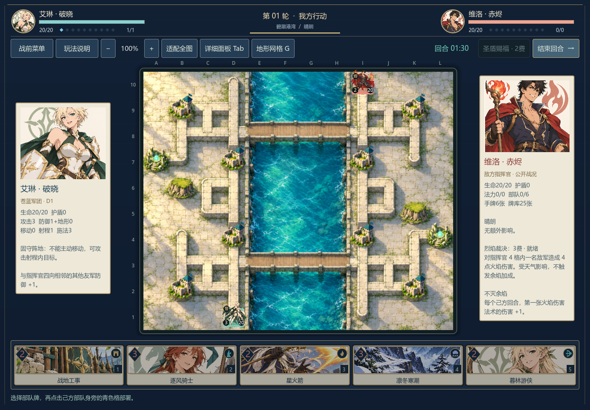
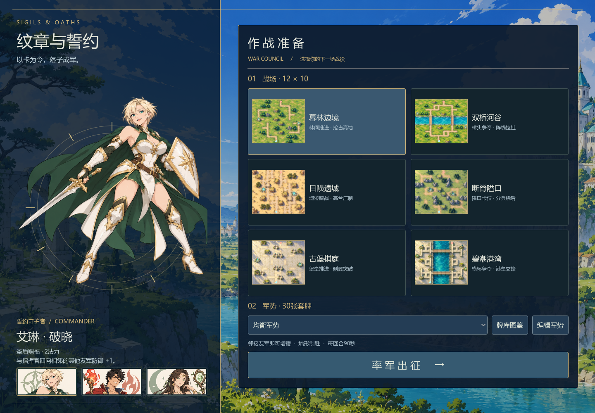
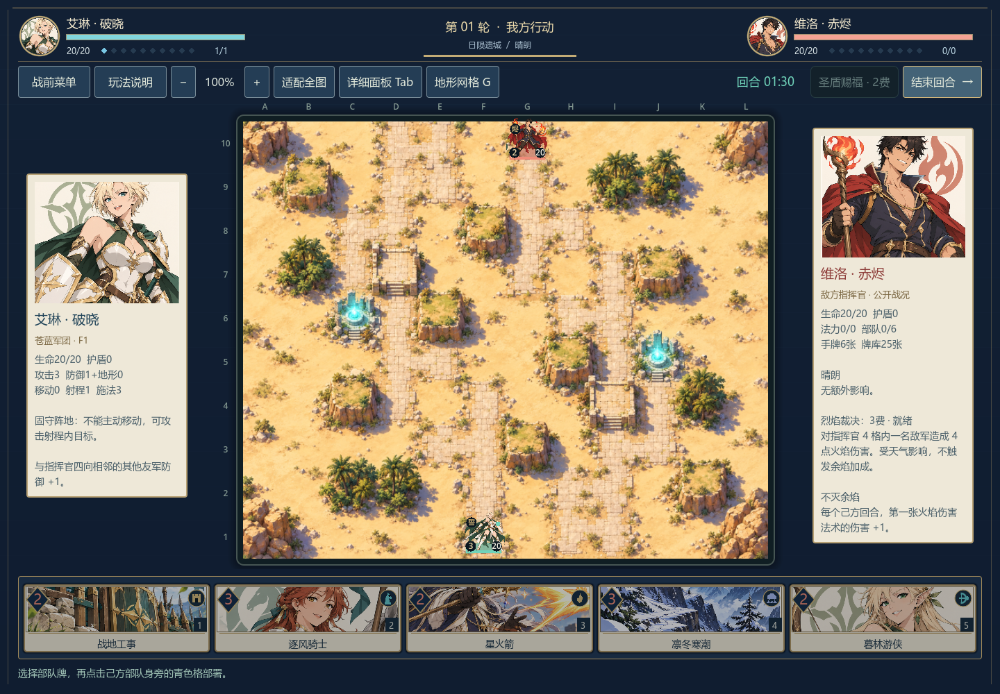
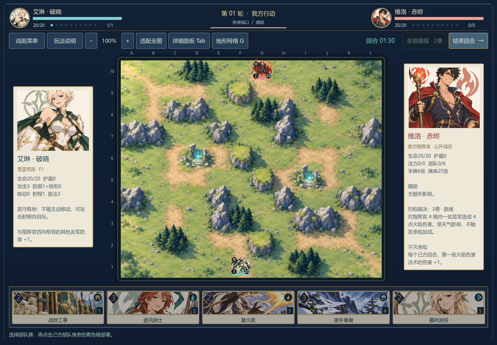
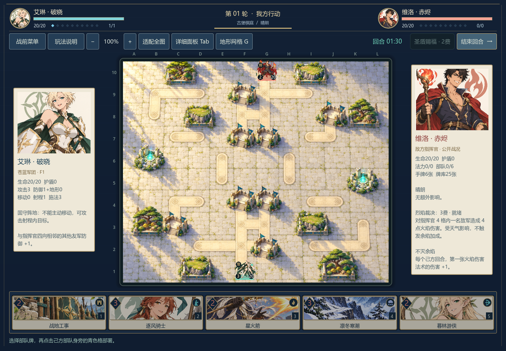
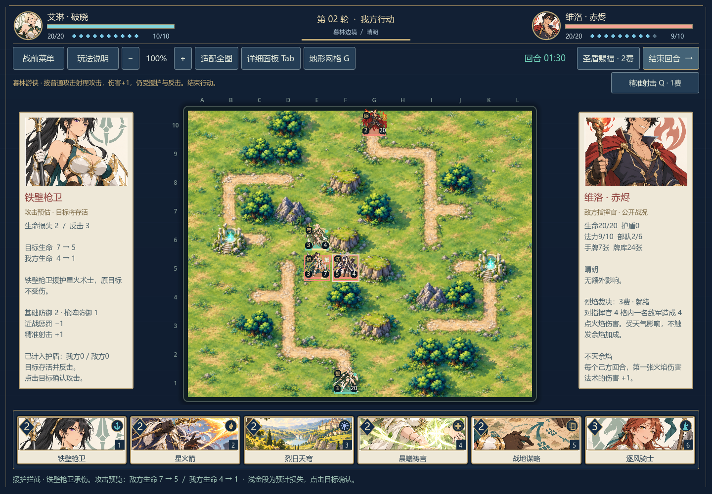

<p align="center"><strong>A personal project by a BUPT AI student</strong> · Follow for updates and collaboration</p>
<p align="center"><a href="README.md">简体中文</a> · <a href="README_EN.md">English</a></p>

<h1 align="center">Sigils &amp; Oaths · 纹章与誓约</h1>

<p align="center"><strong>Play your cards onto the battlefield. Make every deployment reshape the front line.</strong></p>
<p align="center">An original single-player card tactics game built with Godot. Summon beside friendly units and fight for position with unit counters, terrain, commanders and weather.</p>
<p align="center">   </p>

If you enjoy deckbuilding and tactical positioning, a ⭐ Star is welcome. Follow for future updates. This README does not display a star count.

Your hand determines what you can field; the board determines what those cards can achieve. Deploy a new unit in an empty, passable cell orthogonally adjacent to any friendly unit, including one you just summoned. Chain reinforcements, contest bridges and claim high ground while keeping your advancing force covered.

The design studies card resource pacing from Hearthstone and terrain, unit counters and commanders from Langrisser. The project uses its own characters, cards, artwork and map layouts; it includes no assets from either game. **Version 0.12.0 is a playable development build**, tested on Windows desktop against a local AI. The game interface is currently Chinese; this English README does not imply an English localization.

## In-game screenshots

These are actual game-window captures, including units, cards and the HUD.




<details>
<summary>Preparation screen and more maps</summary>






</details>

## What you can play

| Tactical choice | Implemented |
| --- | --- |
| Reinforce from cards | 24 collectible card types, three 30-card presets and one saved custom deck; adjacent deployment can extend from newly summoned units |
| Cover different unit roles | Infantry beats spears, spears beat cavalry, cavalry beats infantry; archers, mages and healers have distinct ranges and roles |
| Use active unit skills | Six one-mana abilities: shielding, interception, extra movement, a precise shot, fire damage and healing; once per unit per turn |
| Contest useful ground | Six fully illustrated 12×10 maps; defensive forests, hills and forts, roads and bridges for mobility, and healing ruins |
| Lead with a commander | Ailin protects the front, Velo strengthens fire, and Sera supports healing and woodland recovery; each has active and passive abilities |
| Change the next exchange | Rain, fog, sun and snow affect both sides; replace or dispel weather, build roads and forts, push, root or reposition units |
| Act under a clock | 90-second action turns; targeted spells require a friendly unit within 3 cells, or a mage within 4; weather is global |

## Unit skills and combat animation

Select a friendly troop and press **Q**, or click its skill button above the board. Targeted skills highlight legal cells; right-click/Esc cancels. Every skill costs one mana and is limited to once per unit per turn. New summons cannot use skills.

| Unit | Active skill |
| --- | --- |
| Infantry | Raise its shield to at least 3, without stacking |
| Spear guard | Intercept initiating normal attacks on orthogonally adjacent allies, including commanders, until its next turn |
| Cavalry | After moving but before attacking, move again for at most two terrain-cost points; keep the attack |
| Archer | A normal attack with +1 damage, obeying range, fog, interception and retaliation |
| Mage | Deal 3 fire damage within two cells; weather applies, armor is ignored, shields still absorb damage |
| Healer | Restore 3 health to a wounded friendly within two cells, capped at maximum health |

All skills except cavalry's extra movement end movement and attack for that unit. Root prevents extra movement and guard interception. Interception does not stop spells or retaliation and cannot chain; the earliest deployed eligible guard is chosen. Defense uses the guard's own terrain, retaliation uses its original position and range, and lethal damage does not spill into the protected ally.

Forecasts identify the actual defender. Combat includes melee lunges and slashes, arrows and magic projectiles, interception, impact, advantage labels and retaliation. Rules resolve once; animation does not move rule positions or deal damage again. This version animates the existing character artwork within the board; it does not provide frame-by-frame character animation or a separate full-screen battle scene.



[Watch the in-game skills and combat demo](docs/screenshots/unit-skills-combat.mp4)

## Quick start

Use **Godot 4.7.2 Standard**, without .NET. Engine binaries, exported executables and local caches are not included.

```bash
git clone https://github.com/yifanchen12/sigils-and-oaths.git
cd sigils-and-oaths
```

1. Get Godot from the [official download page](https://godotengine.org/download/windows/). The exact tested version and official archive URL are recorded in [`docs/engine-download.json`](docs/engine-download.json).
2. Import the root `project.godot` in Godot's project manager and wait for resource import.
3. Press **F5** to run the project. Select a commander, map and deck, then start the battle.

Alternatively, with your Godot executable available as `godot`:

```bash
godot --editor --path . --import
godot --path .
```

On Windows, you may place the official archive's GUI and console executables in `.tools/godot/`, keeping the filenames `Godot_v4.7.2-stable_win64.exe` and `Godot_v4.7.2-stable_win64_console.exe`. Then double-click `play.cmd`; `edit.cmd` opens the editor. These scripts do not download the engine automatically.

## Your first match

1. Choose a unit card and click an empty cyan-highlighted cell orthogonally adjacent to a friendly. Each side has at most six ordinary units, plus its commander.
2. New summons act on your next turn. Select a ready unit: blue dots mark movement and red frames mark attack targets. Normally you can move once and attack once; attacking ends movement.
3. Hover an attackable enemy to preview damage, retaliation and both units' remaining health. A surviving target retaliates once if the attacker is in range.
4. Maximum mana increases and refills each turn, up to ten. Use spells and commander skills to support your front within the 90-second limit.
5. Defeat the opposing 20-health commander to win. Commanders cannot move normally, but can be swapped. Drawing from an empty deck causes escalating fatigue damage.

Full rules are available in the game's rules panel. The deck editor saves one local custom deck: 30 cards, at most four copies of a card and at least one unit. Custom decks face the balanced AI preset.

| Action | Input |
| --- | --- |
| Cards, units and targets | Left-click; 1–8 select a card |
| Cancel | Right-click / Esc |
| End turn | Space / button |
| Zoom | Wheel / + / − |
| Pan | Middle mouse / Alt + left mouse |
| Fit map | Home |
| Exact terrain grid | G |
| Selected troop's active skill | Q / skill button |
| Toggle battlefield layout | Tab |
| Keyboard board navigation | Arrow keys / Enter |

The card library, rules and preparation menu pause the local clock and AI. Changing the map, commander or deck during a match starts a new one.

## Six battlefields

| Map | Main terrain |
| --- | --- |
| Greenwood frontier | Forests, winding roads, rocky blockers, hills and healing ruins |
| River crossing | A horizontal river with two bridge routes |
| Sunspire ruins | Sand, terraces, sparse groves and ruined fortifications |
| Ridge pass | Rocky barriers, narrow openings and pine groves |
| Citadel courtyard | Stone paths, bastions, garden terraces and ruins |
| Tidal harbor | A central canal, two bridges, shorelines and port forts |

Map paintings are separate from the rule grid. Rules and highlights define exact passability, range and selection; road-building and fortification cards update the corresponding terrain artwork. Position guides and visual review notes are in [`docs/map-art-audit.md`](docs/map-art-audit.md) (Chinese).

## Development and validation

All rules go through `scripts/battle.gd`; the UI and AI submit the same action format. Cards, commanders, decks and maps use Godot Resources. Rendering does not alter rules. The AI uses the public board and its own hand, without reading the opponent's hidden cards or deck order.

```text
data/          Card, map, commander and deck resources
scripts/       Rules, AI, UI and presentation
scenes/        Godot main scene
assets/art/    Character, card and map sources with provenance
tests/         Rules, full AI matches and actual-window interactions
tools/         Map-guide, audit-image and diagnostic utilities
docs/          Screenshots, validation and development records
```

Verified locally with **Godot 4.7.2 / Windows / Compatibility**: 54 unit-skill checks, 51 skill-window checks, 257 existing UI checks and 113 combat-forecast checks passed. This version's rule/AI-match results are recorded in [`docs/validation.md`](docs/validation.md). The 59 map-art checks belong to version 0.11; historical results are kept by version rather than presented as fresh runs.

```bash
godot --headless --path . --editor --quit
godot --headless --path . --script res://tests/test_battle.gd
godot --headless --path . --script res://tests/test_unit_skills.gd
godot --path . --script res://tests/test_ui.gd --resolution 1440x1000 --audio-driver Dummy
godot --path . --script res://tests/test_forecast.gd --resolution 1440x1000 --audio-driver Dummy
godot --path . --script res://tests/test_map_art.gd --resolution 1440x1000 --audio-driver Dummy -- --complete
godot --path . --script res://tests/test_unit_skills_ui.gd --resolution 1440x1000 --audio-driver Dummy
```

UI, forecast, map-art and skill-window checks require a graphical window. Earlier commands and rules are in [`docs/development.md`](docs/development.md) (Chinese); use this page and the in-game help for the new skills.

## Current limits and artwork

- Single-player development build; no multiplayer, touch adaptation or packaged release. macOS and Linux have not been validated.
- Ranged attacks and spells currently do not check line of sight. AI diagnostics are not a substitute for competitive human playtesting.
- One custom deck is saved locally at Godot's `user://custom_deck.json`; player data is not included in this repository.
- Development uses AI-assisted coding and original image generation. The cel-shaded characters are all adults. Artwork sources, full prompts and generation provenance are recorded in [`assets/art/manifest.json`](assets/art/manifest.json). Source PNGs remain intact; Godot draws text, values, grids and highlights.
- Issues with reproduction steps, window size, map and commander are welcome. Do not attach credentials or unrelated personal files.

## License

MIT License; see [`LICENSE`](LICENSE). Godot is covered by its [own license](https://godotengine.org/license/); engine binaries are not bundled.
