<p align="center"><strong>A personal project by a BUPT AI student</strong> · Follow for updates and collaboration</p>
<p align="center"><a href="README.md">简体中文</a> · <a href="README_EN.md">English</a></p>

<h1 align="center">Sigils &amp; Oaths · 纹章与誓约</h1>

<p align="center"><strong>Play your cards onto the battlefield. Make every deployment reshape the front line.</strong></p>
<p align="center">An original single-player card tactics game built with Godot. Summon beside friendly units and fight for position with unit counters, terrain, commanders and weather.</p>
<p align="center">   </p>

If you enjoy deckbuilding and tactical positioning, a ⭐ Star is welcome. Follow for future updates. This README does not display a star count.

Your hand determines what you can field; the board determines what those cards can achieve. Deploy a new unit in an empty, passable cell orthogonally adjacent to any friendly unit, including one you just summoned. Chain reinforcements, contest bridges and claim high ground while keeping your advancing force covered.

The design studies card resource pacing from Hearthstone, concealed card play and counterplay from Duel Links, and terrain, unit counters and commanders from Langrisser. Characters, card effects, illustrations and map layouts are made for this project, with no assets from those games. Current source is **0.38.0-dev**, with fourteen chapters, branching encounters and cross-chapter saves. One fixed New Campaign model route won eleven consecutive battles and reached chapter eleven. Three separate earned chapter-eleven saves won the depot battle in chapter twelve and continued into chapter thirteen. Two chapter-thirteen ending saves then won the new chapter-fourteen channel battle. These are separate verification routes. The story conclusion, human balance and 100,000-character target remain in development. The interface is Chinese; this README does not imply an English localization.

## In-game screenshots

The new 16×12 spillway battlefield is from 0.38.0-dev. The chapter-thirteen mill scene is from 0.37.0-dev; the north-bank depot is from 0.36.0-dev. Later captures are from earlier milestones.

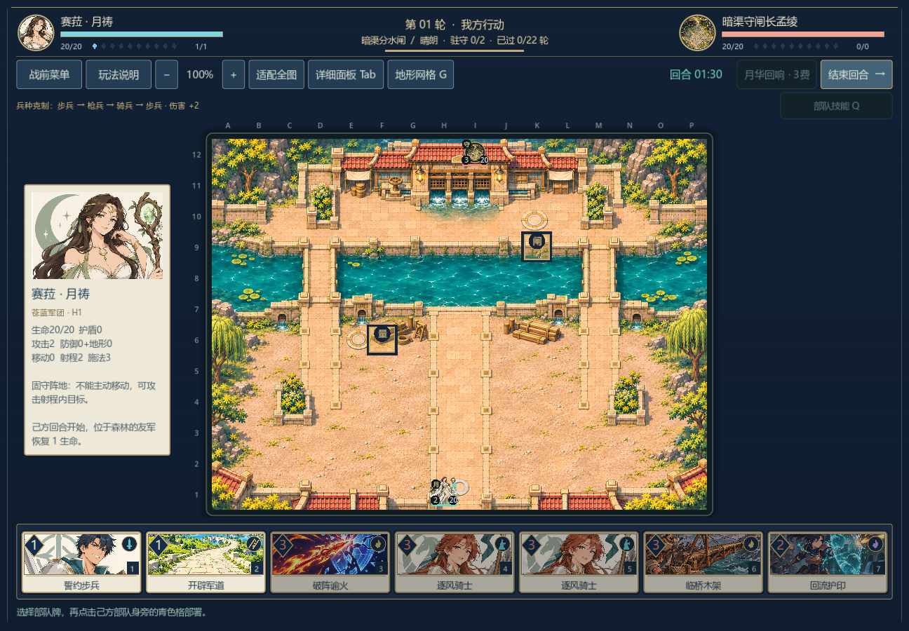

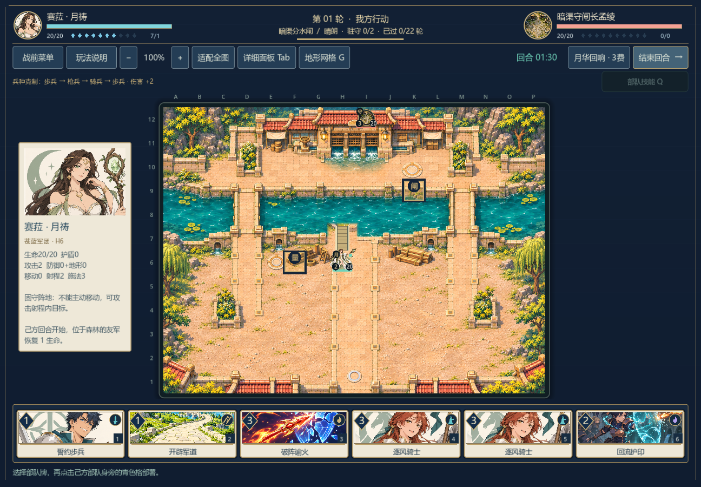

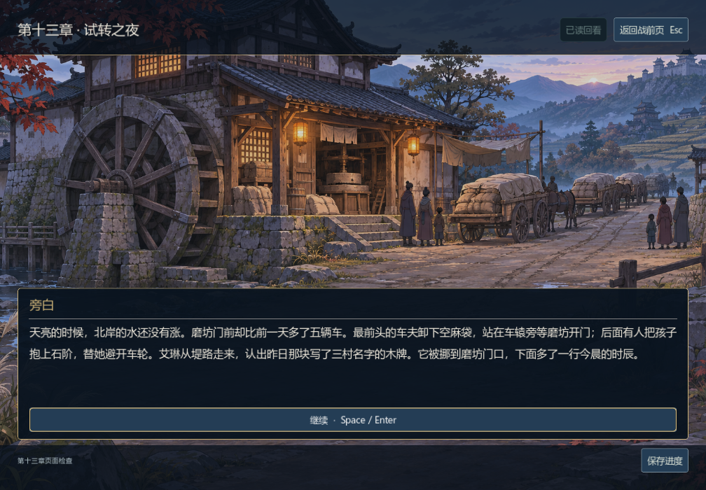

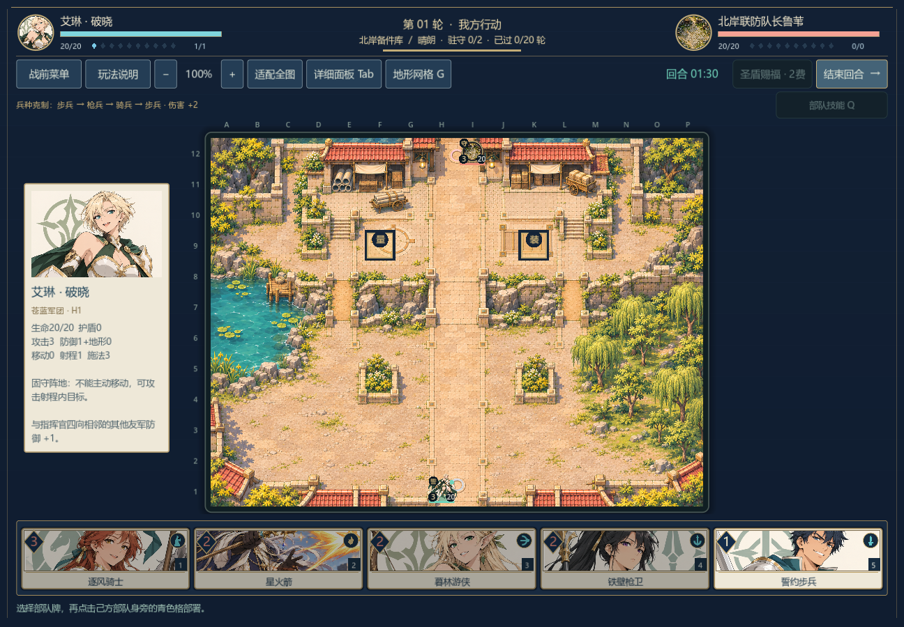

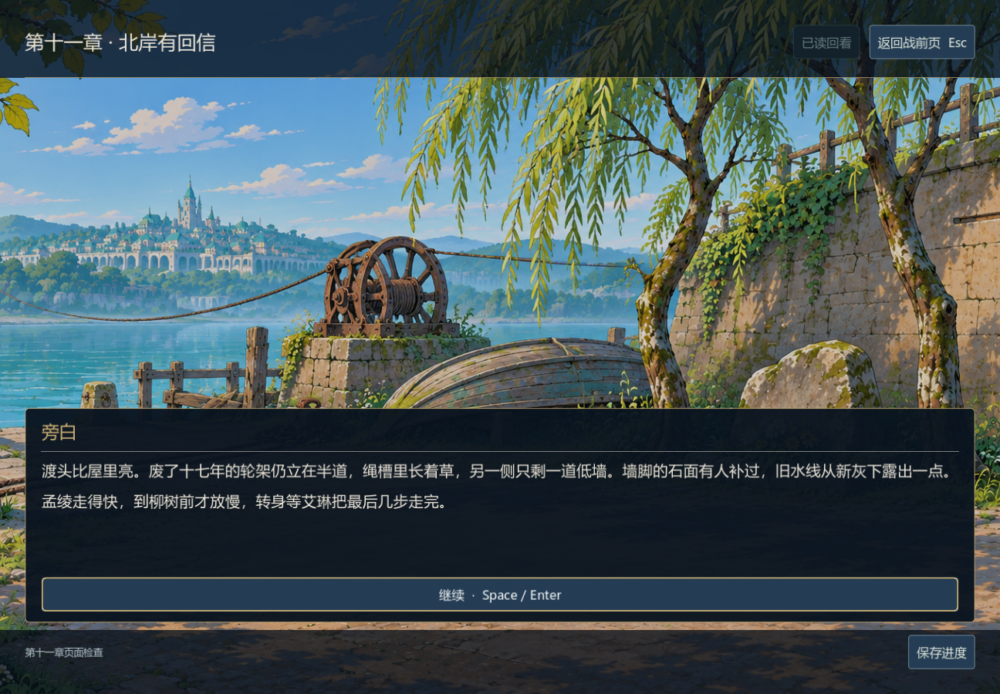

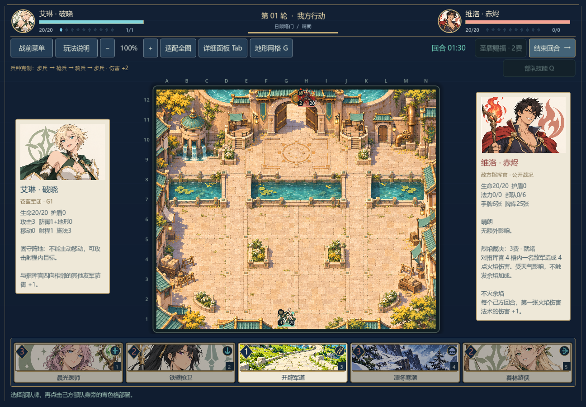

[Scene states, small-window choices, backlog and verification](docs/narrative-art-v020.md).


<details>
<summary>Preparation screen and more maps</summary>


</details>

## What you can play

| Tactical choice | Implemented |
| --- | --- |
| Reinforce from cards | 35 card types, five 30-card presets and one saved custom deck; adjacent deployment can extend from newly summoned units |
| Set traps and counter them | Movement snares, mines, attack wards and spell wards are paid for from hand; each side has two trap slots, enemies see only the count, and a search spell can reveal and remove traps |
| Cover different unit roles | Infantry beats spears, spears beat cavalry, cavalry beats infantry; archers, mages and healers have distinct ranges and roles |
| Use active unit skills | Six one-mana abilities: shielding, interception, extra movement, a precise shot, fire damage and healing; once per unit per turn |
| Contest useful ground | Six selectable 12×10 maps, a 14×12 gate and two 16×12 campaign maps; build a local bridge across water, use forests, hills and forts for defense |
| Lead with a commander | Ailin protects the front, Velo strengthens fire, and Sera supports healing and woodland recovery; each has active and passive abilities |
| Change the next exchange | Rain, fog, sun and snow affect both sides; replace or dispel weather, build roads and forts, push, root or reposition units |
| Act under a clock | 90-second action turns; targeted spells require a friendly unit within 3 cells, or a mage within 4; weather is global |

## 0.38: The spillway

Chapter fourteen follows both night-watch discoveries. The upstream choice starts with a bridge kit; the tower choice starts with a countercurrent ward. A new original 16×12 waterworks map has two existing stone bridges, while hand-played bridge cards can form a third route across the open central river. The ward protects one friendly unit from the next enemy damage spell or skill, but does not trigger on an ordinary attack. Protect the south measuring site and capture the north intake site through two consecutive player-turn checks. After combat, choose between sealing the leak to preserve the mill or sending metered water to the city while compensating the villages; the order persists in campaign saves.

Two chapter-thirteen earned saves won the new battle with legal actions against production AI on turns 37 and 33, with exact midbattle reloads. All 58 body pages rendered in native Godot UI with 597 checks passing. These are specified winning openings, not evidence of human balance, broad seed coverage or one continuous fourteen-chapter run. [Chapter-fourteen review](docs/narrative/chapter-14-review.md) · [Earned game records](docs/chapter14-earned-results.json).

The fourteen chapters and archive contain **93,428 distinct Chinese body-text Han characters**, 6,572 below the aggregate target; a single route is shorter. The download link and build checks will be added after the public package is verified.

## 0.37: The night trial

Chapter thirteen shows the cost of the shaft decision. Borrowing it stops the village mill until food and a replacement arrive; leaving it allows the mill to run while the city casts, cools and tests a new part. Neither route treats a low-pressure trial as a completed repair. A night assignment sends the available scouts upstream to find a leaking stone seam or keeps them at the tower to find a faulty rivet. The other site remains unchecked. The original mill painting is now in the game. This is an aftermath chapter without a new battle.

Three saves earned by actual depot victories each continue through both night assignments: six routes, 990 checks passed. All 95 dialogue paragraphs, two endings and the choice rendered in native Godot UI with 916 checks passed; a small-window capture was visually reviewed. [Chapter-thirteen review](docs/narrative/chapter-13-review.md).

The thirteen chapters and archive now contain **90,046 distinct Chinese body-text characters**, still 9,954 short of the aggregate target. A single route is shorter.

[Download the 0.37 Windows x64 development preview](https://github.com/yifanchen12/sigils-and-oaths/releases/tag/v0.37.0-dev). The anonymous public download is 212,509,505 bytes, SHA-256 `3c4599d4c46882d9be6305dc81cf74ca43a67804f79f99223e070aa85417c169`, and matches the local build from source commit `18245e0`. ZIP CRC, 289 PCK entries and standalone startup were checked.

## 0.36: Who holds the spare shaft

Chapter twelve adds an original 16×12 north-bank depot map. Hold the F9 measuring slab and K9 loading apron across two player-turn checks, or drive off the opposing commander, before the crew can open the crate. Measurement finds a usable but unfinished spare that still needs a sleeve and pressure testing. After the battle, choose whether to borrow the shaft for the city with food, replacement and return obligations to three villages, or leave it at the depot and cast a new one for the city. The three governance plans change commander, deck and deadline; the defender pays for traps from its hand.

The twelve chapters and archive contain **85,371 distinct authored Chinese body-text characters**, below the 100,000 target. All 68 chapter-twelve body paragraphs rendered in native Godot UI, passing 840 checks; 48 inherited model routes passed 29,881 checks. Three previously earned saves each won the new battle through legal actions, reloaded mid-battle and reached a custody ending, passing 624 checks. They do not establish one continuous twelve-win run, human difficulty or win rates across every branch. [Chapter-twelve review](docs/narrative/chapter-12-review.md) · [Earned battle results](docs/chapter12-earned-results.json).

[Download the 0.36 Windows x64 development preview](https://github.com/yifanchen12/sigils-and-oaths/releases/tag/v0.36.0-dev). The anonymous public download is 210,297,517 bytes and matches the local build from source commit `0138600`. SHA-256: `2c2b287adca83d2596cadd397973b5c1190955c581548c030b78a3ae85e82088`. ZIP CRC, 286 PCK entries and standalone startup were checked.

## 0.35: The north-bank reply

Chapter eleven adds original red-roof house and old ferry landing scenes. Two firsthand witnesses tell Ailin what happened during her father's last rescue and where he was buried. The family retains the choice of whether to read a returned letter and when to restore his name to the memorial. The cracked inner valve and north-bank spare remain practical objectives for later chapters. Earlier companion and governance choices change the dialogue.

Eleven chapters plus the archive contain **81,355 distinct authored Chinese body-text characters**. All 119 chapter-eleven paragraphs rendered in native Godot UI with 1,361 checks passing. Each of three governance plans entered from an actual prior gate-win save, read 112 pages and resumed its ending in a separate process. A model check covered 24 inherited routes and 12,627 assertions. The fixed eleven-battle route used 2,500 legal actions and read 1,110 dialogue IDs, 16 choices and 60,044 Han characters. This establishes one specified route, not human difficulty or all branch win rates. [Chapter-eleven review](docs/narrative/chapter-11-review.md) · [Continuous campaign summary](docs/continuous-v035.json).

[Download the 0.35 Windows x64 development preview](https://github.com/yifanchen12/sigils-and-oaths/releases/tag/v0.35.0-dev). The anonymous public download is 207,515,562 bytes and matches the local build from source commit `c9e1d75`; SHA-256: `ac8067c69dabdc6a90958a58880134258909ca563c96e6c49f6f276efdc32563`. ZIP CRC, 283 packaged resources and standalone startup were checked.

## 0.34: The two-bridge tower gate

The chapter-nine choice among joint rotation, a staged bypass and a season-long reservoir seal now determines the chapter-ten commander, deck and round limit. An original 14×12 map has two crossings. Hold D9 and K9 through two consecutive own-turn-start checks, or defeat the gate captain, to secure the outer valve. Prior pressure control, shipyard material ownership and the forest community's mandate change dialogue. Victory secures only the bridges and outer valve; the cracked inner valve, water costs and Ailin's father's transfer record remain unresolved.

Ten chapters plus the archive contain **74,422 distinct authored Chinese body-text characters**. All 88 chapter-ten body paragraphs rendered in native Godot UI, passing 1,050 checks. Each governance plan entered from a real prior ten-win save, won the new native battle in 213, 98 or 165 pointer actions, and resumed its earned ending in an independent process; 1,516 checks passed. One fixed New Campaign model route won eleven battles through 2,500 legal actions and read 998 dialogue IDs, 16 choices and 53,561 Chinese characters. These are specified winning openings, not evidence of human difficulty or all branch win rates. [Chapter-ten design and verification](docs/narrative/chapter-10-review.md) · [Eleven-battle summary](docs/continuous-v034.json).

[Download the 0.34 Windows x64 development preview](https://github.com/yifanchen12/sigils-and-oaths/releases/tag/v0.34.0-dev). The anonymous public download is 202,462,792 bytes and matches the local build from source commit `bd53bd3`; SHA-256: `05bdd696cf3de7b652078117abca123618d93bef4999af9ece915e75e09dbf12`.

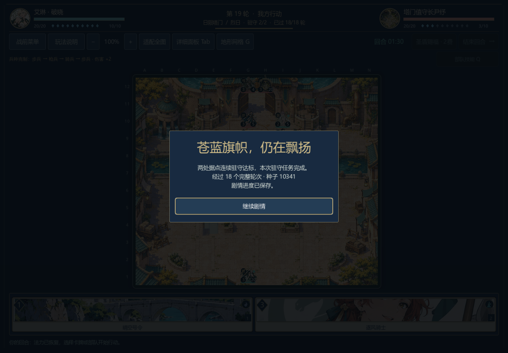

## 0.33: Three chapter-nine governance plans

After the eighth night, residents first account for housing, wages and water readings. Delegates arrive later. The player chooses a joint local and three-party rotation, separately controlled bypass pipes, or sealing the main reservoir for one season. Each plan names its supply limits, delays and costs. Earlier isolation or buffering, Vero's debt and Syla's mandate alter the dialogue. One original terrace background was added. In the 0.33 release, the chapter ended at a conflict over control of the tower gate, before the next battle was implemented.

Nine chapters plus the archive contain **69,452 distinct authored Chinese body-text characters**. All 158 chapter-nine conditional body paragraphs rendered in Godot StoryView with 1,442 checks passing. A copy of the separately verified actual ten-win save entered each of the three plans, reached the chapter-nine end page and resumed in an independent process. The fixed ten-battle model route reached the current chapter-nine end after 924 dialogue IDs, 16 choices and 2,287 legal battle actions; it reads about 49,401 Chinese characters. Three encounters use declared public-information diagnostic player policies. Human full-playthrough and other battle-path win rates remain unverified. [Chapter-nine design and evidence](docs/narrative/chapter-09-review.md).

[Download the 0.33 Windows x64 development preview](https://github.com/yifanchen12/sigils-and-oaths/releases/tag/v0.33.0-dev). The anonymous public download is 199,831,800 bytes and matches the local build from source commit `f0a18ea`; SHA-256: `414a0c7c5d6aad51a2ea0081ce34e1af5aa8485f7adc4ce59b2bc8caf0c0cd06`.

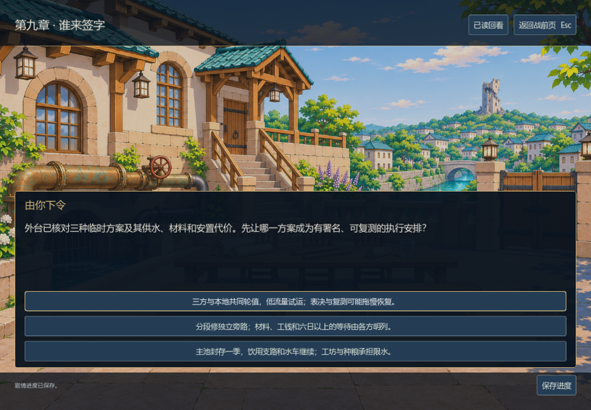

## 0.32: One continuous route through the then-current eight chapters

The road, relief and Sunspire-isolation choices led from the actual New Campaign button through ten consecutive wins to the existing chapter-eight end page. Native Godot input clicked 799 distinct dialogue pages, 15 choices and 2,287 battle actions; a separate process reloaded the same end page. The two processes passed 5,548 checks with no failures. The pump room, nursery and court used existing player policies that read only visible battlefield information; the player side elsewhere and every opponent used production AI. This establishes a legal route, not human difficulty or win rates across other branches.

The Sunspire isolation encounter still requires holding two points within 12 rounds; its opposing preset changed from Bastion to Balanced. Already-started old battles remain resumable, while a retry uses the current setup. This route read 42,598 Chinese ideographs in dialogue. The eighth chapter leaves the reservoir dispute open; chapters nine and ten are still outlines. [Per-battle record, policies and screenshots](docs/continuous-campaign.md).

[Download the 0.32 Windows x64 development preview](https://github.com/yifanchen12/sigils-and-oaths/releases/tag/v0.32.0-dev). The anonymous public download is 197,615,362 bytes and matches the local build from commit `35ac83a`; SHA-256: `3fe558c27013be1cff4b665c7211f47139c80524011e76e11d04c6a136c5589d`.

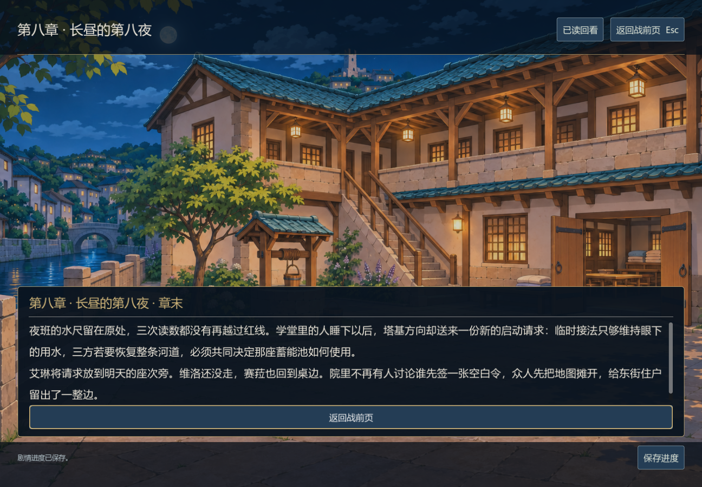

## 0.31: Both chapter-two routes reach chapter four

The relief bridge now fields a Balanced opposing deck while retaining its 12-round, two-point hold objective. The dispatch encounter now fields a Bastion player deck. Already-started battles retain their old decks; a retry uses the revised setup. Fixed-opening comparisons and save-compatibility checks cover both changes.

From the actual New Campaign button, the native relief route read 262 distinct dialogue pages, made nine choices, and performed 1,858 visible actions across seven battles. It won six and lost the seventh at the chapter-four pump room. Two independent native processes passed 4,517 checks, including a reload and retry after defeat. The seed-priority branch also reached the pump-room loss in a model-only continuous run; it has no seven-battle native verification. A focused diagnostic player can win the pump encounter in isolation, which is not a continuous-campaign clear. [Route, limits and per-battle evidence](docs/continuous-campaign.md).

[Download the 0.31 Windows x64 development preview](https://github.com/yifanchen12/sigils-and-oaths/releases/tag/v0.31.0-dev). The 197,614,678-byte public anonymous download matches the local build from commit `1c38a28`; SHA-256: `595efbc09432f3afc9b7ac52a2ef94f45abb090f6013bea4322fe9e222b725e3`.

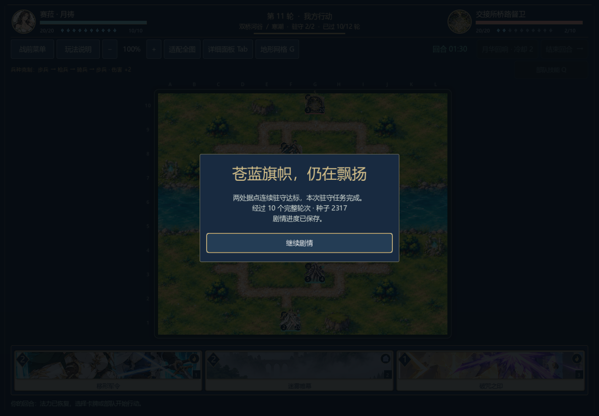

## 0.30: A continuous chapter-one route

The bridge encounter now fields a balanced opposing deck and gives practical bridge, healer and archer guidance. Two public-information diagnostic strategies lost to the old Bastion setup and won against this revised fixed encounter, though the battles still took roughly 25–31 full rounds. An already-started Bastion battle remains resumable; retrying uses the revised setup.

Starting from the actual New Campaign button, a native Godot run advanced through 82 distinct dialogue pages, four choices and 755 visible battle actions. The first two encounters won, leading into chapter two; the relief-bridge control battle lost at its deadline. Two independent native processes passed 1,801 checks, including a disk reload and retry without duplicate rewards. A separate model run of the seed-priority branch reached a fourth encounter before defeat; its four-battle native route has not been verified. [Continuous route and failure evidence](docs/continuous-campaign.md).

[Download the 0.30 Windows x64 development preview](https://github.com/yifanchen12/sigils-and-oaths/releases/tag/v0.30.0-dev). The public ZIP's SHA-256 matches the local build from commit `17b0aa3`.

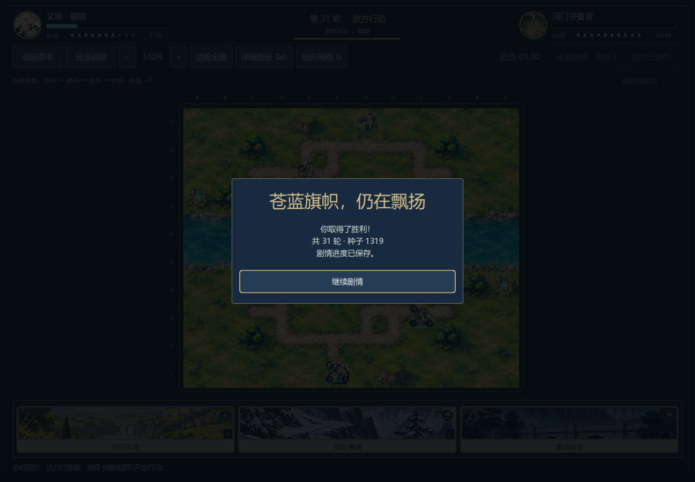

## 0.29: Play traps from hand and contest the front

The expansion adds **four spells, one terrain card and three traps**. Anchor Snare interrupts an enemy's voluntary movement, Ember Mine deals weather-sensitive fire damage, and Oath Ward grants a shield before its protected unit actually takes a normal attack. Pay the card's cost from hand to arm it; it remains in the trap zone until consumed. Placement uses the existing three-cell friendly casting range, extended to four by mages. Opponents cannot see the trap's identity or position.

The other cards break shields before dealing fire damage, heal a cross-shaped area, cleanse roots, search for hidden traps, or turn a local tile into forest. Select the new **誓痕伏阵** preset in skirmish mode or add these cards to a custom deck; authored campaign encounters retain their assigned armies. New illustrations were generated with native image_gen, with provenance retained.

All 125 expansion rule checks passed. Twenty-one distinct automated openings completed without illegal actions or reaching the action cap: the new preset won 5 of 18 matchups against older presets, with three mirror matches recorded separately. These verify execution, while balance still needs tuning and human playtesting. Authored prose remains at 60,703 Chinese characters, and continuous campaign completion is pending. [Cards, trigger order and verification scope](docs/card-expansion.md) · [0.29 Windows development preview](https://github.com/yifanchen12/sigils-and-oaths/releases/tag/v0.29.0-dev).

The native interface fixture passed 55 checks. A full skirmish from unmodified 30-card decks completed 173 real input actions across 27 side turns (round 14 in the UI), passing 458 checks. These screenshots show the actual deck editor and that match's terminal screen.

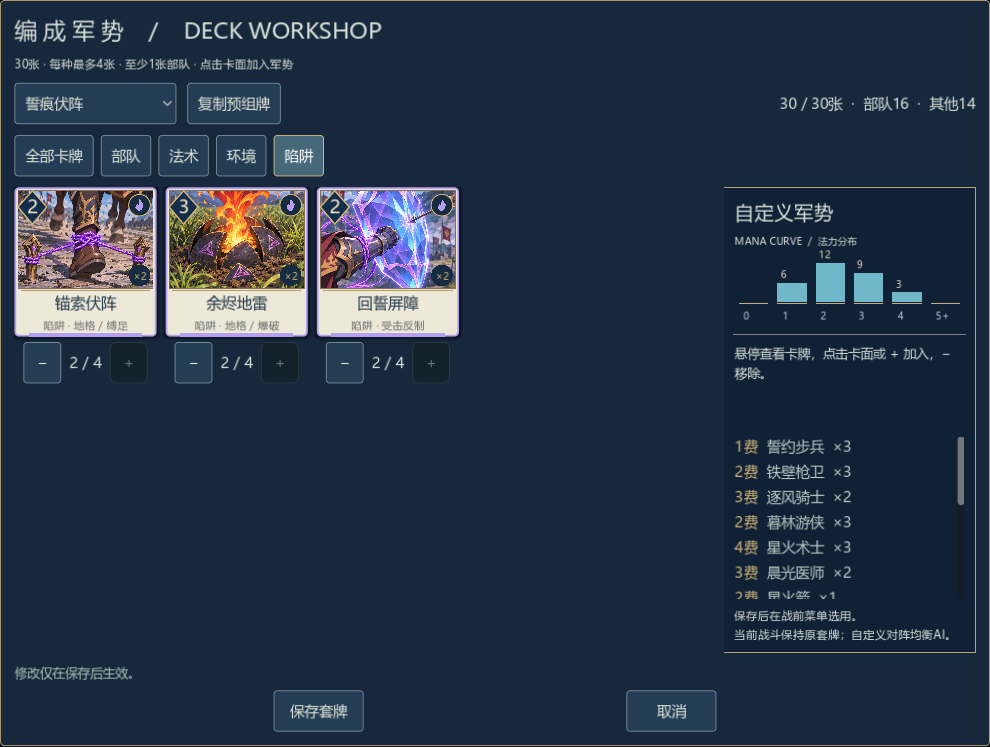
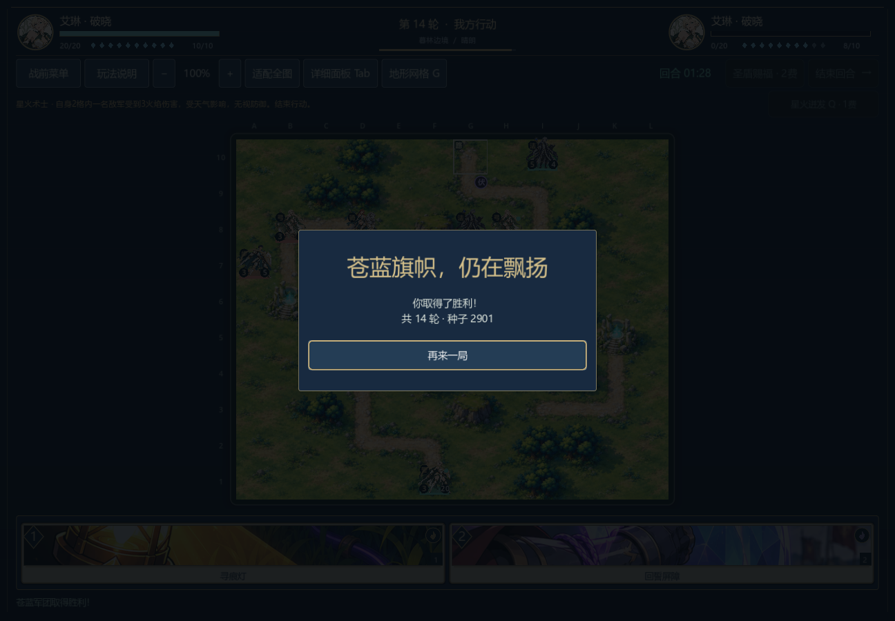

See the [historical 0.28 verification](docs/defensive-decisions.md) for defensive AI changes and the dock's native continuation test.

## Historical 0.26: Both Sunspire routes completed

The isolation route reaches two-point control; the cooling-pool route defeats the enemy commander. Both now have native victories from authored starting resources, including exit, restart and postbattle saves. Briefings put victory conditions first and expand the reading area in small windows.

The two encounters contain 374 legal actions and passed 1080 native continuation checks. All four earlier losses remain public. These prove two legal winning routes, while overall balance and a continuous ten-encounter campaign remain unverified. [Native evidence and scope](docs/sunspire-playthrough.md).

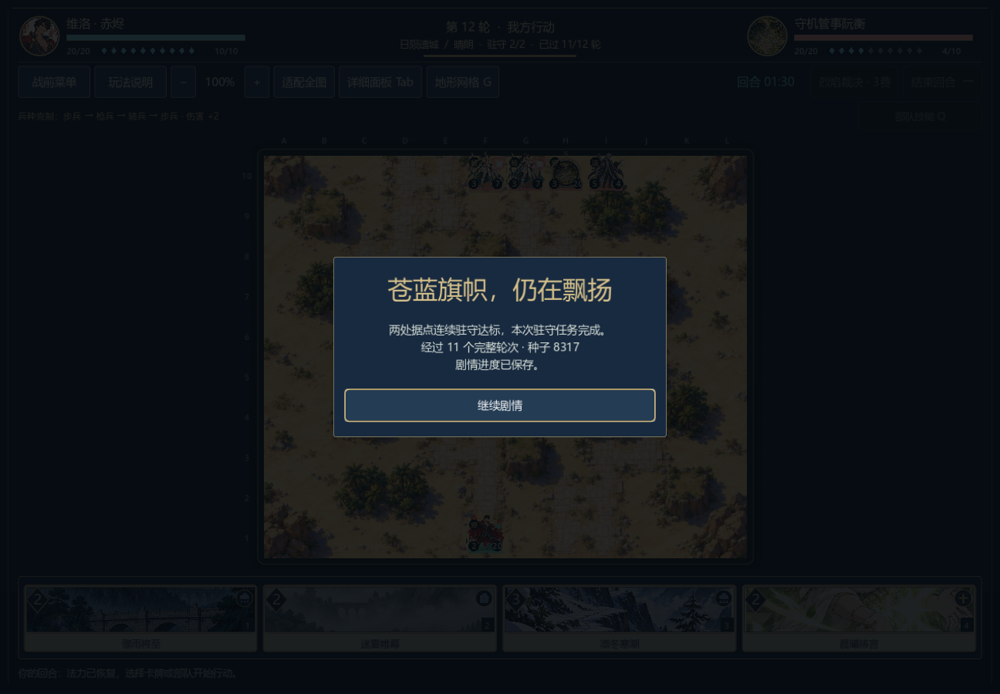

## Chapter 8: The Eighth Night

A fallen lamp stops the work crew. Iser discovers they are using a drawing he signed, while Velo meets someone who knew his master. Choose between removing new pipes and rationing pump shifts, or sacrificing stored molds to use the cooling pool. Both choices carry losses into the aftermath.

This chapter adds **8,079 Chinese body-text characters**, two original backgrounds and two encounter routes. Eight chapters plus the archive contain **60,703 authored characters**; all 1,031 chapter paragraphs have native rendering checks. There are 49,152 cumulative choice paths, each with ten encounters. The four 0.25 losses remain recorded; 0.26 adds native victories using a central-formation player policy. Overall difficulty still needs evaluation. Continuous ordinary-difficulty completion, external reading and the full 100,000-character script are still pending. [Chapter-8 editorial, art and verification](docs/narrative/chapter-08-review.md).


See [Chapter 7](docs/narrative/chapter-07-review.md) for the residents’ move, three camp stories and day/night scenes.

## 0.23: Position after moving

AI now evaluates vacated cells and newly blocked routes. All outcomes from 13 fixed-seed diagnostics are retained; 927 related regression checks and 15,189 independent replay checks passed. The current-policy seed bridge completed 88 legal actions across two native processes, with save/exit, reload, victory and story handoff verified in 268 checks. Long games and a roughly 0.52-second peak decision remain; this is not human balance or continuous campaign proof. [Changes and native evidence](docs/ai-occupancy.md).

## Historical objective and continuation evidence

AI captures and holds control points, using knockback, spells and guard to contest progress. It now weighs recruit exposure and prioritizes meaningful healing over chip damage. Both chapter-2 bridge routes have native victories from original resources: exit during an enemy turn, relaunch, resume AI, complete control, then enter and save the corresponding postbattle story.


A test-only player strategy now wins the chapter-1 bridge by concentrating on the left crossing: 260 legal actions against unchanged production AI and original resources/card order, also verified through two native processes with exit/relaunch. Earlier encounters are still skipped by narrative fixtures, so this is not continuous campaign completion. All previous losing records remain available; ordinary battles still include long games. [Chapter-1 bridge evidence](docs/bridge-playthrough.md) · [Chapter-2 controls and historical diagnostics](docs/tactical-survival.md).

## Chapter 6: Old Seals of the Court

Eileen finally meets her teacher and sees her father's original suspension order. Roser explains his old decision while facing responsibility for the current water orders. Players choose immediate disclosure or a witnessed review with a next-morning deadline; both branches actually release their findings. Her father's private letter presents a different choice: read alone or ask her companions to stay.

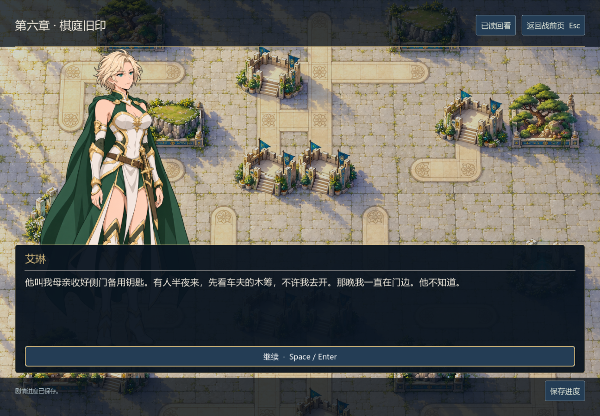

At the 0.22 milestone, this chapter added **7,109 Chinese body-text characters**. Six chapters plus the archive totaled **42,481 authored characters**, with 8,192 cumulative choice paths and nine encounters per path. All 623 chapter paragraphs have native rendering checks; continuous ordinary-difficulty accessibility is still pending. This milestone passed 83,576 related model checks and 6,562 native checks. The new court diagnostic loses from normal resources; its complete trace is retained and passes 420 independent replay checks. [Chapter-6 editorial, art and verification notes](docs/narrative/chapter-06-review.md).

The 0.22.0-dev chapter-5 channel route also has a native victory from original resources, exit/relaunch continuation and postbattle handoff, with 421 checks across two independent processes. [Native channel encounter evidence](docs/channel-playthrough.md).

## Chapter 5: Where the Water Comes From

Syla returns to find her banner taken down. Preserving the hillside nursery requires another night of water hauling downstream; clearing the channel first costs damaged hillside crops. Her mother will not decide for her, and winning the canal encounter does not automatically restore her mandate. She can accept a limited term with local co-signatures or return the seal and travel as a witness.


The chapter adds **7,290 Chinese body-text characters**, with 5,784–5,839 per route, two decisions and one branching encounter. The 0.21 milestone has five chapters and 2,048 cumulative choice paths and eight encounters per path; authored prose including the archive totals **35,372 characters**. All 493 chapter paragraphs have native rendering checks, but continuous ordinary-difficulty access remains pending and the conservative accepted count stays at 5,558. Related models passed 21,730 checks and native UI passed 4,716. Both new fixed-seed diagnostic traces are retained: one win and one loss, 252 legal actions independently replayed. These are not balance or full-campaign evidence. [Chapter-5 editorial and verification notes](docs/narrative/chapter-05-review.md).

## Unit skills and combat animation

Select a friendly troop and press **Q**, or click its skill button above the board. Targeted skills highlight legal cells; right-click/Esc cancels. Every skill costs one mana and is limited to once per unit per turn. New summons cannot use skills.

| Unit | Active skill |
| --- | --- |
| Infantry | Raise its shield to at least 3, without stacking |
| Spear guard | Intercept initiating normal attacks on orthogonally adjacent allies, including commanders, until its next turn |
| Cavalry | After moving but before attacking, move again for at most two terrain-cost points; keep the attack |
| Archer | A normal attack with +1 damage, obeying range, fog, interception and retaliation |
| Mage | Deal 3 fire damage within two cells; weather applies, armor is ignored, shields still absorb damage |
| Healer | Restore 3 health to a wounded friendly within two cells, capped at maximum health |

All skills except cavalry's extra movement end movement and attack for that unit. Root prevents extra movement and guard interception. Interception does not stop spells or retaliation and cannot chain; the earliest deployed eligible guard is chosen. Defense uses the guard's own terrain, retaliation uses its original position and range, and lethal damage does not spill into the protected ally.

Forecasts identify the actual defender. Combat includes melee lunges and slashes, arrows and magic projectiles, interception, impact, advantage labels and retaliation. Rules resolve once; animation does not move rule positions or deal damage again. All six troop types and three commanders now have three original preparation, action and recovery poses. Guards brace, retaliation has separate timing, and local spells animate an eligible friendly caster while weather uses the commander. Full walking cycles and a separate full-screen battle scene are not implemented.


[Watch melee poses, attacks in both directions and interception](docs/screenshots/melee-poses.mp4)


[Watch the in-game skills and combat demo](docs/screenshots/unit-skills-combat.mp4)

Hover a legal target for a mage, healer or supported numeric spell to preview remaining health and shields. Healing respects maximum health and adds a green preview segment to the health bar; area spells list actual enemies by board coordinate. Weather, the commander's fire-card passive and shield absorption are included. Spells bypass guard interception and do not provoke normal retaliation.

Healing uses green trails and a cross, protection uses a shield shape, and area fire marks its actual five-cell cross. The final hit and defeat effect finish before the result panel appears; restarting clears the previous presentation.

[Watch the approximately 20-second spell preview and final-hit demo](docs/screenshots/spell-feedback.mp4)

<details>
<summary>Healing and area-spell previews</summary>


</details>

## World archive and campaign development

Open the archive from the war council to read profiles for three commanders and six troop captains, six battlefield histories, and the background of the oaths and the Long Day disaster. The reader reuses the original portraits and full-body artwork, pauses local combat and returns to the menu with Escape.


The archive contains 18 entries and 52 paragraphs: **5,558 distinct Chinese body-text characters**, excluding headings, summaries, UI, design documents and prompts. The planned game is an ensemble war story with relationships and optional romance, targeting at least 100,000 accessible Chinese characters.

Chapter 1 contains **5,820 body-text characters**, three decisions and eight route combinations. The road and riverside routes recover different evidence, with two encounters per route. Only victory grants its story facts; defeats retain a retry point. One route contains 4,065–4,197 characters. New/continue campaign, dialogue, choices, backlog and saving are wired into the UI. **Version 0.16.0-dev checks native pages, new-campaign/backlog/choice controls and chapter transitions. Victory fixtures reach later chapters; normal-difficulty playthroughs remain pending.** Chapter text stays separate from fully verified delivery totals.

Chapter 2 contains 4,914 Chinese body-text characters and carries the eight prior fact combinations into two new decisions: shipment priority and receipt inspection. Its 32 cumulative routes each contain two encounters. Relief priority uses Sera and the defensive deck; seed priority uses Ailin and the balanced deck. Hold both D5 and I5 at two consecutive player-turn starts within 12 full rounds, or defeat the opposing commander. Velo leads the dispatch-office encounter. Chapter transitions retain prior reading history and facts, and only commit after saving succeeds. Stable dialogue IDs survive inserted or reordered earlier lines. **Native chapter pages and transitions are checked. Both chapter-2 bridge routes now have actual victories, saving and postbattle continuation; the chapter-1 bridge and continuous campaign completion remain pending.**

Campaign autosaves now include **complete battle state**: board, card order, skills/guard/root, weather, resources, clock and RNG, alongside dialogue and choices. Completed actions are saved immediately; the active clock is saved every five seconds. Menu entry and normal exit are wired to save too. Cross-process recovery and continued actions pass pure-logic checks. Version 0.17.0-dev additionally exits during the vent encounter, loads it in a new native process, resumes enemy AI and plays through to victory and the saved postbattle dialogue. Failed writes preserve the previous save and report an error. Newer or incompatible rules versions are protected. The current v3 format accepts v1 story checkpoints and v2 full battles; files without a board resume at the briefing.

Switching to a skirmish retains the ongoing campaign battle. An unexpected termination may lose the latest unsaved clock interval; backups and flushing cannot guarantee the newest write survives a sudden power loss. Enemy guards still use separate names and temporary fort icons with existing rules classes; dedicated NPC artwork remains pending.

0.15.1-dev rewrites both chapters using the `chinese-novelist` editorial workflow: distinct motives, strained cooperation, old debts and an imperfect witness replace repeated procedural exposition. All 189 text IDs and branch mechanics remain stable. Chapter prose shrank from 13,321 to 10,734 Chinese characters; that revision brought authored prose including the archive to 16,292. Saves still resume, but backlog text uses the revision; existing readers should reread chapter 1. [Reading sample](docs/narrative/reading-sample.md) · [Editorial record](docs/narrative/editorial-review.md).

Chapter 3, “Wind over the Broken Ridge”, follows Frey’s mine-rescue history and Lishi’s letter to her sister. Preserve the upper maintenance passage by holding E6/H5 twice within ten full rounds with the defensive deck, or seal it and defeat the convoy commander with the assault deck. Both routes record distinct supply consequences. The chapter adds 5,766 Chinese body-text characters (4,805–4,851 per route). Three chapters now have 128 cumulative choice paths, five battles per path, and 22,058 authored characters including the archive.


Version 0.16.0-dev passes 1,520 relevant model checks and 2,264 native UI checks, covering all 261 dialogue paragraphs and three endings. It fixes collapsed toolbar buttons and missing progress in the actually drawn HUD. Troops in the objective screenshot were placed by a test fixture; **this is not a normal-difficulty victory capture**. Playthroughs, balance, external editorial feedback and the full 100,000-character campaign remain incomplete. [Chapter 3 editorial and validation record](docs/narrative/chapter-03-review.md).

[Text audit](docs/narrative-audit.json) · [Narrative direction](docs/narrative-direction.md) · [Campaign acceptance plan](docs/plans/steam-campaign.md) · [Steam readiness](docs/release/steam-readiness.md)


Chapter 4 adds **6,024 Chinese body-text characters**, two harbor encounters and separate choices about crew accommodation and unpaid wages. The crew leaves the locked ship, the old foundry pattern gets a concrete origin, and Velo must surrender assets or income while installment debts remain explicit. A chapter-4 route contains 5,147–5,258 characters. Four chapters have 512 cumulative choice paths with seven encounters per path; that milestone contained **28,082 authored characters** including the archive, with 360 chapter paragraphs / 22,524 characters rendered natively.

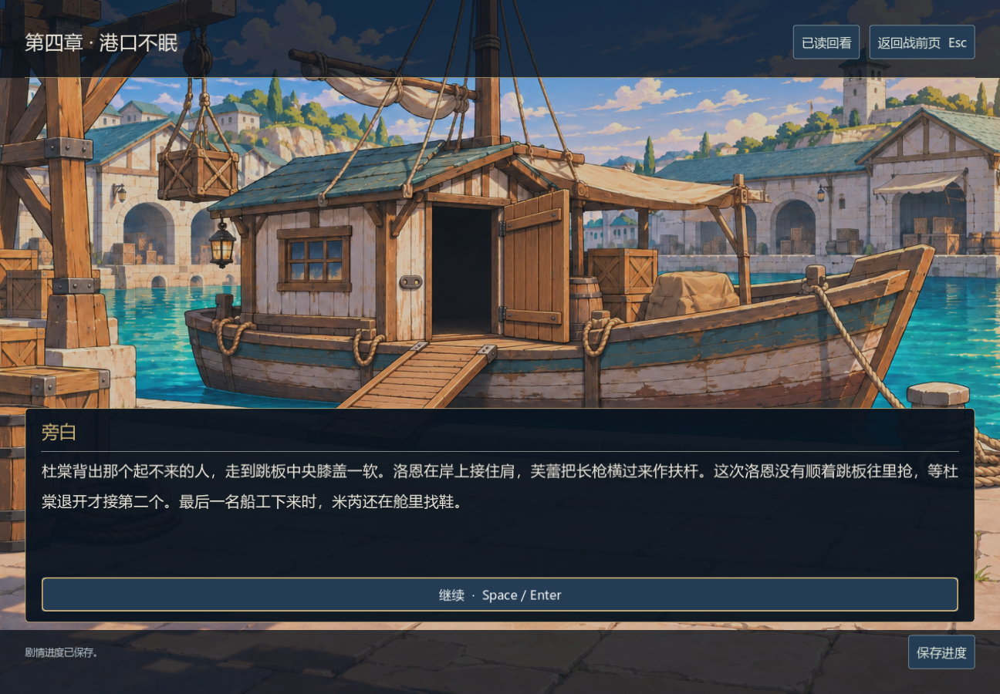

The chapter and related model suite passed 6,325 checks; native pages and controls passed 3,085. Harbor deployment is checked, but ordinary-resource harbor victories are still pending. Version 0.20.0-dev adds seven dedicated scenes, with 3,455 native page checks and 5,667 related model checks passing. NPC portraits, noncombat companion poses and dedicated backgrounds for chapters 1–3 remain pending. [Chapter-4 editorial and verification notes](docs/narrative/chapter-04-review.md).

## Quick start

Use **Godot 4.7.2 Standard**, without .NET. Engine binaries, exported executables and local caches are not included.

```bash
git clone https://github.com/yifanchen12/sigils-and-oaths.git
cd sigils-and-oaths
```

1. Get Godot from the [official download page](https://godotengine.org/download/windows/). The exact tested version and official archive URL are recorded in [`docs/engine-download.json`](docs/engine-download.json).
2. Import the root `project.godot` in Godot's project manager and wait for resource import.
3. Press **F5** to run the project. Select a commander, map and deck, then start the battle.

Alternatively, with your Godot executable available as `godot`:

```bash
godot --editor --path . --import
godot --path .
```

On Windows, you may place the official archive's GUI and console executables in `.tools/godot/`, keeping the filenames `Godot_v4.7.2-stable_win64.exe` and `Godot_v4.7.2-stable_win64_console.exe`. Then double-click `play.cmd`; `edit.cmd` opens the editor. These scripts do not download the engine automatically.

## Your first match

1. Choose a unit card and click an empty cyan-highlighted cell orthogonally adjacent to a friendly. Each side has at most six ordinary units, plus its commander.
2. New summons act on your next turn. Select a ready unit: blue dots mark movement and red frames mark attack targets. Normally you can move once and attack once; attacking ends movement.
3. Hover an attackable enemy to preview damage, retaliation and both units' remaining health. A surviving target retaliates once if the attacker is in range.
4. Maximum mana increases and refills each turn, up to ten. Use spells and commander skills to support your front within the 90-second limit.
5. Defeat the opposing 20-health commander to win. Commanders cannot move normally, but can be swapped. Drawing from an empty deck causes escalating fatigue damage.

Full rules are available in the game's rules panel. The deck editor saves one local custom deck: 30 cards, at most four copies of a card and at least one unit. Custom decks face the balanced AI preset.

| Action | Input |
| --- | --- |
| Cards, units and targets | Left-click; 1–8 select a card |
| Cancel | Right-click / Esc |
| End turn | Space / button |
| Zoom | Wheel / + / − |
| Pan | Middle mouse / Alt + left mouse |
| Fit map | Home |
| Exact terrain grid | G |
| Selected troop's active skill | Q / skill button |
| Toggle battlefield layout | Tab |
| Keyboard board navigation | Arrow keys / Enter |

The card library, rules and preparation menu pause the local clock and AI. Changing the map, commander or deck during a match starts a new one.

## Six battlefields

| Map | Main terrain |
| --- | --- |
| Greenwood frontier | Forests, winding roads, rocky blockers, hills and healing ruins |
| River crossing | A horizontal river with two bridge routes |
| Sunspire ruins | Sand, terraces, sparse groves and ruined fortifications |
| Ridge pass | Rocky barriers, narrow openings and pine groves |
| Citadel courtyard | Stone paths, bastions, garden terraces and ruins |
| Tidal harbor | A central canal, two bridges, shorelines and port forts |

Map paintings are separate from the rule grid. Rules and highlights define exact passability, range and selection; road-building and fortification cards update the corresponding terrain artwork. Position guides and visual review notes are in [`docs/map-art-audit.md`](docs/map-art-audit.md) (Chinese).

## Development and validation

All rules go through `scripts/battle.gd`; the UI and AI submit the same action format. Cards, commanders, decks and maps use Godot Resources. Rendering does not alter rules. The AI uses the public board and its own hand, without reading the opponent's hidden cards or deck order.

```text
data/          Card, map, commander and deck resources
scripts/       Rules, AI, UI and presentation
scenes/        Godot main scene
assets/art/    Character, card and map sources with provenance
tests/         Rules, full AI matches and actual-window interactions
tools/         Map-guide, audit-image and diagnostic utilities
docs/          Screenshots, validation and development records
```

Verified locally with **Godot 4.7.2 / Windows / Compatibility** for version 0.13.0: 274 melee-pose, 363 ranged/casting-pose, 122 archive-UI, 257 existing-UI, 56 feedback, 134 effect-forecast and 28 casting/clock checks passed (1,234 total). Unit rules, full AI matches and map-art results retain their actual validation versions in [`docs/validation.md`](docs/validation.md). These checks do not constitute a complete campaign playthrough or Steam approval.

0.14.0-dev adds headless checks for the chapter graph, storage, cross-process recovery and coordination with the real battle resolver, plus unit-skill, effect-forecast and clock regressions. Short fixture battles validate transitions, not normal-difficulty completion or balance. New UI verification is pending.

0.14.1-dev passes 485 new and related full-save checks: snapshot 190, storage 31, session 204, migration/mid-battle 41, and two independent processes with 2+17 checks. Subsequent draws, an AI decision and future RNG samples match an independent baseline. No new graphical or full AI balance validation is claimed. See the [full battle save plan](docs/plans/battle-save.md).

0.15.0-dev passes 1,533 windowless checks for story cursors, chapter continuity, objectives and related rules/saving, including two independent-process pairs. Main is parsed only. The two chapters contain 173 candidate prose paragraphs; native interaction and ordinary playthroughs remain pending. See the [chapter 2 acceptance scope](docs/plans/second-chapter.md).

```bash
godot --headless --path . --editor --quit
godot --headless --path . --script res://tests/test_battle.gd
godot --headless --path . --script res://tests/test_unit_skills.gd
godot --headless --path . --script res://tests/test_effect_forecast.gd
godot --headless --path . --script res://tests/test_story_runner.gd
godot --headless --path . --script res://tests/test_story_cursor.gd
godot --headless --path . --script res://tests/test_campaign_chapters.gd
godot --headless --path . --script res://tests/test_control_objective.gd
godot --headless --path . --script res://tests/test_chapter_resume.gd -- --write
godot --headless --path . --script res://tests/test_chapter_resume.gd -- --read
godot --headless --path . --script res://tests/test_campaign_store.gd
godot --headless --path . --script res://tests/test_campaign_store.gd -- --write
godot --headless --path . --script res://tests/test_campaign_store.gd -- --read
godot --headless --path . --script res://tests/test_campaign_session.gd
godot --headless --path . --script res://tests/test_battle_snapshot.gd
godot --headless --path . --script res://tests/test_battle_save.gd
godot --headless --path . --script res://tests/test_battle_save.gd -- --write
godot --headless --path . --script res://tests/test_battle_save.gd -- --read
godot --path . --script res://tests/test_ui.gd --resolution 1440x1000 --audio-driver Dummy
godot --path . --script res://tests/test_forecast.gd --resolution 1440x1000 --audio-driver Dummy
godot --path . --script res://tests/test_map_art.gd --resolution 1440x1000 --audio-driver Dummy -- --complete
godot --path . --script res://tests/test_unit_skills_ui.gd --resolution 1440x1000 --audio-driver Dummy
godot --path . --script res://tests/test_feedback_polish.gd --resolution 1440x1000 --audio-driver Dummy
godot --path . --script res://tests/test_action_poses.gd --resolution 1440x1000 --audio-driver Dummy
godot --path . --script res://tests/test_cast_poses.gd --resolution 1440x1000 --audio-driver Dummy
godot --path . --script res://tests/test_lore_book.gd --resolution 1440x1000 --audio-driver Dummy
python tools/audit_narrative.py
```

UI, forecast, map-art and skill-window checks require a graphical window. Earlier commands and rules are in [`docs/development.md`](docs/development.md) (Chinese); use this page and the in-game help for the new skills.

## Current limits and artwork

- Single-player development build with a [Windows x64 preview ZIP](https://github.com/yifanchen12/sigils-and-oaths/releases/tag/v0.31.0-dev); no multiplayer or touch adaptation. macOS and Linux have not been validated.
- Ranged attacks and spells currently do not check line of sight. AI diagnostics are not a substitute for competitive human playtesting.
- One custom deck is saved locally at Godot's `user://custom_deck.json`; player data is not included in this repository.
- One campaign autosave and a last-good backup use `user://campaign_autosave.json`. Starting over asks for in-game confirmation before replacing progress; these files are not published.
- Development uses AI-assisted coding, original image generation and narrative writing. Narrative content is fixed during development; the game does not call a live generation service. The cel-shaded characters are all adults. Artwork sources, full prompts and generation provenance are recorded in [`assets/art/manifest.json`](assets/art/manifest.json). Source PNGs remain intact; Godot draws text, values, grids and highlights.
- Issues with reproduction steps, window size, map and commander are welcome. Do not attach credentials or unrelated personal files.

## License

MIT License; see [`LICENSE`](LICENSE). Godot is covered by its [own license](https://godotengine.org/license/); engine binaries are not bundled.
