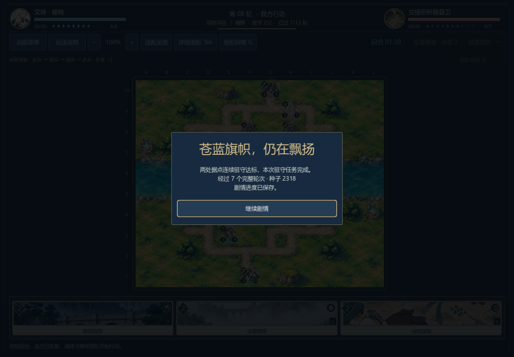

# 移动后的站位与敌军威胁

0.23.0-dev，2026-11-06。修复部队移动后的危险预估：旧策略一直使用移动前的占位图，会漏算敌军走进刚刚让出的格子；同种部队走向同一目的地时，也可能错误复用另一名部队的风险缓存。

## 复现与修改

在只剩四格的通道中，医师从`(4,5)`侧移至`(5,5)`，剑兵位于`(4,3)`。旧预估认为新位置风险为零，但执行这步移动后，剑兵确实能走入腾空的`(4,5)`并造成3点伤害。以移动威胁权重1进行核对，真实移动后重算风险为30。三个回归断言在修复前失败，修复后通过。

`Battle.walk_distances`接受只读占位覆盖：原位置变为空格，新位置变为阻挡；真实棋子、地形、手牌和随机数均不修改。危险预估按这张候选棋盘重算敌军能到达的位置，缓存同时区分出发格和目的格。部署的新兵也会挡住自己的落点，不再允许预估中的敌军穿过它。覆盖不改变山地、水面的不可通行规则。

重算只搜索移动费用允许的范围。六张地图、六兵种和晴雨雪雾共144组检查，对照完整加权路径搜索，确认可达格子及枚举顺序均相同。包含新兵、定身、地形费用、隐藏信息隔离、只读性、两种路口变动和缓存顺序检查，战术专项合计170项。

这是公开棋盘上的风险估计。潜在移动攻击仍按0.45行动权重评分；同一回合内多名敌军争抢狭口、援护者阵亡、天气消退、骑兵额外再动和未来手牌等情况仍未完整搜索。此次没有调整兵种、卡牌、初始资源、关卡期限或90秒回合规则。

## 对照与复现

两组均从13个正式关卡的初始资源出发，双方使用各自版本的生产策略，记录全部合法行动与最终快照。旧策略基于提交`f26db9716366e861163096703c1c2df17a682ed8`；前八关的完整行动与最终状态和历史0.18记录完全一致。固定种子、自对弈与程序玩家都不能代表真人胜率或整体平衡。

| 关卡 | 旧策略 | 新策略 | 新行动数 |
| --- | --- | --- | ---: |
| 军道 `c01_road` | 败 | 胜 | 182 |
| 河岸 `c01_river` | 败 | 胜 | 493 |
| 首章桥关 `c01_bridge` | 败 | 败 | 425 |
| 救济守桥 `c02_relief_bridge` | 期限败 | 期限败 | 145 |
| 种粮守桥 `c02_seed_bridge` | 期限败 | 驻守胜 | 88 |
| 交接所 `c02_dispatch` | 败 | 胜 | 393 |
| 风口接应 `c03_vent` | 驻守胜 | 驻守胜 | 56 |
| 山脊押运 `c03_ridge` | 败 | 胜 | 412 |
| 北坞接人 `c04_dock` | 败 | 胜 | 413 |
| 泵房 `c04_pump` | 胜 | 败 | 377 |
| 暮林保苗 `c05_nursery` | 期限败 | 驻守胜 | 127 |
| 暮林清渠 `c05_channel` | 败 | 胜 | 206 |
| 棋庭 `c06_court` | 败 | 败 | 89 |

旧组3,612行动，玩家侧2胜11败；新组3,406行动，9胜4败。双方策略一起变化，不能将胜负变化解读成人类玩家难度改善；泵房由胜转败，桥关、救济和棋庭仍败。河岸、山脊和北坞仍有超过60个行动回合的长局。本机新组单次决策峰值518.43ms，响应时间仍需优化；未宣称这是严格控制负载的前后性能实验。

两组完整记录分别为`tests/fixtures/campaign_v023_before.json`与`campaign_v023_selfplay.json`，包括所有失败。独立规则重放7,278+6,866项通过，另重放旧桥关528项、第五章两路线517项；共15,189项。战斗/AI/六技能/效果/目标/计时/快照/会话与上述170项战术检查合计927项通过，其中另含12场完整基础AI对局。源码哈希、精确分组和检查数见[验证摘要](ai-occupancy-v023.json)。

## 当前策略的原生续战

新版种粮守桥从正式资源、牌序和种子2318开始，共88个合法行动，于内部turn15（第8轮开始）完成连续两次驻守。第27行动、敌方turn8尚待行动时打开菜单保存并关闭窗口；另一进程从磁盘恢复完整局面与精确剩余时钟，真实敌军接续行动，真实鼠标点击完成战斗。

写入78项、读取190项，共268项原生检查通过。最终非时钟局面与独立规则重放一致，继续剧情打开`c02.bridge_after.01`，再次读盘不重复结算。新的`--fixture`参数允许明确选择当前策略记录；写入/读取还核对记录文件SHA256，避免两个进程误用不同动作文件。



[退出前菜单](screenshots/v023-c02_seed_bridge-before-exit.png) · [胜后剧情](screenshots/v023-c02_seed_bridge-story.png)

此前章节入口仍由叙事胜利夹具到达。这是单场实际运行证据；六章九战连续通关、其他关卡当前策略的原生通关、人工体验和整体平衡均未完成。旧版本的原生胜利与动作文件保留为历史，不默认代表新AI仍选择相同动作。

```powershell
godot --headless --path . --script tests/test_tactical_ai.gd
godot --headless --path . --script tests/benchmark_campaign.gd
godot --headless --path . --script tests/test_campaign_replays.gd -- --fixture=res://tests/fixtures/campaign_v023_selfplay.json
godot --path . --audio-driver Dummy --script tests/test_campaign_playthrough_ui.gd -- --write --scenario=c02_seed_bridge --fixture=res://tests/fixtures/campaign_v023_selfplay.json --capture-prefix=v023-
godot --path . --audio-driver Dummy --script tests/test_campaign_playthrough_ui.gd -- --read --scenario=c02_seed_bridge --fixture=res://tests/fixtures/campaign_v023_selfplay.json --capture-prefix=v023-
```

先完成资源导入并创建忽略的`.tools/`目录；两个原生命令必须依次运行，使用独立测试存档，不覆盖玩家自动槽。精确重跑旧策略可检出上述基线提交后执行其`tests/benchmark_campaign.gd`，不能用当前策略冒充旧基线。
