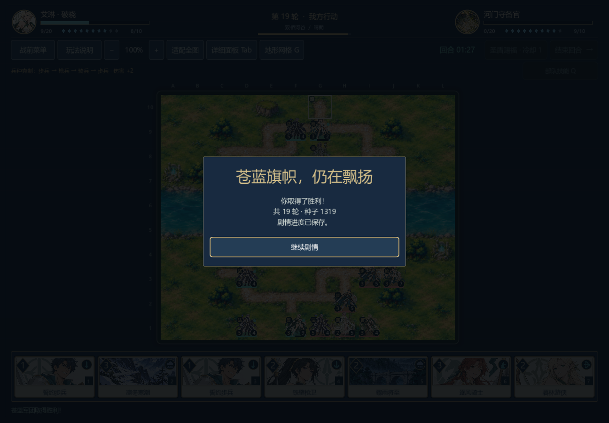
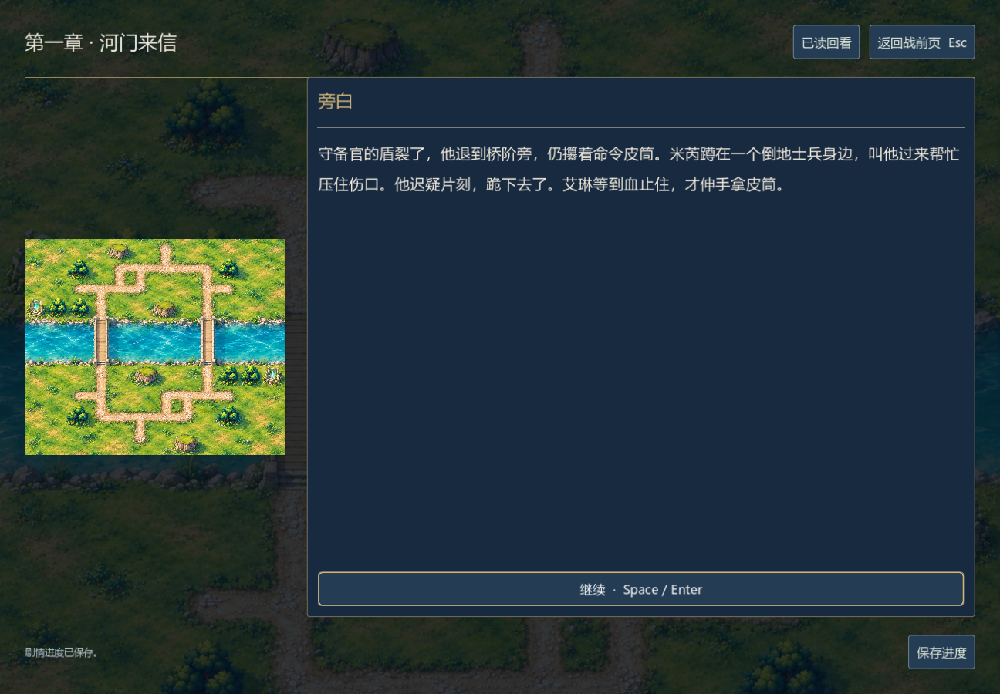

# 首章桥关的合法获胜与原生续战

本文保留对应版本的历史原生记录。0.23.0-dev已更新生产AI，旧动作不保证继续被现场AI选出；[当前策略与新的种粮续战验证](ai-occupancy.md)单独记录。

0.19.0-dev，2026-11-06。没有修改生产敌方AI、卡牌数值、关卡开局或90秒行动时限。新增的是测试用玩家打法：沿左桥集中推进，关注公开可见的受伤目标与医师，同时保留谨慎移动评分。它不是游戏内自动战斗，也不是通用最优解。

## 结果

`c01_bridge`，种子1319，原有均衡军势对壁垒军势：260次合法行动，在第19轮己方回合击败守备官（内部行动回合37），己方指挥官剩9生命。生产AI双方互打的旧失败记录全部保留；单条专门寻找的获胜路线不能拿来当真人胜率或整体平衡结论。最终本机策略单次决策峰值284.45ms。

独立规则重放528项通过。原生窗口另用两个独立进程验证：写入69项、读取615项，共684项，全部通过。使用真实手牌/棋盘/技能/结束回合点击，敌方由生产AI现场决策；完成23个行动后，在内部第8回合的敌方行动前暂停并正常关闭，再通过新进程的「继续战役」读盘。实际计时、牌序、单位、RNG、最终局面和独立重放一致；获胜后真实「继续剧情」打开`c01.w01`，重新读盘确认战果不重复。

第一次原生读取检查在最后一击动画结束前点击了尚未出现的按钮。测试原先遇到胜负已定就跳过等待，现改为无论胜负都等待AI与棋盘动画结束；重新完整执行写入和读取均通过。没有为测试删掉产品动画或改动胜利规则。





此前首章军道战仍用叙事夹具进入桥关。本证据只覆盖这场完整战斗，不是首章两战或四章七战连续通关。普通战斗节奏、其他策略与种子、港口新关和外部试玩仍待验证。历史0.17/0.18八关夹具现在显式列出原来八个关卡，防止第四章新增关卡后误报历史覆盖；所有旧动作和胜负均未删改。

## 复现

完整轨迹在`tests/fixtures/campaign_v0181_bridge.json`（文件名保留开发时编号），策略在`tests/fixtures/bridge_focus_pilot.gd`，最终源文件哈希与紧凑摘要在[bridge-playthrough-v019.json](bridge-playthrough-v019.json)。

```powershell
godot --headless --path . --script tests/benchmark_campaign.gd -- --focus-player --scenario=c01_bridge
godot --headless --path . --script tests/test_campaign_replays.gd -- --fixture=res://tests/fixtures/campaign_v0181_bridge.json
godot --path . --audio-driver Dummy --script tests/test_campaign_playthrough_ui.gd -- --write --scenario=c01_bridge
godot --path . --audio-driver Dummy --script tests/test_campaign_playthrough_ui.gd -- --read --scenario=c01_bridge
```

先创建忽略的`.tools/`目录，干净工程先导入。写入/读取必须按顺序运行，与其他原生关卡共用独立测试槽，不得并行覆盖。最新重放检查还覆盖旧0.18全八关4,731项、三目标关632项和0.17八关3,195项，全部通过；历史分组不混合计算胜率。
