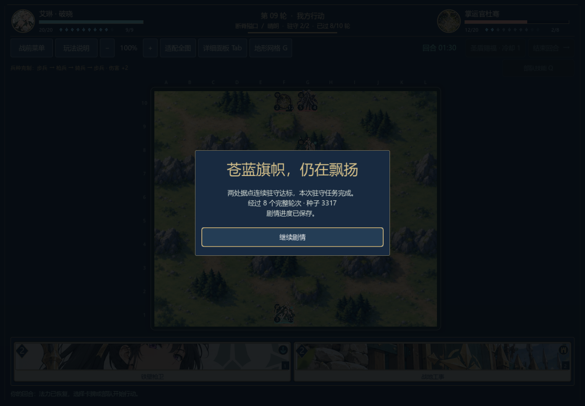
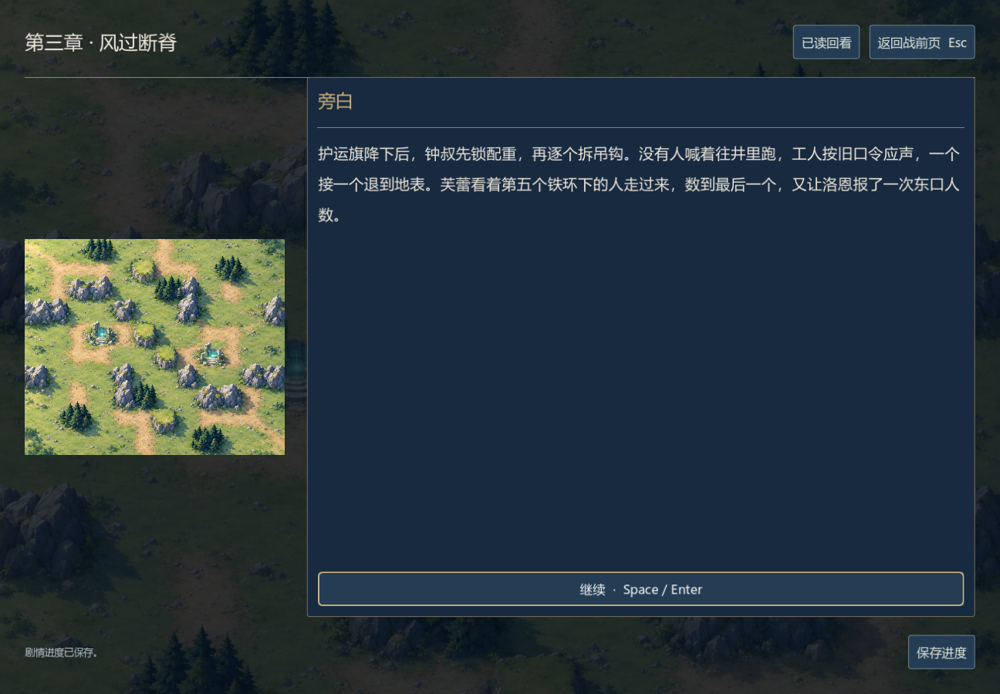

# 战役目标 AI 与完整行动记录

本页保留0.17.0-dev的历史结果。当前AI与原生续战脚本已更新，见[0.18.0-dev记录](tactical-survival.md)。精确复现本页原生81行动流程需检出提交`8caa9fdd981065b0ea5431d6515d13570031c965`；旧动作夹具仍可由当前规则重放，不代表当前AI会选择同一序列。

0.17.0-dev，2026-11-06。AI 在双点驻守关卡中会抢占未控制的据点、留守已控制的据点，并用击退、伤害或援护改变驻守局势。守方只需阻断一个点；普通遭遇战保留既有决策。卡牌数值、地形、初始资源、90 秒回合和目标期限未调整。

## 决策与规则

`scripts/objective_ai.gd`为现有行动评分增加目标价值，不代替`Battle`的合法性和结算。逆向 Dijkstra 使用实际地形费用和棋子阻挡；敌占据点从合法攻击位置接近。一次决策内复用路径，AI 只读取公开棋盘和自己的手牌，不读取对方手牌或牌库顺序。

占领收益按动作后的实际存活者计算。普通攻击使用包含援护、护盾和反击的预估；法术使用共享效果预估，逐人处理范围伤害、护盾和击退落点。定身不等于移出据点，换位不凭空增加占领，治疗优先维持据点守军，能直接击败敌指挥官时优先结束战斗。

29 项目标专项检查覆盖上述行为、绕墙、最后一次检查前阻断、指挥官胜利、决策只读与隐藏信息隔离。普通 AI 的 10 项回归通过。五个无目标关卡的完整动作序列与旧版逐项相同，包括结束回合的零分平局处理。

## 八个关卡的固定种子诊断

双方使用同一策略，从每关正式初始牌组、手牌、法力、指挥官和地形开始；没有预放部队。规则重放每行动推进 0.35 秒，实际决策耗时另计。这是策略诊断，不是人工试玩或胜率平衡样本。

| 关卡 | 原策略 | 新策略 | 新策略行动数 |
| --- | --- | --- | ---: |
| 首章军道 `c01_road` | 败 | 败 | 131 |
| 首章河岸 `c01_river` | 胜 | 胜 | 316 |
| 首章桥关 `c01_bridge` | 败 | 败 | 214 |
| 救济优先 `c02_relief_bridge` | 指挥官败亡 | 期限失败 | 136 |
| 种粮优先 `c02_seed_bridge` | 期限失败 | 期限失败 | 118 |
| 交接所 `c02_dispatch` | 胜 | 胜 | 185 |
| 风口接应 `c03_vent` | 期限失败 | 驻守胜利 | 81 |
| 山脊押运 `c03_ridge` | 败 | 败 | 395 |

种粮路线曾达成一次驻守，之后被打断。风口路线在第 17 行动回合，即第 9 轮开始时完成连续两次驻守；双方指挥官均存活。八关共 1,576 个合法行动，3 胜 5 败，未删除失败记录。最高单次决策耗时为本机测得的 212.36 毫秒，不代表所有硬件的性能。

对照基线为提交`29323546d0a4a64ca3229b106d7d4a1d8e9299f8`。完整动作及最终快照保存在`tests/fixtures/campaign_v017_replays.json`，紧凑对照和策略源文件 SHA256（UTF-8，换行统一为 LF） 在`docs/campaign-ai-v017.json`。独立重放的 3,185 项检查核对所有动作、回合、计时、单位、牌序、RNG、目标与最终存档；不只比较胜负。

## 原生窗口的完整单场验证

`tests/test_campaign_playthrough_ui.gd`在两个独立 Windows Godot 进程中验证风口接应：

1. 从正式战前页面点击出征，初始状态与关卡定义一致。
2. 玩家侧以真实鼠标事件点击手牌、棋盘、技能和结束回合；敌方由游戏原生 AI 自行动作。
3. 第 8 行动回合、敌方尚待行动时打开菜单保存，触发正常窗口关闭处理器退出进程。
4. 新进程通过「继续战役」读盘，精确恢复退出时的时钟与完整局面，继续敌方 AI。
5. 打完全部 81 个行动，以驻守获胜，再点击「继续剧情」进入`c03.vent_after.01`；新建会话从磁盘验证战果仅处理一次。

写入进程 81 项、读取进程 181 项，共 262 项通过。原生过程使用实际经过时间，不把重放的固定时间代入游戏。首轮测试抢在容器布局完成前误点了别的卡，测试现等待布局完成并断言选中卡牌；产品规则没有为测试改动。





前两章胜利在本原生测试中仍是用于到达第三章的叙事夹具；只证明这一场战斗从正式初始状态可胜及其退出续战流程，不证明三章五战连续通关。全部章节、其他分支正常通关、人工策略体验、外部阅读及完整平衡仍未完成。

## 复现

从工程根目录，用 Godot 4.7.2 先导入资源，再运行：

```powershell
godot --headless --path . --import
godot --headless --path . --script tests/test_objective_ai.gd
godot --headless --path . --script tests/test_opponent.gd
godot --headless --path . --script tests/test_campaign_replays.gd
```

原生流程会打开窗口，在忽略的`.tools/`目录保存独立测试槽，不覆盖玩家的自动槽；完成后自行退出。先创建该目录，然后按顺序运行，不能并行启动写入和读取进程：

```powershell
New-Item -ItemType Directory -Force .tools
godot --path . --audio-driver Dummy --script tests/test_campaign_playthrough_ui.gd -- --write
godot --path . --audio-driver Dummy --script tests/test_campaign_playthrough_ui.gd -- --read
```

重新运行策略诊断可用`tests/benchmark_campaign.gd`，输出到`.tools/campaign-objective-ai.json`。`--baseline`是开发比较选项，需要把上述基线提交的`opponent.gd`保存成`.tools/opponent_before_v017.gd`并去掉其`class_name Opponent`声明，以免与当前脚本重名。仓库保留已记录结果，不把旧策略作为第二套生产 AI。
