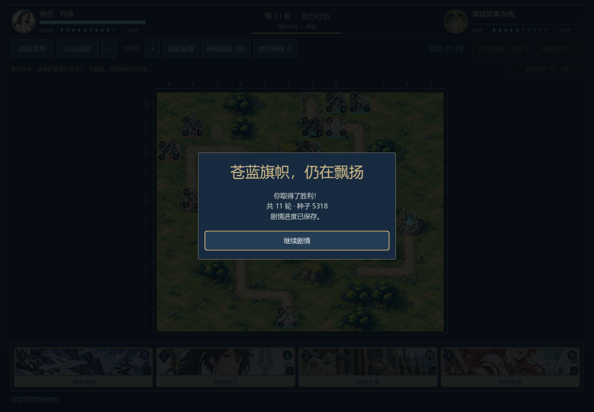

# 第五章清渠路线：正常资源与独立进程续战

0.22.0-dev，2026-11-06。采用此前公开的谨慎诊断玩家获胜路线，在两个真实Godot进程中点击手牌、棋盘、技能和结束回合按钮。生产敌军自主行动；没有改初始兵力、数值、牌序或计时规则。

第一进程从第五章`c05_channel`正式战前页出征，核对与原始种子5318的规则局面完全相同。第23行动、内部turn8的敌方待行动时打开菜单，保存并按实际关闭处理退出。第二进程从磁盘恢复完整战局和剩余时钟，点击继续战役，敌军恢复行动，最终135个合法行动、内部turn21（第11轮）击败敌方指挥官。

写入进程75项、读档/续战进程346项检查通过。最终棋子、牌库、随机数与所有非时钟字段和独立规则重放一致；真实继续剧情按钮进入`c05.after_water.01`，再读盘仍是战后对白，没有重复结算。分水选择保持`channel`，放水战果为真，赛菈代表权仍待玩家稍后表决。



[退出前的菜单](screenshots/v022-c05_channel-before-exit.png) · [胜后继续进入放水剧情](screenshots/v022-c05_channel-story.png) · [源码与验证摘要](channel-playthrough-v022.json)

前四章与第五章之前的阅读入口使用叙事胜利夹具。本次证明一场从正常资源开始的原生获胜及跨进程续战，不是人工试玩、六章九战连续通关或其他分支难度验收。第五章保苗路线的期限败局、第六章棋庭败局仍保留。

```powershell
godot --path . --audio-driver Dummy --script tests/test_campaign_playthrough_ui.gd -- --write --scenario=c05_channel
godot --path . --audio-driver Dummy --script tests/test_campaign_playthrough_ui.gd -- --read --scenario=c05_channel
```
