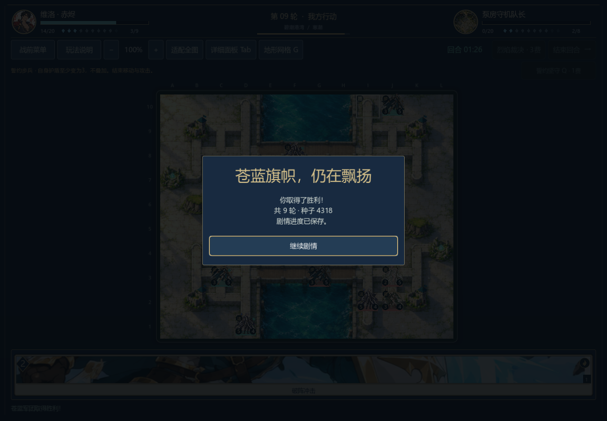
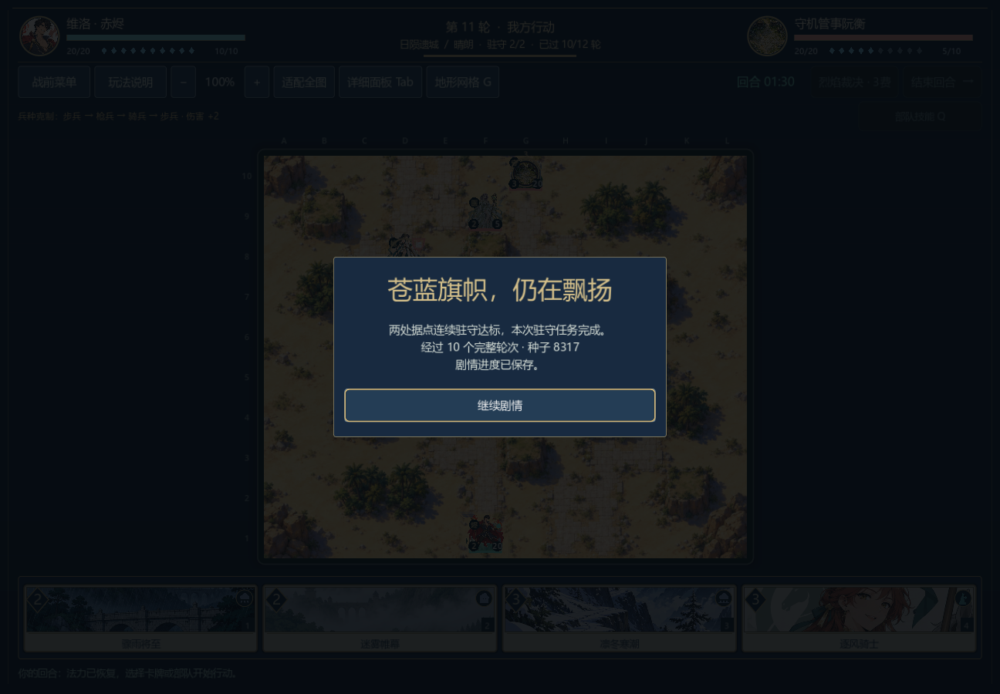
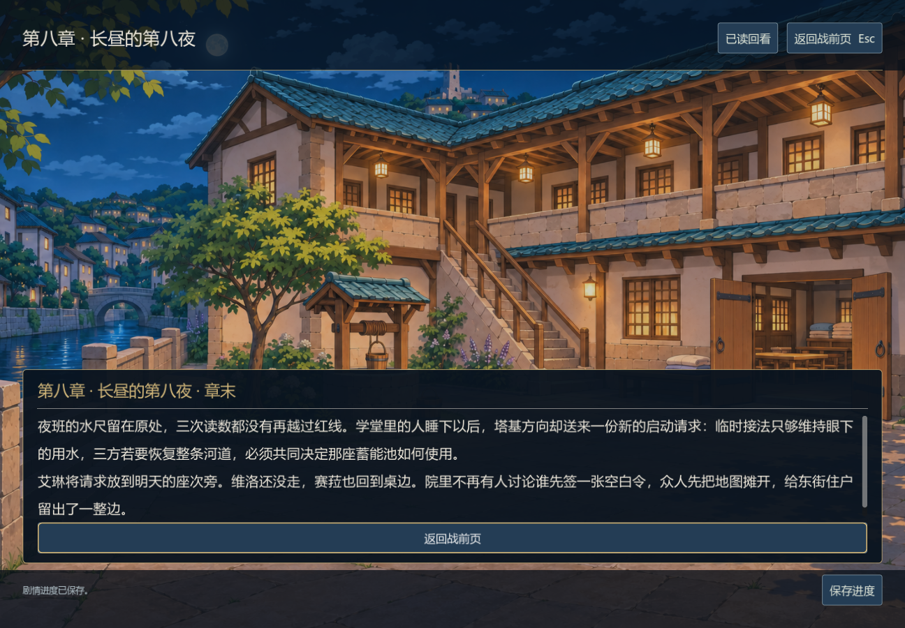
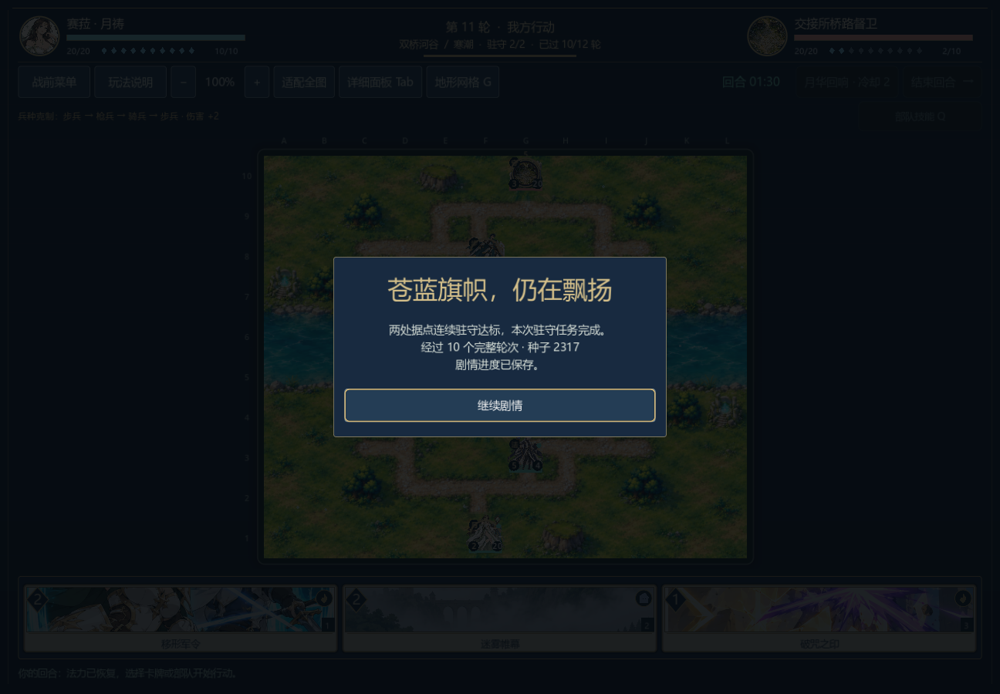
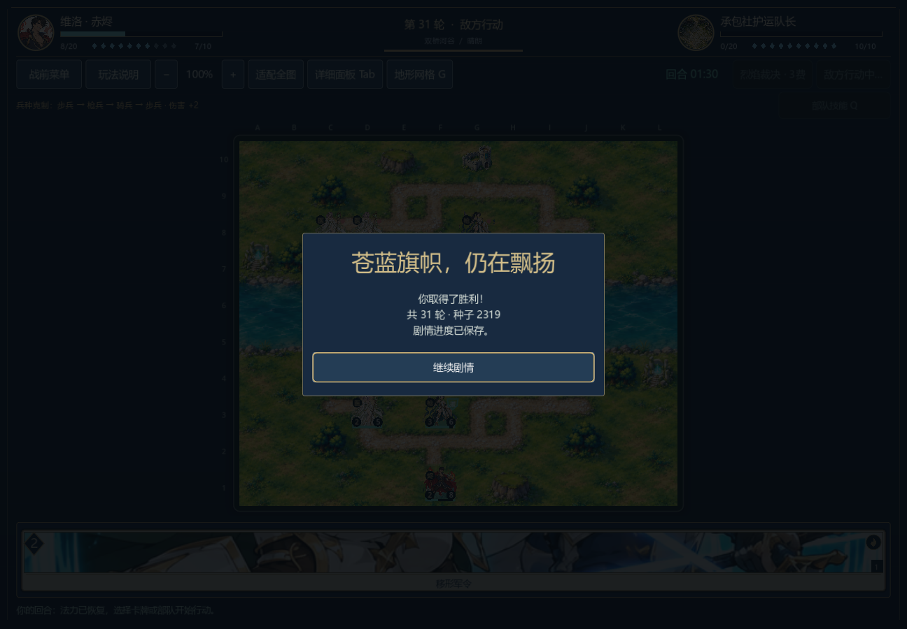
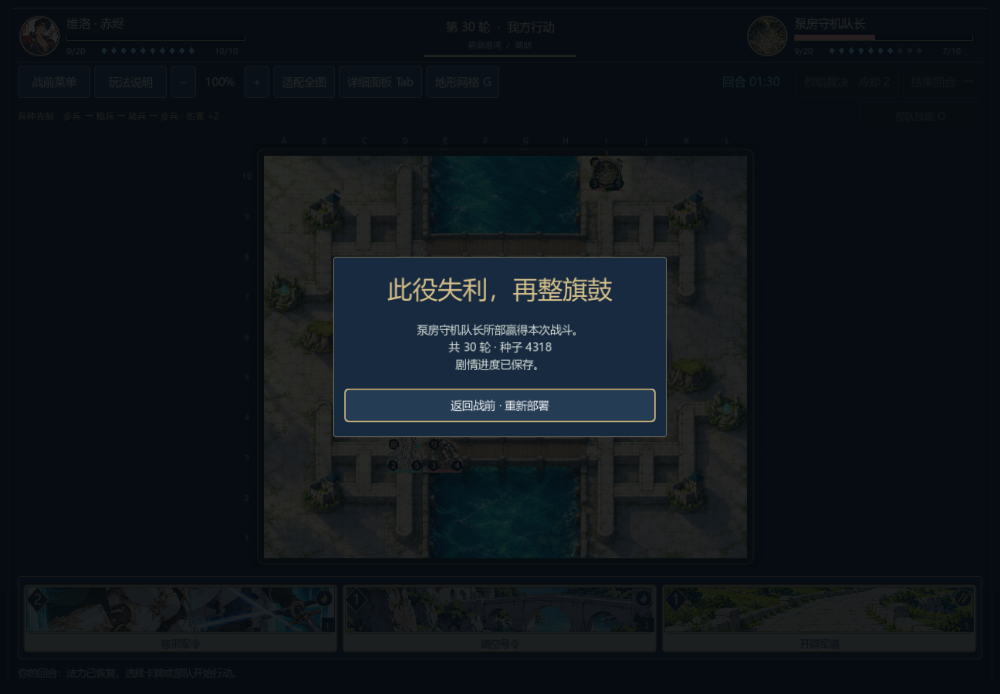
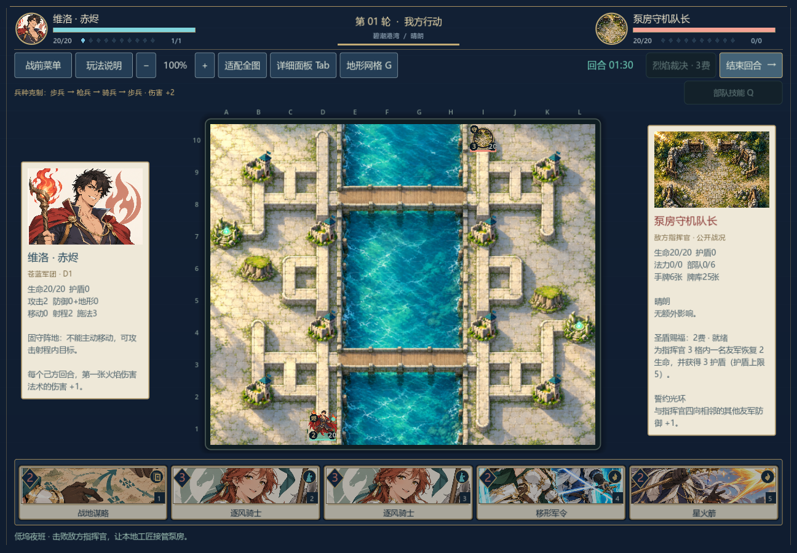
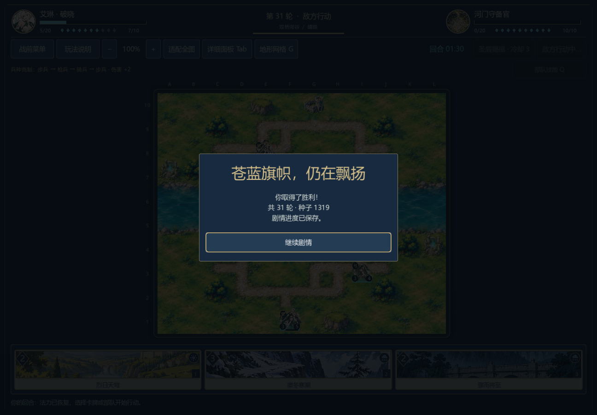

# 从新战役开始的连续流程记录

## 0.34 续入第十章与塔门三路线（2026-11-07）

从此前真实原生十战胜利的三份第九章终页存档分别继续：共同轮值、分段旁路、封池一季自动决定不同指挥官、预组和期限。原生窗口逐张打牌、逐格移动、攻击并施放技能，三场塔门战分别用213、98、165次合法操作获胜；各自走到第十章终页并在独立进程读回。合计1,516项原生检查零失败。这里重用的是已验证的前十战存档，本次短测试没有重新点击前十战。

当前源码另从真正「新战役」状态走一条固定选择路线，十一场战斗均由规则模型的合法动作获胜，进入十章末页；2,500次行动、998段对白、16次选择，3,685项检查零失败。该路线实际读到53,561个汉字（按已显示对白逐段计数）。三处旧关己方仍采用公开战场信息诊断策略，塔门和其他战斗双方使用生产AI。这不证明真人难度或其他分支胜率。[第十章实机与文本记录](narrative/chapter-10-review.md) · [逐战精简摘要](continuous-v034.json)。

## 0.33 续入第九章（2026-11-07）

0.32实际原生十战胜利存档在当前版本继续进入第九章，三种治理方案分别点击到终页并在独立新进程读回；三方案共436项原生检查零失败。当前源码的固定种子模型也从新战役入口打赢相同十场，读过924段对白、16次选择，走到第九章当前终页，3382项检查零失败。一条路线的正文阅读量为49,401汉字。三关玩家使用已声明的公开信息测试策略；这不是真人试玩、其他分支连续胜率或完整故事结局。[第九章实机与文本记录](narrative/chapter-09-review.md) · [逐战精简摘要](continuous-v033.json)。

## 0.32 八章十战的一条可达路线（2026-11-07）

从真实「新战役」状态开始，选军道、先送救济、日陨隔离等已声明的剧情选项，连续进入八章、打完十场遭遇战并抵达**目前已写的第八章终页**。固定种子模型逐战核对3251项，失败0；十战均由实际合法行动获胜，共2287次行动、15次选项、799段不同对白。该路线实际经过的对白字符串含42,598个汉字（逐段只计U+4E00–U+9FFF，不含终页、图鉴、界面和未走分支）。现有剧情在蓄能池议题后仍留有后续章节，抵达终页不等于完整故事结局或十万字交付。

第四章泵房、第五章苗圃、第六章棋庭分别采用既有的公开战场信息集中目标测试策略；其余关卡己方与全部敌方采用生产AI。测试策略只读可见位置、生命和地形，不窥探手牌或随机数，也没有跳章、修改战果和预置资源。第八章日陨隔离关的守军预组由壁垒改为均衡，原12轮两点驻守规则不变；固定开局下生产策略115次行动完成，旧壁垒守军下同策略在期限内失败。0.31已经开始的壁垒守军战斗继续按旧编队读存档，失败重试才使用当前均衡编队；无关预组仍受严格校验。

| 战斗顺序 | 剧情关卡 | 玩家测试策略 | 合法行动 |
| --- | --- | --- | ---: |
| 1–2 | 军道、河门桥头 | 生产AI | 151、448 |
| 3–4 | 救济双桥、押运队 | 生产AI | 128、454 |
| 5 | 断脊风口 | 生产AI | 55 |
| 6–7 | 港口码头、泵房 | 生产AI、泵房集火 | 269、90 |
| 8 | 暮林苗圃 | 支援目标集火 | 132 |
| 9 | 棋庭对质 | 中央阵线集火 | 445 |
| 10 | 日陨隔离 | 生产AI | 115 |

[逐战模型结果、路线选择与截图哈希](continuous-v032.json)。原生 Godot 窗口从「新战役」按钮逐段点击全部799段对白、15次选项及十战2287次可见操作，写入进程5540项检查通过，失败0。独立新进程读取实际战役存档后回到相同的第八章终页，不重复结算第十战；另8项检查通过，两进程合计5548项。已逐张查看泵房、棋庭、日陨隔离胜利及终页、恢复终页截图。第八章终页仍是蓄能池后续冲突的开端，不能当作全故事完结。

可用 `godot --headless --path . --script res://tests/benchmark_campaign_continuous.gd -- --route=road --priority=relief --pump-focus --nursery-focus --court-focus` 复核固定路线；原生窗口按顺序执行 `godot --path . --audio-driver Dummy --script res://tests/test_campaign_continuous_ui.gd -- --write --capture-prefix=v032 --report=res://.tools/continuous-campaign-road-pump-focus-nursery-focus-court-focus.json` 与同命令的 `--read`。这不是人工试玩、其他分支通关或整体平衡证明；棋庭等关卡仍有明显长局。

对应[0.32 Windows开发预览版](https://github.com/yifanchen12/sigils-and-oaths/releases/tag/v0.32.0-dev)已公开；匿名下载的字节数与SHA-256见[发行准备记录](release/steam-readiness.md)。

## 0.31 两条第二章路线推进到第四章（2026-11-07）

救济双桥关保留原12轮期限与两点连续驻守规则，将敌方军势由突袭改为均衡；固定种子2317下，生产策略和谨慎测试策略均从期限失败变为驻守获胜。押运队关保留敌方均衡军势，将己方军势由突袭改为壁垒；固定种子2319下，两种策略均从指挥官败亡变为胜利。战前说明分别提示分兵守桥和枪医阵线。这些是既定开局的关卡调试，不是随机种子胜率或真人平衡测试。已经开始的旧军势战斗可继续保存，失败重试采用当前关卡军势；不接受其他军势伪装旧档。

从「新战役」第一句开始，选择军道与「先送救济」，模型连续读过262段不同对白、点击9次选项，依次完成首章军道、桥头，第二章救济双桥、押运队，第三章风口和第四章码头六场胜利；第四章泵房在第七战失败。七战共1858次合法行动，2230项剧情、战斗和存档检查通过。另一实际选项「先送种子」的模型路线也六胜一败，在同一泵房关停止：七战1817次行动、262段对白、9次选项、2189项检查通过。两条路线均在真实败局处停止，未跳关或注入胜利。

救济路线另从原生 Godot 窗口的「新战役」按钮走完同一262段对白、9次选择和七战1858次可见输入，前六战胜利、第七战失败，写入进程4507项检查通过。独立新进程实际读取泵房败局并点击重新出征，10项检查通过，之前战果未重复结算。两进程共4517项检查。已查看救济双桥、押运队、第三章风口胜利及泵房败局、重新部署截图。

泵房另从正式关卡开局，以仅使用公开战场信息的集中火力测试策略90次合法行动获胜；这只是单关模型对照，**不是**上述连续路线的泵房胜利，也没有原生单关胜利的新证据。整体战役、真人难度和10万汉字目标仍未完成。[逐战数据、诊断与截图哈希](continuous-v031.json)。模型复核命令为 `godot --headless --path . --script res://tests/benchmark_campaign_continuous.gd -- --route=road --priority=relief`（种子分支改为 `--priority=seed`）；原生救济路线按顺序执行 `godot --path . --audio-driver Dummy --script res://tests/test_campaign_continuous_ui.gd -- --write --capture-prefix=v031` 与同命令 `--read`。

## 0.30 桥头关调整后的连续诊断（2026-11-07）

首章第二战原为均衡玩家军势对壁垒守军；在当前0.29规则和固定种子1319下，生产AI双方对弈425次行动后玩家失败，左桥集火策略341次行动后也失败。只把敌军军势改为「均衡」的对照中，两种策略分别在448次和350次合法行动后获胜；敌军改为「突袭」时，生产策略196次行动后仍败，左桥策略350次行动后获胜。这是同一固定开局的关卡调试，不是随机种子胜率或真人难度测量。

因此首章桥头关现采用均衡守军，并在战前说明中提示沿单桥集结、优先限制医师、提防弓手齐射。从「新战役」首句出发的连续模型诊断已实际完成军道151次行动获胜、桥头448次行动获胜，进入第二章并读到共82段不同对白；随后第二章救济双桥战156次行动后在驻守期限失利。三场共755次行动，当前脚本888项连续流程与存档检查通过，4次真实剧情选择。没有跳关、注入胜利或预设战果。0.29已经开始的旧壁垒桥头战仍可读盘和继续保存；若该战失败后重新出征，则采用新版均衡守军。其他关卡军势不享受这个兼容例外。

原生窗口从实际「新战役」按钮进入，按上述82段对白和4个选择依次推进，使用可见卡牌、地格、技能与结束回合按钮完成三战755次行动。写入进程1791项检查通过，独立读取进程10项通过，共1801项；两场真实胜利推动第一章结尾和第二章入口，救济双桥战真实失败后存档仍停在该关。读取进程点击「重新出征」重新得到未增益的正式开局，之前选择与胜利不会重复结算。已查看下面的实机图像。
原生窗口验收在诊断脚本新增路线参数检查前完成；该检查使当前模型检查数由887变为888，不改变三场战斗轨迹、剧情选择或原生窗口验收数字。公开诊断摘要的哈希对应当前脚本重新生成的报告。

第二章失败时两处据点都有友军，但连续驻守仅1/2；把期限单独增至13、14或15轮，两种公开信息诊断策略仍失利，不能靠简单延时解决。该路线尚未连通后续章节，也不能证明人工玩家能稳定通过桥头关。旧0.28原生实测和图像保留在下节。

在同一首章实绩后，显式选择第二章另一真实选项「先送种子」的模型诊断，依次完成军道151、桥头448、种粮双桥87次合法行动并获胜；之后在第二章押运队关380次行动后失利。四战共1066次行动，97段不同对白、1225项剧情/战斗/存档检查通过，仍未进入第三章。这条分支只完成headless连续诊断，没有对应的原生四战连续验收。

[两条路线逐战结果与实机截图哈希](continuous-v030.json)。模型复核入口为 `godot --headless --path . --script res://tests/benchmark_campaign_continuous.gd -- --route=road --priority=relief`（或 `--priority=seed`）；救济路线原生验收依次运行 `godot --path . --audio-driver Dummy --script res://tests/test_campaign_continuous_ui.gd -- --write` 和同命令的 `--read`。原生脚本消费刚生成的救济路线诊断，旧0.28截图不会被覆盖。

记录补入0.29.0-dev文档；实际运行使用新卡扩展前的0.28规则。**首战获胜，第二战失利，未完成首章或八章十战。** 这份证据保留真实失败，不把早期单关夹具胜利拼接成完整战役。

## 实际走过的路线

原生Godot窗口从主菜单“新战役”进入第一句正文，按声明路线阅读48个对白页面、点击实际选项，再通过正式出征按钮进入遭遇战。没有跳章或注入前置胜利，战斗资源、敌方生产AI与关卡规则均沿用当时版本。

| 顺序 | 遭遇战 | 实际结果 | 完整合法行动 |
| --- | --- | --- | --- |
| 1 | `c01_road` | 玩家胜利，进入实际战后剧情 | 151 |
| 2 | `c01_bridge` | 玩家失败，停在“重新出征”页 | 425 |
| 合计 | 两场 | 一胜一负 | 576 |

第一个原生进程完成1367项检查，失败0，并保存实际失败状态后关闭窗口。另一个原生进程通过“继续战役”恢复同一失败记录，再点击“重新出征”，以原始资源重建第二战；另10项检查通过，失败0。共1377项检查核对对白/选择顺序、双方完整行动、战斗终态、磁盘恢复及重试后的未改动开局。

失败不会推动未读剧情、发放胜利奖励或变成进行中的旧战斗。重试保留此前已完成的选择和首战结果，不重复记录尚未发生的新战果。

## 画面

## 范围与复核入口

原生脚本为`tests/test_campaign_continuous_ui.gd`，按`--write`、`--read`顺序分两个进程执行；它消费同规则版本生成的连续路线动作记录，并以实际页面按钮驱动流程。它会核对生产敌方AI的现场决策与完整状态，不将独立记录直接当成原生运行结果。

此记录证明该路线的开场、第一次胜利、第一次失利、退出恢复与重试流程。它不证明第二战存在当前玩家策略的胜解，不证明后续章节连续可达，也不是人工阅读评价、整体难度或十万字交付证明。0.29引入新卡与存档规则版本后，旧记录保留其历史含义；旧战役动作迁移通过不等于已重跑新的完整原生战役。
