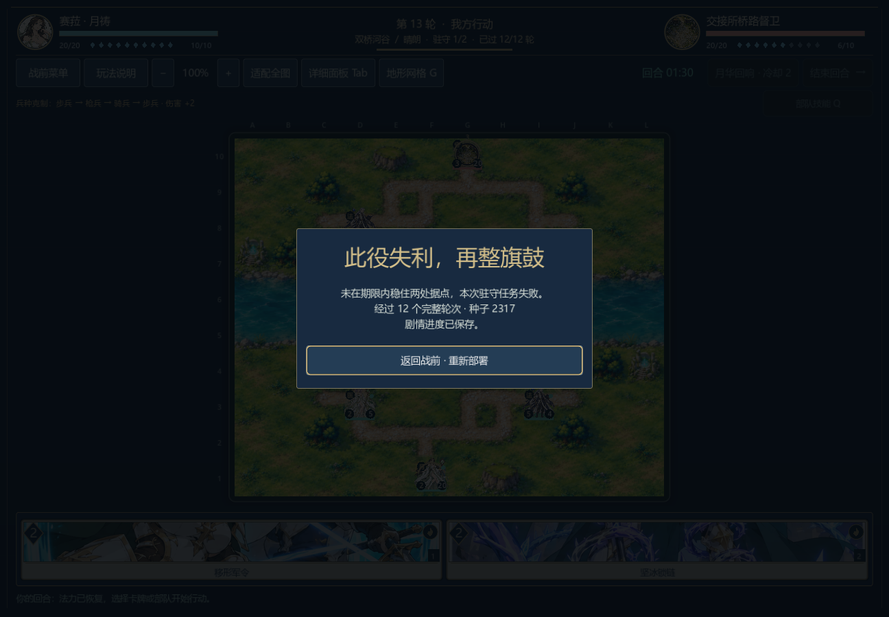
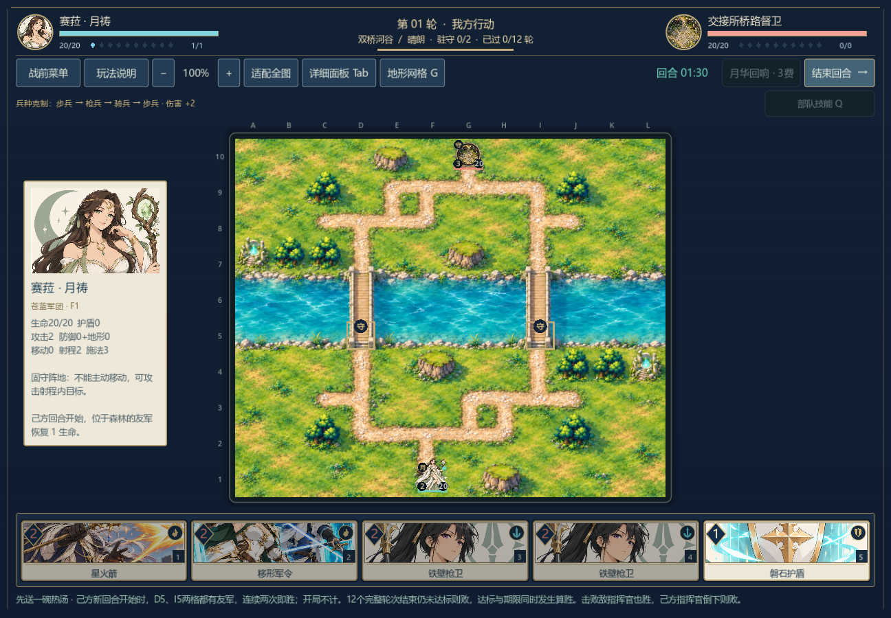
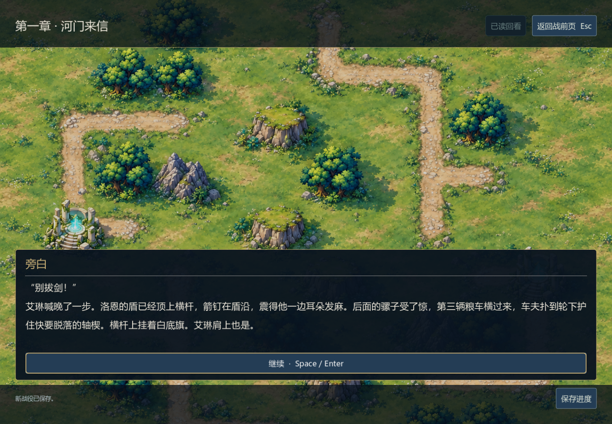
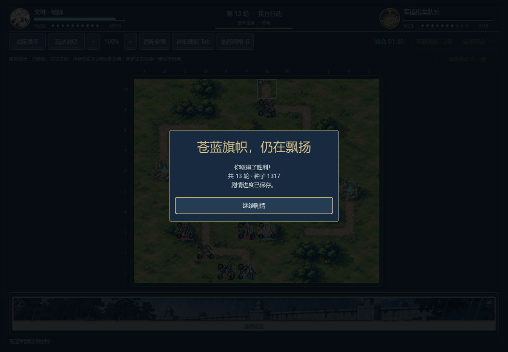
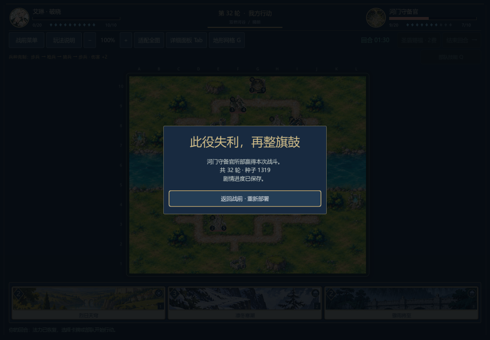
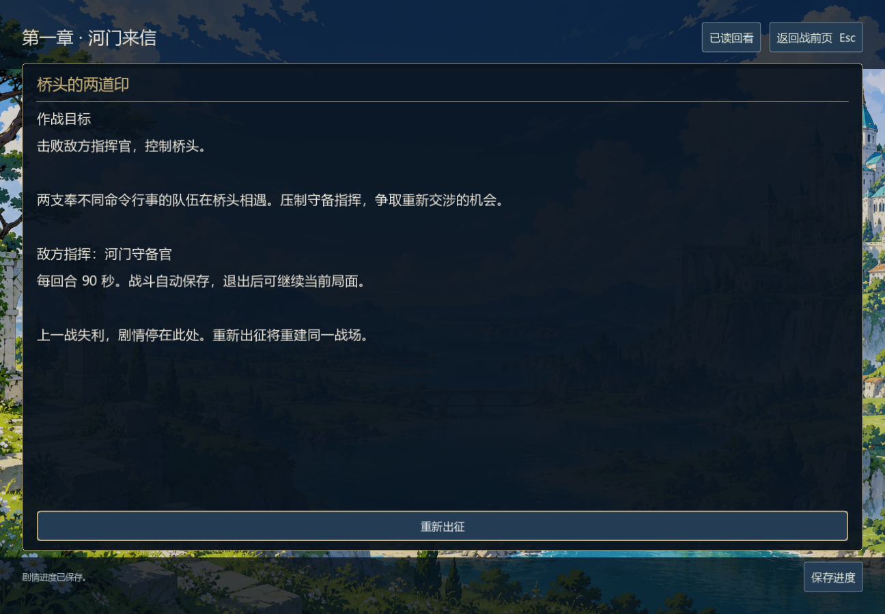
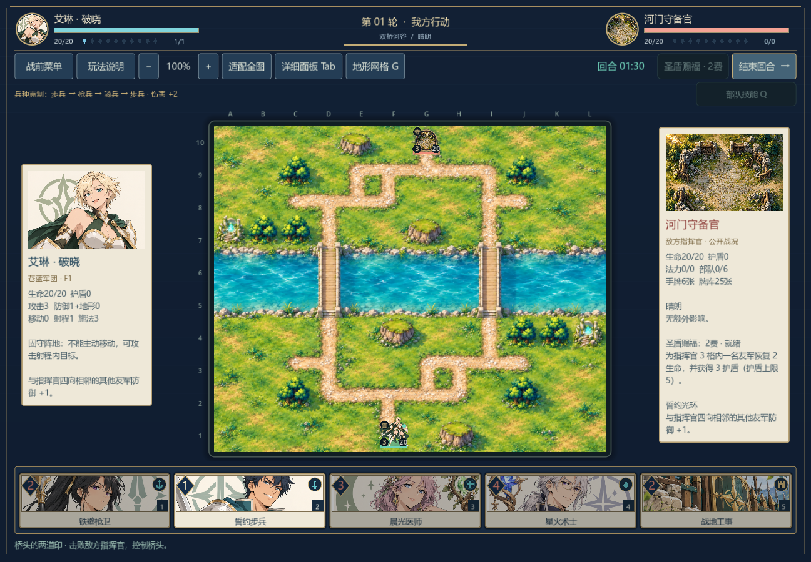

# 从新战役开始的连续流程记录

## 0.30 桥头关调整后的连续诊断（2026-11-07）

首章第二战原为均衡玩家军势对壁垒守军；在当前0.29规则和固定种子1319下，生产AI双方对弈425次行动后玩家失败，左桥集火策略341次行动后也失败。只把敌军军势改为「均衡」的对照中，两种策略分别在448次和350次合法行动后获胜；敌军改为「突袭」时，生产策略196次行动后仍败，左桥策略350次行动后获胜。这是同一固定开局的关卡调试，不是随机种子胜率或真人难度测量。

因此首章桥头关现采用均衡守军，并在战前说明中提示沿单桥集结、优先限制医师、提防弓手齐射。从「新战役」首句出发的连续模型诊断已实际完成军道151次行动获胜、桥头448次行动获胜，进入第二章并读到共82段不同对白；随后第二章救济双桥战156次行动后在驻守期限失利。三场共755次行动，当前脚本888项连续流程与存档检查通过，4次真实剧情选择。没有跳关、注入胜利或预设战果。0.29已经开始的旧壁垒桥头战仍可读盘和继续保存；若该战失败后重新出征，则采用新版均衡守军。其他关卡军势不享受这个兼容例外。

原生窗口从实际「新战役」按钮进入，按上述82段对白和4个选择依次推进，使用可见卡牌、地格、技能与结束回合按钮完成三战755次行动。写入进程1791项检查通过，独立读取进程10项通过，共1801项；两场真实胜利推动第一章结尾和第二章入口，救济双桥战真实失败后存档仍停在该关。读取进程点击「重新出征」重新得到未增益的正式开局，之前选择与胜利不会重复结算。已查看下面的实机图像。
原生窗口验收在诊断脚本新增路线参数检查前完成；该检查使当前模型检查数由887变为888，不改变三场战斗轨迹、剧情选择或原生窗口验收数字。公开诊断摘要的哈希对应当前脚本重新生成的报告。

第二章失败时两处据点都有友军，但连续驻守仅1/2；把期限单独增至13、14或15轮，两种公开信息诊断策略仍失利，不能靠简单延时解决。该路线尚未连通后续章节，也不能证明人工玩家能稳定通过桥头关。旧0.28原生实测和图像保留在下节。

在同一首章实绩后，显式选择第二章另一真实选项「先送种子」的模型诊断，依次完成军道151、桥头448、种粮双桥87次合法行动并获胜；之后在第二章押运队关380次行动后失利。四战共1066次行动，97段不同对白、1225项剧情/战斗/存档检查通过，仍未进入第三章。这条分支只完成headless连续诊断，没有对应的原生四战连续验收。

[两条路线逐战结果与实机截图哈希](continuous-v030.json)。模型复核入口为 `godot --headless --path . --script res://tests/benchmark_campaign_continuous.gd -- --route=road --priority=relief`（或 `--priority=seed`）；救济路线原生验收依次运行 `godot --path . --audio-driver Dummy --script res://tests/test_campaign_continuous_ui.gd -- --write` 和同命令的 `--read`。原生脚本消费刚生成的救济路线诊断，旧0.28截图不会被覆盖。

记录补入0.29.0-dev文档；实际运行使用新卡扩展前的0.28规则。**首战获胜，第二战失利，未完成首章或八章十战。** 这份证据保留真实失败，不把早期单关夹具胜利拼接成完整战役。

## 实际走过的路线

原生Godot窗口从主菜单“新战役”进入第一句正文，按声明路线阅读48个对白页面、点击实际选项，再通过正式出征按钮进入遭遇战。没有跳章或注入前置胜利，战斗资源、敌方生产AI与关卡规则均沿用当时版本。

| 顺序 | 遭遇战 | 实际结果 | 完整合法行动 |
| --- | --- | --- | --- |
| 1 | `c01_road` | 玩家胜利，进入实际战后剧情 | 151 |
| 2 | `c01_bridge` | 玩家失败，停在“重新出征”页 | 425 |
| 合计 | 两场 | 一胜一负 | 576 |

第一个原生进程完成1367项检查，失败0，并保存实际失败状态后关闭窗口。另一个原生进程通过“继续战役”恢复同一失败记录，再点击“重新出征”，以原始资源重建第二战；另10项检查通过，失败0。共1377项检查核对对白/选择顺序、双方完整行动、战斗终态、磁盘恢复及重试后的未改动开局。

失败不会推动未读剧情、发放胜利奖励或变成进行中的旧战斗。重试保留此前已完成的选择和首战结果，不重复记录尚未发生的新战果。

## 画面

## 范围与复核入口

原生脚本为`tests/test_campaign_continuous_ui.gd`，按`--write`、`--read`顺序分两个进程执行；它消费同规则版本生成的连续路线动作记录，并以实际页面按钮驱动流程。它会核对生产敌方AI的现场决策与完整状态，不将独立记录直接当成原生运行结果。

此记录证明该路线的开场、第一次胜利、第一次失利、退出恢复与重试流程。它不证明第二战存在当前玩家策略的胜解，不证明后续章节连续可达，也不是人工阅读评价、整体难度或十万字交付证明。0.29引入新卡与存档规则版本后，旧记录保留其历史含义；旧战役动作迁移通过不等于已重跑新的完整原生战役。
