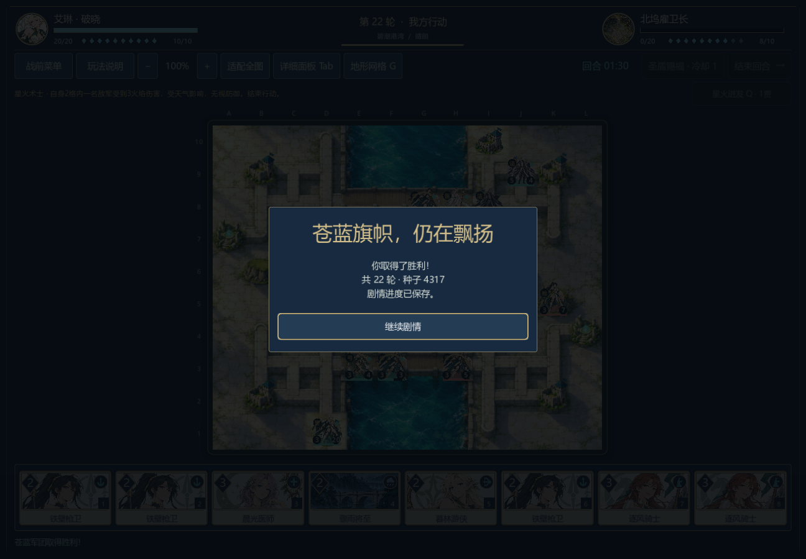
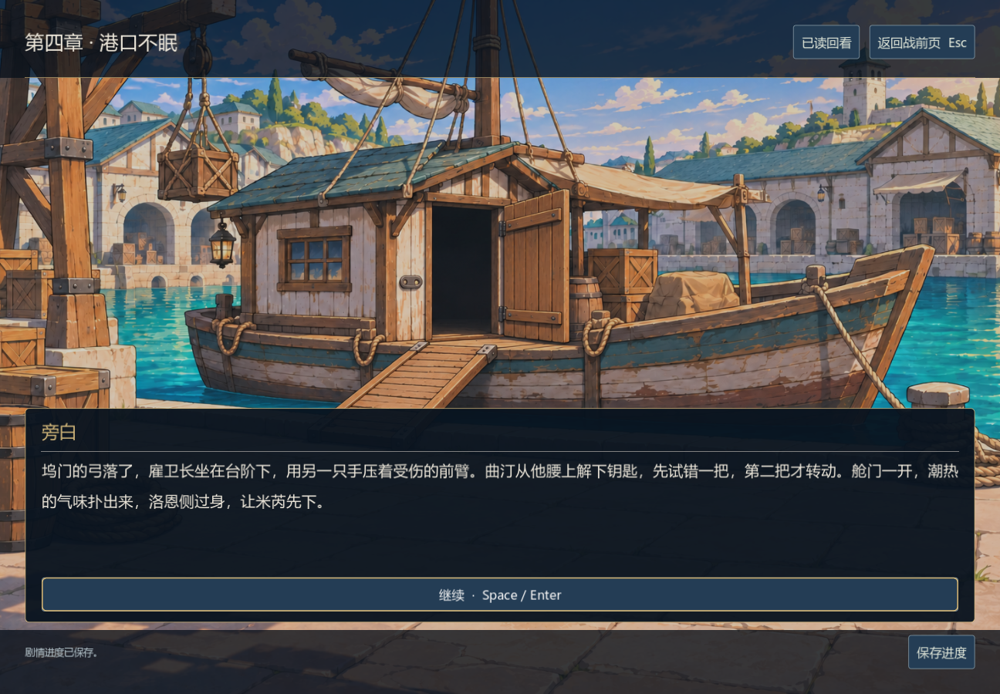

# 防御决策与北坞推进

0.28.0-dev，2026-11-06。枪兵的援护与步兵补盾改为检查公开棋盘上的实际可达位置和防护收益。北坞在当前策略下由32轮疲劳获胜变为22轮直接击败敌指挥官，并完成真实退出续战；整体战役难度仍未通过验收。

## 已复现的问题与修正

旧援护评分只检查直线距离加移动力，会奖励隔墙敌人、费用不足以穿过高地的敌人，以及下回合仍被定身的敌人；同一目标已被较早的枪兵援护时，另一枪兵仍会获得重复保护收益。法师能以同等致命的技能绕过援护，也曾被算成可以救下的情况。补盾没有区分已有护盾是否足够，以及真实伤害风险与隔墙距离。19项针对性检查中旧版7项失败；新版全部通过。

新评分复用每次决策建立的可达位置，按正常的下一回合状态处理新兵、行动刷新与定身期限。援护只评估普通攻击；同一敌人的多个位置/多个可保护友军最多计一次攻击，不会把一个敌人算成数个。已有援护顺序、目标护盾、伤亡代价和枪兵承伤一起考虑；同等有效的绕过援护法术不会被算作救命收益。盾量与伤亡按单位累计，避免每个敌人都重复消耗一份不存在的完整护盾。

补盾比较当前护盾与技能后护盾能避免的生命损失。由于护盾会保留到以后，无即时威胁时仍保留较低的准备收益；它应让位于正常推进和攻击。评分仍是启发式，未穷举敌人的完整回合、手牌、天气变更或连招，不保证所有决策最优。

另用20个实际移动/攻击局面核对预估：六兵种、平地/高地/工事、精准射击，以及骑兵绕障碍走四步却只平移两格的冲锋。冲锋先计入伤害再执行最低1点截断，避免重甲上凭空多出伤害。共59项防御专项通过。其余规则/AI/六技能/效果/目标/计时/快照/会话940项，含12场基础完整对局；两个测试玩家94个真实回合开局的公开信息/不变性477项，共 **1476项模型检查**。

## 完整诊断没有隐藏退步

| 正式关卡 | 0.27双方生产策略 | 0.28双方生产策略 | 当前行动数 |
| --- | --- | --- | ---: |
| 军道 | 胜 | 胜 | 151 |
| 河岸 | 败 | 胜 | 397 |
| 首章桥关 | 胜 | 败 | 425 |
| 救济守桥 | 期限败 | 期限败 | 156 |
| 种粮守桥 | 驻守胜 | 驻守胜 | 87 |
| 交接所 | 胜 | 败 | 380 |
| 风口接应 | 驻守胜 | 驻守胜 | 55 |
| 山脊押运 | 胜 | 败 | 468 |
| 北坞接人 | 胜 | 胜 | 269 |
| 泵房 | 败 | 败 | 353 |
| 暮林保苗 | 驻守胜 | 期限败 | 155 |
| 暮林清渠 | 胜 | 胜 | 168 |
| 棋庭 | 败 | 败 | 104 |
| 日陨隔离 | 期限败 | 期限败 | 137 |
| 日陨缓压 | 败 | 败 | 258 |

当前生产组共3,563动作、6胜9败，旧组为3,574动作、9胜6败；总动作只少11，不能宣称整体节奏已改善。北坞从413动作/32轮降到269动作/22轮，清渠从206动作/16轮降到168动作/14轮；其他长局仍存在。胜负变化来自双方都使用新AI，不等于真人难度或胜率。

港口/棋庭测试玩家另成一组：北坞352行动败、泵房90行动胜、棋庭445行动胜（第31轮敌方回合结束）。日陨中央阵形玩家两场均败：隔离136行动期限败、缓压130行动指挥官败。前者0.27曾获胜，现不可继续引用为当前胜例。三组共20场全部保留，包括所有失败；与旧0.27三组一起独立重放 **19036项**通过，核对完整状态、牌序、随机状态、计时和战报。

## 当前北坞原生胜局

真实窗口第25行动、内部turn8敌军待行动时菜单保存并正常关闭；新Windows进程加载剩余时钟和完整局面，现场敌方AI继续，玩家通过实际手牌/棋盘/技能按钮走完269动作。第22轮法师直接击败敌指挥官，双方疲劳均为0，己方指挥官仍20/20生命。

写入76项、读取续战643项，共 **719项原生检查**。胜后实际点击继续剧情进入`c04.ashore.01`，`crew_safe`为真、尚未获得泵房战果，再新建会话从磁盘恢复验证不重复结算。前三章入口仍使用叙事胜利夹具，这不是连续十战通关。





本次没有修改伤害规则、资源、套牌、关卡、正文、美术或UI布局，90秒每回合时限保持。正文仍60,703已写汉字；全页面证据的正文/UI源码哈希保持一致，未重复跑全剧情页面。当前日陨两线、其余分支、完整连续流程、长局、外部试玩和发行构建仍待完成。

[源码与记录哈希、完整结果](defensive-decisions-v028.json) · [0.27港口与棋庭历史记录](harbor-court-playthrough.md)

```sh
godot --headless --path . --script tests/test_defensive_ai.gd
godot --headless --path . --script tests/benchmark_campaign.gd
godot --headless --path . --script tests/benchmark_campaign.gd -- --harbor-player
godot --headless --path . --script tests/benchmark_campaign.gd -- --sunspire-player
godot --headless --path . --script tests/test_sunspire_pilot.gd -- --harbor-player
godot --headless --path . --script tests/test_sunspire_pilot.gd
godot --headless --path . --script tests/test_campaign_replays.gd -- --fixture=res://tests/fixtures/campaign_v028_selfplay.json
godot --path . --audio-driver Dummy --script tests/test_campaign_playthrough_ui.gd -- --scenario=c04_dock --write
godot --path . --audio-driver Dummy --script tests/test_campaign_playthrough_ui.gd -- --scenario=c04_dock --read
```

原生写入/读取必须串行。测试入口现在默认读取0.28记录，明确拒绝没有当前获胜记录的路线；可以用`--fixture`显式指定其他记录，但敌军仍现场执行当前AI。复现历史原生证据需检出对应提交，不能只换旧动作文件。
