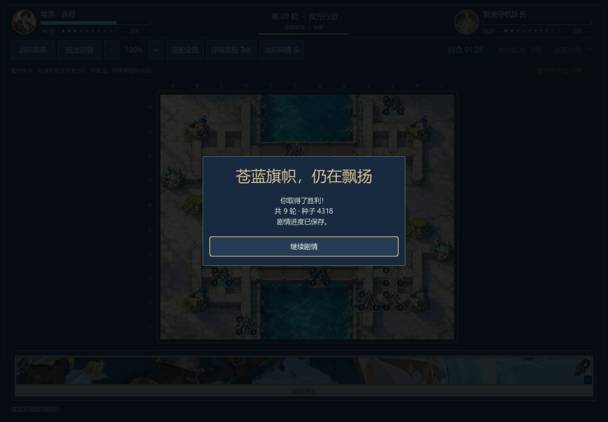
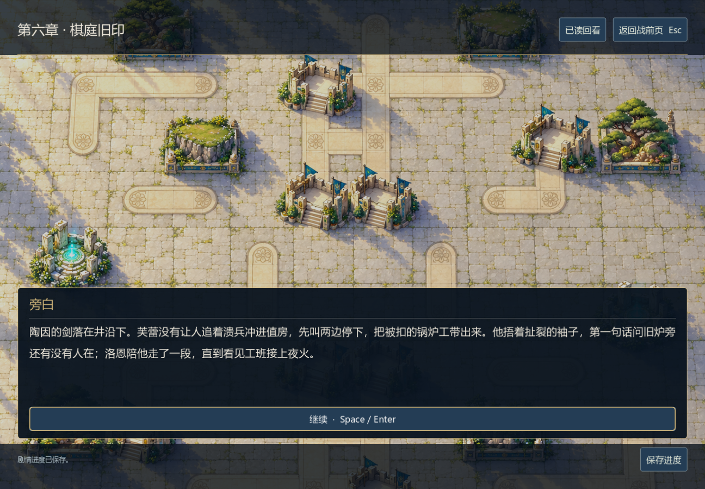

# 法师决策修复与港口、棋庭续战

0.27.0-dev，2026-11-06。修复法师有法力时仍偏爱低伤害普攻的问题；港口两战和棋庭分别从正式开局完成原生胜利、退出续战和战后存档。它们仍不是连续十战通关或难度终验。

后续0.28改进防御评分后，北坞另有22轮直接击败指挥官的原生胜局。本文三场原生证据和默认复现命令属于0.27提交`3799941`，当前记录见[防御决策与推进](defensive-decisions.md)。

## 法师为什么不用技能

同一名法师面对两格外工事中的枪兵时，普通攻击只有1点伤害；星火晴天3点、雨天2点，却因两类动作使用不同评分基准而被低估。晴天、雨天的动作选择复现先失败。现在星火与攻击共用收益尺度，按天气、实际护盾和目标生命计算，明确不触发援护或反击，并扣除与弓手技能一致的法力机会成本。23项AI检查通过，另验证无蓝时仍能普攻、法术击破护盾并绕过援护。

本次只改AI动作估值，未改伤害公式、兵种/英雄数值、套牌、地形、关卡资源、90秒或目标期限。存档格式不变，读档后后续AI选择会使用新评分。

## 所有胜败都保留

修复前15关记录由0.23的13关与0.25的两关按原行合并；已核对同一旧AI源码哈希，并重新完整重放。旧文件不覆盖。当前15关共3,574合法行动、9胜6败，未出现非法动作或行动数封顶；修复前为3,723行动、9胜6败。首章桥关由败转胜，河岸由胜转败，因此不能用总胜率证明体验改善。两个样本的决策耗时来自不同运行，不能推成性能提升。

| 正式关卡 | 修复前 | 当前双方生产策略 | 当前行动数 |
| --- | --- | --- | ---: |
| 军道 | 胜 | 胜 | 182 |
| 河岸 | 胜 | 败 | 521 |
| 首章桥关 | 败 | 胜 | 246 |
| 救济守桥 | 期限败 | 期限败 | 145 |
| 种粮守桥 | 驻守胜 | 驻守胜 | 88 |
| 交接所 | 胜 | 胜 | 393 |
| 风口接应 | 驻守胜 | 驻守胜 | 56 |
| 山脊押运 | 胜 | 胜 | 412 |
| 北坞接人 | 胜 | 胜 | 413 |
| 泵房 | 败 | 败 | 378 |
| 暮林保苗 | 驻守胜 | 驻守胜 | 127 |
| 暮林清渠 | 胜 | 胜 | 206 |
| 棋庭 | 败 | 败 | 89 |
| 日陨隔离 | 期限败 | 期限败 | 123 |
| 日陨缓压 | 败 | 败 | 195 |

另有两个明确分组，均使用正式资源和公开信息：港口/棋庭测试玩家在北坞348行动败、泵房89行动胜、棋庭466行动胜；日陨中央阵形玩家在隔离108行动胜、缓压124行动败。缓压在0.26曾赢，新敌方法师评分改变了后续战局；[旧原生记录](sunspire-playthrough.md)仅属于旧版。新旧全部完整trace、最终牌序、单位、随机状态和计时均保留，不拼成一份筛掉败局的胜率。

## 三场实际退出与续战

| 实机遭遇战 | 玩家策略 | 行动数 / 轮数 | 写入 + 读取检查 | 战后段落 |
| --- | --- | --- | --- | --- |
| c04_dock | 生产策略 | 413 / 32 | 76 + 1011 | `c04.ashore.01` |
| c04_pump | 公开目标集火／棋庭中央集结 | 89 / 9 | 43 + 232 | `c04.after_pump.01` |
| c06_court | 公开目标集火／棋庭中央集结 | 466 / 31 | 83 + 1167 | `c06.after_court.01` |

合计 **2612项原生检查**。每场在内部turn8敌军待行动时菜单保存并正常关闭，独立Windows进程加载完整状态和剩余时钟，敌军现场自主行动；玩家使用真实手牌、棋盘和技能按钮。胜利后实际点击继续剧情，并新建会话再次读盘核对战果只结算一次。此前章节用叙事胜利夹具进入，不能计为连续战役。

泵房第9轮获胜、己方指挥官剩14/20生命。北坞第32轮依靠敌方疲劳结束；棋庭第31轮也经历大量疲劳抽牌，说明可通关但战斗节奏仍需改善。测试脚本的总安全超时放宽到600秒以容纳长局，游戏每回合90秒没有改变。





## 检查范围

规则、战斗、AI、六技能、效果、目标、计时、快照与会话共940项通过，含12场基础完整AI对局。两个测试玩家在85个真实玩家回合开局验证不改状态、不读取敌手牌/未来牌序/种子，共432项。相关模型总1372项；三组新记录独立重放9511项，历史记录另8916项。重放检查合法性与完整终态，不把旧动作仍合法当作当前敌军仍会选择它们。

正文仍为60,703已写汉字，未新增正文或美术。既有逐页呈现证据的正文/UI源码哈希保持一致，本轮未重跑全部剧情页面。长局、日陨缓压新败局、其他当前版本分支、连续十战、完整十万字、外部试玩及独立发行构建仍待完成。

[源码哈希、分组结果和检查摘要](harbor-court-v027.json)

```sh
godot --headless --path . --script tests/test_opponent.gd
godot --headless --path . --script tests/benchmark_campaign.gd
godot --headless --path . --script tests/benchmark_campaign.gd -- --harbor-player
godot --headless --path . --script tests/benchmark_campaign.gd -- --sunspire-player
godot --headless --path . --script tests/test_sunspire_pilot.gd -- --harbor-player
godot --headless --path . --script tests/test_sunspire_pilot.gd
godot --headless --path . --script tests/test_campaign_replays.gd -- --fixture=res://tests/fixtures/campaign_v027_selfplay.json
godot --path . --audio-driver Dummy --script tests/test_campaign_playthrough_ui.gd -- --scenario=c04_pump --write
godot --path . --audio-driver Dummy --script tests/test_campaign_playthrough_ui.gd -- --scenario=c04_pump --read
```

北坞与棋庭分别将最后两条的scenario替换为`c04_dock`、`c06_court`。三个默认夹具对应上表，必须一关的write/read完成后才开始下一关，共用测试存档。诊断生成文件写入工具目录，已发布fixture不被命令覆盖。历史0.26日陨复现需要检出其对应提交。
