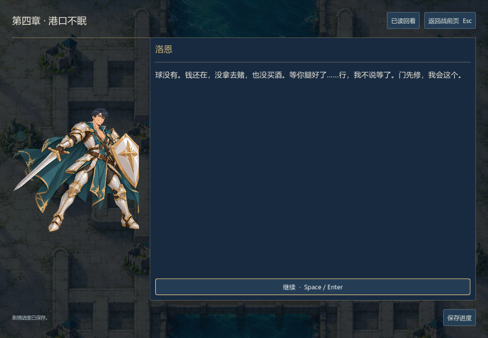
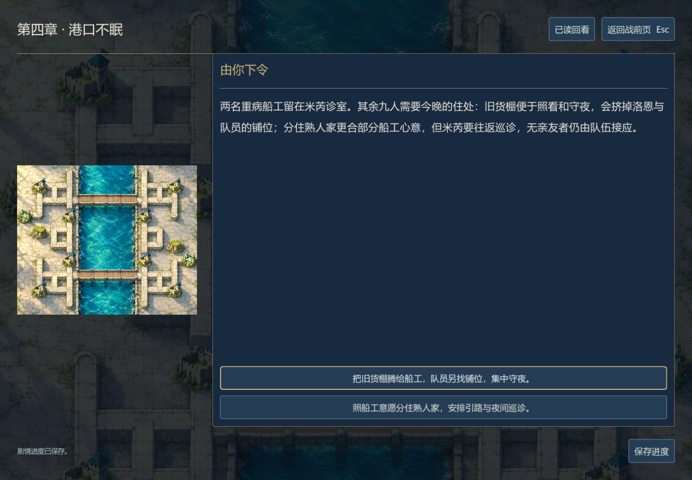

# 第四章《港口不眠》编辑与验证

0.19.0-dev，2026-11-06。继续采用`chinese-novelist`的串行场景设计、正文、人物声线与写后审读。此记录是编辑自审和程序验证，不是外部读者评价。

## 本章写什么

洛恩回到租下的货棚，却发现病床已经占了原先想留作球场与住处的地方。米芮的旧诊室无法再接下一整船病人。三人到东堤核实第三章的口信，亲眼见到返潮的锁舱；维洛的私人信用无法让雇卫放人，只能在争得岸位后处理自己出资的铸管线与欠饷。

港口不是一个全知反派的机关。曲汀要收回货款，炉工要拿到薪钱，杜棠要下船而不是替哥哥继续偿债，守机雇卫害怕停泵后的违约扣款。这些利益不因一场胜利立即消失。旧模线索在本章兑现：原模已熔，新模来自维洛亲自留下的修复图，缺口与编号可被复制；维修图不能赋予关闸命令效力。

玩家先决定船工集中住货棚还是分住熟人家，再决定维洛转让份额付清本批欠饷，或让出三年租息、先垫半数并逐人确认剩余款项。两次选择都有后文，分期线明确仍欠部分款，不能写成无代价保住资产。两名重病号始终留诊室，其余九人的安置、巡诊与夜班分别交代。

## 自审修订

- 洛恩、米芮在故乡有尚未兑现的承诺与现实工作，不只替主角赞同或解释。洛恩在码头按芙蕾的要求报位置，接人时留在岸边；门廊里的靠近延续上章信任，不突然确立恋爱关系。
- 新人物杜棠是成年船工、杜骞弟弟。杜骞仍在断脊接受留置；船员获救不撤销他拆机伤人的责任。曲汀管债务，雇卫拿钥匙，两者的权力与利益没有混写。
- 补写货棚侧间的空筐与预留铺位，避免已挤满的诊室凭空多出九张床。港口信使、栗雨轮休和两种补给路线都有空间与时间衔接。
- 上游来人的议事期限改为三日后，给主队从港口赶往支流留下时间，不让消息抵达时已经无法参与。第五章需兑现赛菈授权与上游取水，而不是再转去查一张无后果的单据。
- 排水泵与供给调候管线的新泵共用动力，锁在新泵侧造成低坞久不排水。战后由工匠轮换设备，坏粮仍不能食用，伤员也没有立刻康复。此处未宣称所有粮损都由同一原因造成。
- 具名说话人页只放直接对白，动作与多人交谈留在旁白；选择页说明当下代价。文字没有伪造游戏中尚不存在的护送NPC、水位倒计时、经济账户或死亡判定。

## 接入与证据

- 17节点、102条文本，其中96段正文，共6,024个独立中文汉字。继承前三章128种历史，再分四路，累计512条路径；每条第四章两场战斗，四章每条共七战。第四章单路线5,147–5,258字；按实际首选路线导出后，技能字数脚本独立得到5,174字。导出稿、设计稿、选项和本记录不重复计数。
- 四章共360段正文22,524字，加档案5,558字，当前已写28,082字。正常难度连续可达仍未验收，所以保守已交付统计仍为档案5,558字。完整十万字目标与外部审读尚未完成。
- 第四章4,633项模型检查、第三章1,045、跨章394、存储31、会话204、稳定游标18，共6,325项通过。覆盖继承事实、512条累计路线、失败不发战果、旧第三章结尾进入新章、过期回调拒绝、港口战局完整保存与结算一次。
- 原生Windows 3,085项检查通过：356段对白与4段章末全部渲染；真实跨章按钮进入第四章，安置/欠饷选项实际落入分支，1008×700窗口按钮不出界，泵房战前页打开正式港口关卡。正文源SHA256见`../narrative-native-ui.json`。
- 四张本章截图已逐张查看。剧情入口与战果使用测试夹具，港口只验证入场，**尚未证明第四章两战能在正常资源下连续通关**。专用港口剧情背景与NPC肖像仍待制作，目前复用港口地图与已有角色立绘。





[小窗口欠饷选择](../screenshots/chapter4-terms-small.png) · [正式港口战斗入场](../screenshots/chapter4-pump-opening.png)

```powershell
godot --headless --path . --script tests/test_chapter_four.gd
python tools/audit_narrative.py --output docs/narrative-audit.json
godot --path . --audio-driver Dummy --script tests/test_campaign_ui.gd
```

下一章连续性：返潮十一人均离船，两名重病者仍在米芮诊室；杜棠不再回船干活。旧泵夜班由本地工匠接管，北支流出口线索由赛菈记录。维洛处置权益的方式与未结余款按`foundry_terms`延续；安置按`harbor_shelter`延续。原模没有复活，老师的旧案仍需其他证据。
