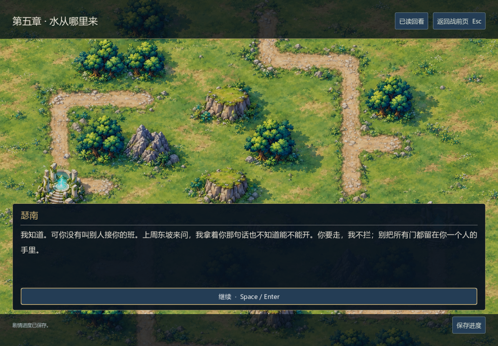
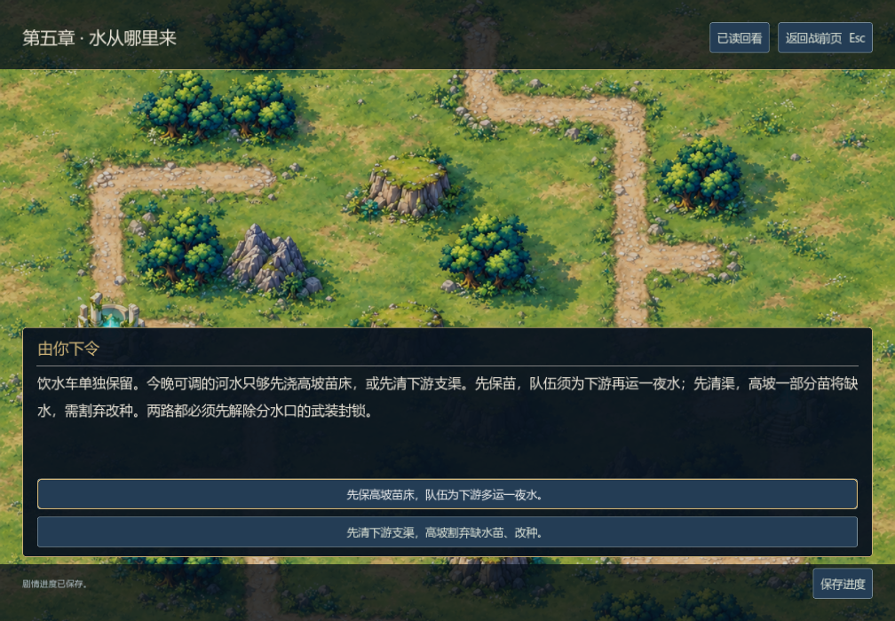

# 第五章《水从哪里来》编辑与验证

0.21.0-dev，2026-11-06。采用`chinese-novelist`串行设计、正文、声线审读与接入。这是编辑自审与工程证据，尚无外部读者评价。

## 本章的冲突与后果

赛菈回乡想先救苗，居民却不让她拿仅剩的饮水浇地。她留下的等候指示没有得到更新，代行旗已被撤下。母亲瑟南既曾因救下游难民失席，也曾把本地缺药的烂摊子留给邻居；她理解女儿，却不替女儿争取票数。渠首管事岑槐把沉泥坑填作工棚，隐瞒了排水去向，也怕失去自己与雇工的苗床。交战由他拒绝交出分水口并射箭阻拦引发。

玩家先选保高坡苗床或清下游支渠。两路都先留居民饮水；前者让队伍从西坡石泉运一夜水，后者需要割弃部分苗、改种短季作物。胜利后给工人交班、重新导污，病株没有复活，岑槐也未自动得到谅解。林社随后决定谁有权继续代表他们：有限续任需要共签与下月复议，交回代行印则让赛菈只以见证者同行。母女晚间对白随授权结果改变，不让交印的人仍承担续任义务。

米芮替伊瑟处理沾泥的脚，希弥拒绝莉希又一次不吃不睡地赶路；靠近来自疲劳中的具体照料，不以救援换取恋爱。维洛在前章选择售产或让出租息，本章分别保留已结清/仍欠款的事实。艾琳收到老师罗瑟的亲笔来信，他承认签过父亲的停职令，下一章必须兑现当面对质与原本查验。

## 自审后修订

- 地理因果明确为港口淡水被新管抽入高位旧池，冲洗盐泥后经维修沟进入苗圃支渠；不是海水逆流到山上。给夜间运水补出西坡石泉、当地带路人与往返约一时辰的距离，运桶量不能替代整个苗圃灌溉。
- 修正时间：代表按约在第三日下午到渠口议临时交接，同意观察夜班后第四日下午投票，不凭空把原定期限延后一夜。
- 瑟南十七年前失席，后来重新当选；本次有投票权。榆汀是受损苗圃的照料者，可以发言，但不是十二席之一。
- 赛菈的第二封信改为准备寄出却留在书里的信，避免信已寄出又随身取出的物件矛盾。她的疏漏不被外部阴谋抹掉。
- 具名页只放直接发言；旁白承接动作、场景与多人交谈。选择交代当前代价，实际战斗规则仅为驻守或击败指挥官，没有暗示未实现的运水、NPC护送、盐度或种田模拟。
- 施工令抄件与旧删款依据通向棋庭，原件留林社。老师签过停职令，不等于已证实父亲死亡或认定所有旧案责任，下一章不能借这一点跳过父亲与老师的具体经历。

## 接入与检查

第五章16节点、139条字符串，其中133段正文，共7,290个独立中文汉字。继承全部19项既有事实，新加分水、放水战果、代行权限与抄件四项。单路线5,784–5,839字；实际首选路线导出供阅读，技能字数脚本独立得到5,811字。正文JSON是唯一源，导出、选项、设计稿不计入总量。

第五章模型15,394项、第四章4,633、第三章1,045、跨章394、会话204、存储31、游标29，共21,730项通过。累计2,048条选择路径均检查，旧第四章存档可进入第五章；失败与平局不提前获得放水/抄件，援引过期战斗回调无效，完整战局的90秒时钟与驻守进度可保存恢复。模型中直接布置棋子与战果只证明结算和衔接。

最终Windows原生检查4,716项通过，覆盖488段对白和5段章末、1008×700的分水与授权按钮、读盘保持选择、暮林关卡真实入场以及此前剧情界面的回归。五章493段正文29,814汉字，加档案共35,372字已写；完整普通难度八战路线仍未证明，所以保守正常可达交付量仍为档案5,558字。第六章至结局、剩余正文、外部审读及统一美术仍待完成。





[赛菈回乡](../screenshots/v021-syla-home.png) · [交回代行印的选择](../screenshots/v021-mandate-small.png) · [正式暮林战斗入场](../screenshots/v021-grove-battle.png)

第五章仍复用暮林俯视图，瑟南、岑槐等配角尚无专用立绘；这批截图只证明当前页面状态，不代表最终剧情美术。

## 两场新战斗的正常资源诊断

| 关卡 | 诊断结果 | 合法行动 | 内部回合 | 驻守峰值 |
| --- | --- | ---: | ---: | ---: |
| 林岗的夜班 `c05_nursery` | 12完整轮到期失败 | 117 | 25 | 0 |
| 分水口前 `c05_channel` | 击败敌指挥官获胜 | 135 | 21 | 不适用 |

两场均用原始两名指挥官、牌组、种子、资源和生产敌军策略。测试用玩家以0.35秒固定行动节拍运行，没有改规则、初始兵力、数值或期限。全部252行动、耗时和完整最终存档保存在[公开重放夹具](../../tests/fixtures/campaign_v021_grove.json)，独立规则重放517项通过；[诊断摘要](../grove-diagnostics-v021.json)记录源码哈希与失败局面。决策峰值分别427.13毫秒、198.48毫秒，仍有优化空间。固定种子的一胜一败不能换算成人类胜率，也不构成原生战斗或五章连续通关证据。

```powershell
godot --headless --path . --script tests/test_chapter_five.gd
godot --headless --path . --script tests/test_campaign_replays.gd -- --fixture=res://tests/fixtures/campaign_v021_grove.json
python tools/audit_narrative.py --output docs/narrative-audit.json
godot --path . --audio-driver Dummy --script tests/test_campaign_ui.gd
```
