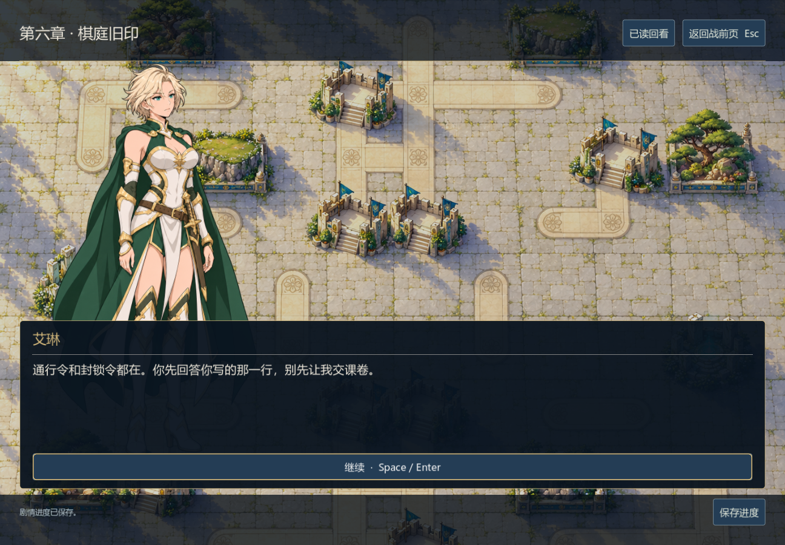
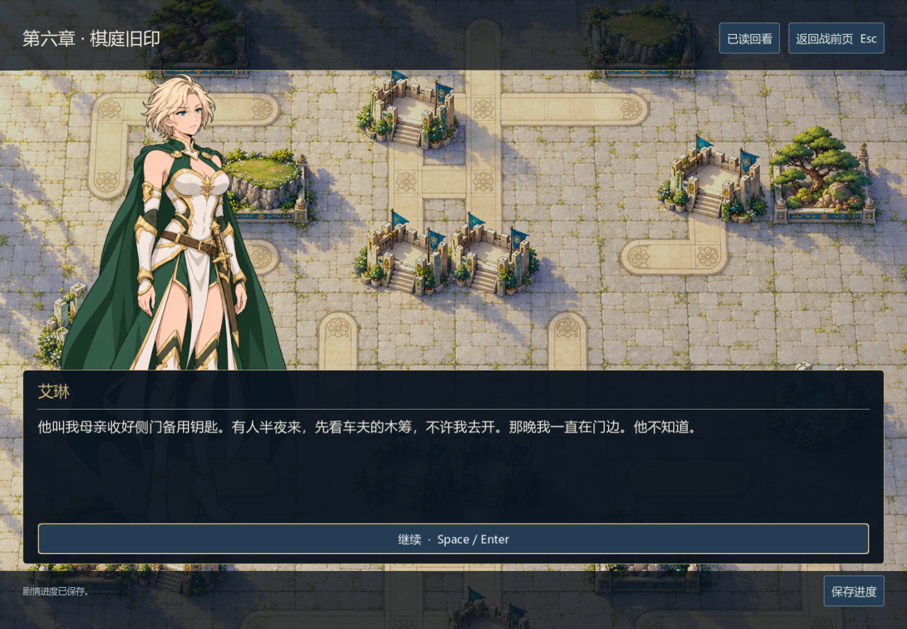

# 第六章《棋庭旧印》编辑与验证

0.22.0-dev，2026-11-06。按`chinese-novelist`串行续写，先读既有角色、第五章来信与章节骨架，再作场景设计、正文和因果审读。此记录不替代外部读者评价。

## 本章兑现什么

艾琳带着老师的来信到棋庭，却先被要求缴械、等待原件校验。她拒绝回到只听老师安排的学生位置。罗瑟亲手打开库房：停职令是真的，他当年改过拘提令，派去接人的车却与守桥人错开，后来还停止了查访。父亲的补记和家书让艾琳得到具体行踪和生活细节，尚不足以判断父亲如今的生死。

罗瑟还要面对现在的命令。他把修复同意与抄送见证扩大解释，调用未注销的紧急印，恢复已删除的停水款。陶因担心自己又被留下收拾断供和欠饷，扣留工班、拒交庭院指挥。老师不靠一番悔悟替玩家平息战斗；胜利后仍须接回旧炉、留住原件、给出可见结论。

公开路线当晚念出有害条款和签发人；质证路线让庭外代表留守监督，并在约定的次晨实际公布结论。两路都不公开无关病患家属姓名，也不把原卷搬进军车。第二个选择只关乎艾琳愿意怎样读自己的家书：同伴尊重独处，也可以留下，不用陪伴交换额外情报或恋爱奖励。

## 审读修订与连续性

- 旧桥备用钥匙、母亲补衣、十二岁时等车的记忆与既有档案相接；钥匙不忽然打开档库，也不改写为家门钥匙。家书从问话凭据中领回，有明确保管和交接过程。
- 父亲停职、车未接到、后补救援记录与老师停止查询分别发生，不能写成老师已知全部去向却反复隐瞒。补记指向日陨诊所，父亲仍失踪，下一章必须回应具体住户与转移名单。
- 补出附册末页工人的逐日水位记录，避免原始尖峰凭空出现；伊瑟带的是见证副本，常芷保留原页。盟约会签、抄送、扩大执行范围并未被混成同一种授权。
- 公开/次晨发布各自兑现，原件共同留馆；赛菈的有限共签或见证者身份持续影响她的发言，正式林社代表最后接手。维洛卖产/租息的款项事实继续保持。
- 买煤改为数钱、装袋和补路费的动作；读信选择删掉奖励提示式措辞。具名对白只保留直接发言，叙述不轮流给人物补上道德总结。

## 正文与工程证据

本章16节点136字符串，其中130段正文7,109汉字；单路线5,948–6,048字。首选公开/独处路线由JSON导出供编辑阅读，技能字数脚本得到5,997字。选项、设计稿、导出稿和提示词不计入游戏正文。

六章累计8,192条选择路径，每条九战；623段章节正文36,923字，加档案共42,481字已写。普通难度连续可达尚未证明，保守完整交付统计仍为档案5,558字，不能称已达十万字或发行质量。

关联模型合计83,576项通过，其中第六章61,467项，另有第五章、第四章、第三章、跨章、会话、存储、游标与剧情引擎检查。覆盖2,048种实际旧章历史、所有8,192种新结局、失败/平局不发战果、旧第五章存档进入第六章、过期回调拒绝、正常初始棋庭战局和77.5秒剩余时钟恢复、结算一次。模型直接设置战果只验证衔接。

最终Windows原生6,562项通过：617段对白与6段章末、每个条件正文ID、1008×700两组选择、真实落入分支与读盘保持、棋庭正式入场、旧章界面回归。页面收集只合并当前及后续显示条件一致的章首历史；全历史存档验证独立保留，不丢弃后续条件段落。

## 艾琳对白立绘

实机复看发现原战斗图的笑容、扬剑姿势与父亲家书不合。用原三角色图集中左侧艾琳为身份参照，原生`image_gen`制作静立、收剑、克制表情的对白图；短金发、青绿披风、白金轻甲与成年比例保留。随后生成一次透明轮廓清理版本，最终1024×1536 RGBA原PNG完整复制，无脚本像素修改，933,736像素全透明。已核对真实窗口没有外圈背景色，开启mipmap；战斗/卡面仍用原有素材。

这是一张共用的平静对白姿态，不是完整表情差分。其余八角色仍使用战装，第六章背景暂用古堡俯视图，新NPC没有专属肖像。完整提示词、两次来源与原图哈希见[提示词](../../assets/art/narrative/warden-dialogue-prompts.json)和[来源记录](../../assets/art/narrative/warden-dialogue-source.json)。





[父亲记录](../screenshots/v022-father-record.png) · [证据处置小窗](../screenshots/v022-evidence-small.png) · [读信选择小窗](../screenshots/v022-letter-small.png) · [正式棋庭入场](../screenshots/v022-court-opening.png)

## 新关卡诊断

`c06_court`原始资源、固定种子6317、测试用谨慎玩家对生产敌军，206合法行动后己方指挥官被击败（内部turn32）。完整失败局面保存在[重放夹具](../../tests/fixtures/campaign_v022_court.json)，独立规则重放420项通过。[诊断摘要](../court-diagnostics-v022.json)含源码hash；运行时同时进行了章节验证，因此决策耗时不作为独立性能基准。没有为得到胜局改兵力、牌序、数值或敌军策略；尚无棋庭正常资源胜利或六章连续通关证据。

```powershell
godot --headless --path . --script tests/test_chapter_six.gd
godot --headless --path . --script tests/test_campaign_replays.gd -- --fixture=res://tests/fixtures/campaign_v022_court.json
python tools/audit_narrative.py --output docs/narrative-audit.json
godot --path . --audio-driver Dummy --script tests/test_campaign_ui.gd
```

同轮补验第五章清渠路线：两个原生进程75+346项通过，从原始资源打赢、退出再续战并进入真实战后对白。[单场续战证据](../channel-playthrough.md)。此项不扩大为六章连续可达结论。
