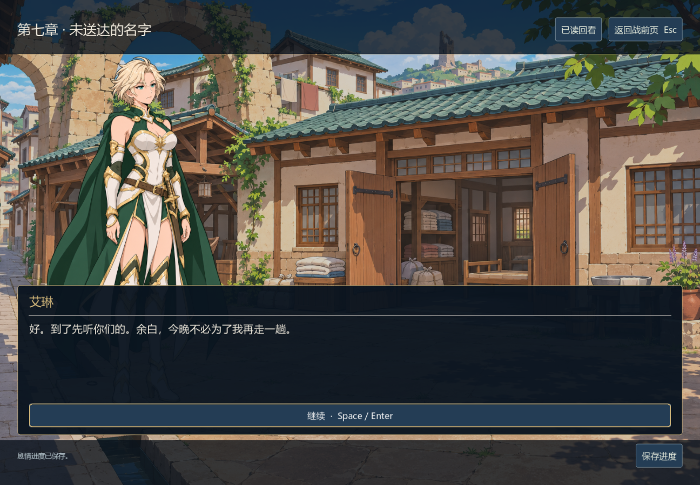
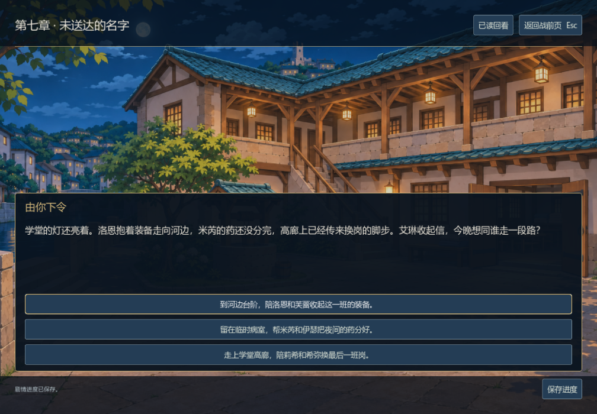
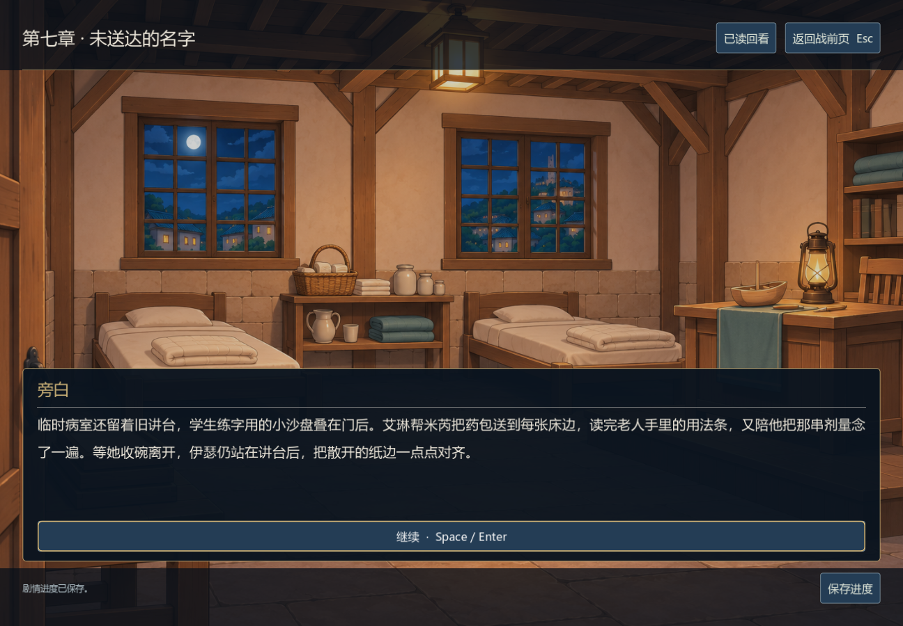

# 第七章《未送达的名字》编辑与验证

0.24.0-dev，2026-11-06。按 `chinese-novelist` 串行完成场景设计、正文、连续性审读和游戏接入。本文记录具体改动与验证范围，不代替外部读者评价。

## 搬家、回访与一晚同行

艾琳想问父亲，秦婶先让她抬被卡住的床。东街八户十九人要临时搬到北街学堂，余白还欠买主一条不能下水的船。队伍先解决门宽、床位、船架和饮水，才有机会听当年的转移者自己说话。赫姆听见自己的“交讫”如何误导家属，却没有因此得到一句现成的原谅。

四个旧称呼有不同的人生：余白与唐穗后来找到家人；叶成已病故；阿蓼随戏班离开，至今没有可靠住址。余白记得父亲曾替他喂水，也见过父亲跟着空担架往东侧过水廊走。发热中的目击和秦婶记得的绳索仍不足以证明父亲生死。余白愿意翌晨带路，但午前得回来修船。

搬迁和信件安排落实后，玩家选择一条营地支线。河边的洛恩与芙蕾谈货棚、回信和换班；病室的伊瑟与米芮先面对校录责任，再一起做一只木船；高廊的莉希与希弥读家信、等接班、练短笛。每条都在次晨留下实际回应，关系的推进不靠统一好感条，也不靠救援或治疗换取亲密。本章不新增战斗，接在前六章每路线九战之后。

## 审读修正

- 第七日塔熄灭，第八夜仍有余震；伊瑟当年十一岁，承担的是后来新档校录时的责任，不能写成十七年前值塔者。他手里只有原始观测的副本与自己的计算稿，没有凭空拿到旧签字原页。
- 私人读信回忆改回棋庭，避免把旅行前的事写成昨夜；莉希姐姐的回信对应实际 `return` / `unscheduled` 分支值。维洛售产与租息、赛菈共签与见证者身份都持续有差别。
- 船棚先写成洛恩的误判，再由维洛提出滑架；移除旁白“必须拆撑木”和实际可不拆之间的矛盾。芙蕾右肩不能抬高，搬船没有治愈旧伤。
- 换班明确发生在夜里，清晨回应不再倒置时序；巡廊改用白灰圈标记缺砖，避免拿小石头制造新的绊脚物。木船靠近灯火的担忧改成可理解的动作。
- 唐穗不再替作者解释自己并非等待主角；她讲秦婶来买饼时仍问她吃没吃饭。锁门前找猫、留门槛、改修船约定等动作承担居民生活细节。
- 章末从重复复述线索改为水位越过刻线、廊内提灯熄灭；人物先停止下探，接第八章现场核查。它不是已实现的动态水位玩法。

## 正文与存档

本章14节点、229字符串，其中225段正文 **10,143汉字**；单路线 **6,899–7,181字**。三条营地的默认旧选择路线从唯一JSON正文导出审读，并运行写作技能的字数脚本。导出稿、选项、标题、提示词和设计文档不额外计数。

七章共848段章节正文、47,066汉字，连档案 **52,624字**。全图审计覆盖累计24,576条选择路线，无未引用或不可达正文，无完全重复正文。图遍历假设前九场战斗获胜；正常难度连续战役尚未证明，不能把52,624字宣称为完整已验交付或十万字完成。

本章模型3,650项通过：从第一章实际选择和战果夹具构造32组继承条件，再分别走完三条营地支线，共96条代表性历史。覆盖229条字符串、27项旧事实不被重写、单个营地选择、无新增战斗、完整历史快照、旧六章结尾进入、过期回调拒绝、三条支线中途保存和新会话精确读回、跨章回看、未写第八章不提供入口。96条不冒称全部24,576种存档历史。

同时重跑既有六章全历史61,467项、剧情引擎379、游标29、跨章394、会话204、存储31，合计 **66,154项模型检查通过**。既有8,192条六章历史均保留，没有用直接改旗标替代真实旧选择。

最终 Windows 原生 **8,896项通过**：841段对白及7段章末，每个条件正文ID都存在且实际打开；旧六章结尾按钮进入第七章、1008×700三个实际营地按钮、选择后磁盘恢复、四场景纹理以及既有章节界面回归通过。入口仍用叙事胜利夹具，不是九战连续通关。

## 四张场景

新增日陨东街、学堂夜景、同构学堂日景、学堂临时病室，均为1536×1024原生生成PNG，保留原字节，Godot使用无损导入与mipmap。夜景初稿左侧多画了一座同样的断塔，编辑移除后才用于生产；白天与病室版本以修正的夜景作为建筑/风格参考。

源图与七张实机截图已逐张查看，昼夜建筑与颜色一致，阅读区域和三选项可用。背景是环境插画，不精确模拟人物移动；桥边与高廊暂共用学堂全景，过水廊入口仍用东街建立场景。配角肖像、其他八位同伴的生活姿态与前三/五/六章专用场景仍需补齐。

[完整提示词](../../assets/art/narrative/chapter07-prompts.json) · [来源、父图和SHA256](../../assets/art/narrative/chapter07-sources.json)







[东街开场](../screenshots/v024-eaststreet.png) · [白天学堂](../screenshots/v024-school-day.png) · [河边营地](../screenshots/v024-river-camp.png) · [高廊营地](../screenshots/v024-gallery-camp.png)

```powershell
godot --headless --path . --script tests/test_chapter_seven.gd
godot --headless --path . --script tests/test_chapter_six.gd
godot --path . --script tests/test_campaign_ui.gd
python tools/audit_narrative.py --output docs/narrative-audit.json
```

外部阅读、全文结局、当前AI下连续通关、平衡试玩与独立发行构建仍待完成。当前没有提交Steam审核。
