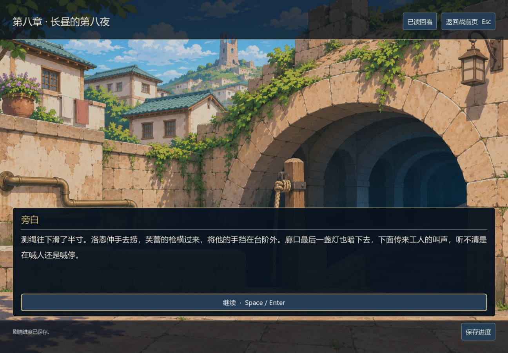
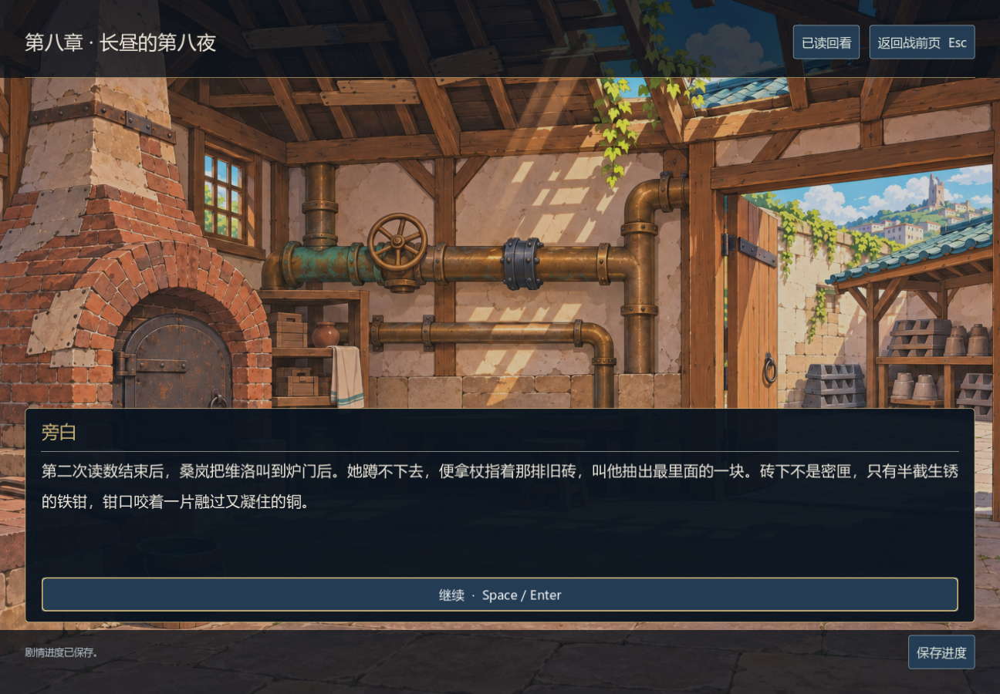
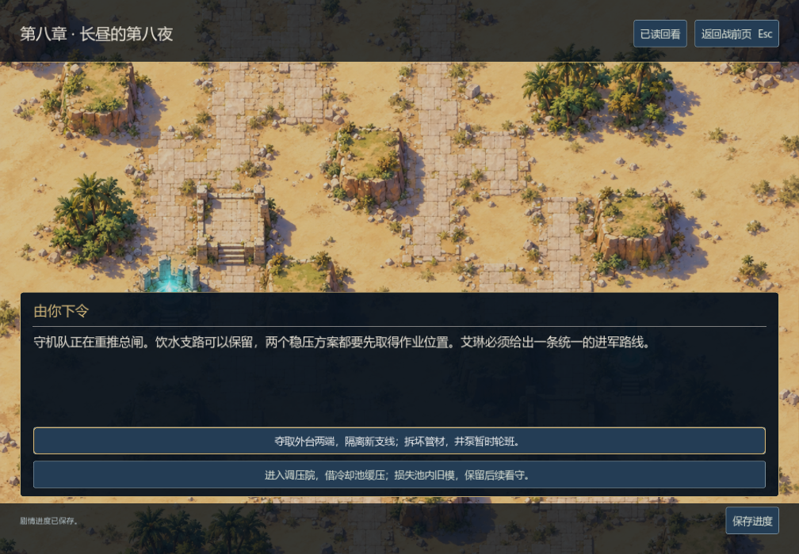
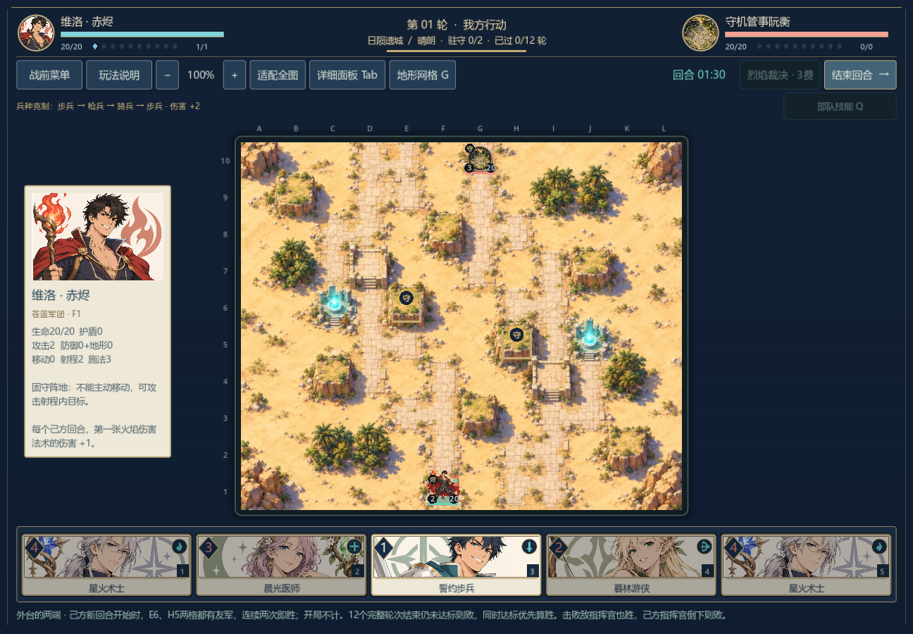
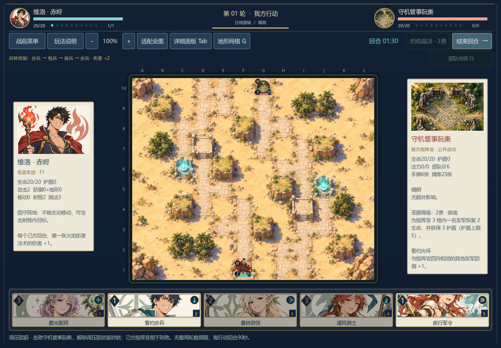

# 第八章《长昼的第八夜》编辑与验证

0.25.0-dev，2026-11-06。继续使用 `chinese-novelist` 串行设计、写作、审读与接入。以下记录开发者自审和运行证据，外部阅读评价仍待收集。

后续0.26已验证两条路线的正常资源原生获胜、退出续战与战后保存，见[日陨通关记录](../sunspire-playthrough.md)。下文保留0.25的四场败局及当时边界。

## 灯落水以后

工班的提灯落进过水廊，队伍先把滑倒的工人拉上来。伊瑟发现工班正在用自己校录过的总图：他曾把缺失的尖峰留在待补批注里，批注却没有随总图送到这里。他必须当着正在承担风险的人说明自己签过什么，再让本地水工复测，而不能等找出最早的删改者才开口。

旧水工桑岚认出维洛，也认出新管上沿用的接口。师父在第五夜关闭过主阀，后加的旁通却绕开了它。维洛留下的修复图、桑岚后来报作停用的支线、伊瑟没有送出的批注，分别造成不同后果；没有一个人知道整个灾害的全部经过。

守机管事阮衡扣着手轮。他怕北区井泵停下，也怕自己成为唯一留下担责的人，于是仍命卫队继续压送。玩家可以隔离新支线、拆掉尚能用的管材，或者用冷却池缓压、牺牲寄存的旧模与料。两条路线都要通过实际战斗解除守机队的控制，修复由战后的工班执行。

桑岚亲历维洛师父被押、班房震塌后的收殓与安葬。维洛去旧工人墓地探望，回来时鞋上带着红土。父亲的线索却只能走到过水廊旧担架架旁：桑岚不能辨认当晚的桥守，也没有能认定身份的遗物。艾琳保留查找的现场，按约回学堂送消息，听秦婶要求在开课前腾出教室。章末先约已经在城里的工班与居民看外台，再给远处代表送信，正式会面须等人抵达。

## 连续性与修订

- 桑岚现65岁、阮衡46岁。伊瑟是后来校录者，不是十七年前原图的删改人；三个营地分支分别承接已听过、尚未听过自白的区别。
- 第五夜关主阀、第六日拘押、第七日班房坍塌、第八夜转移伤者分开。桑岚将旁通记作停用发生在灾后第五年，不与灾前三个月删峰混为一次行为。具体删峰者尚未证实。
- 维洛已在前章承认熔毁原模；炉下残件和修复图不是原印复活。售产/租息与欠饷约束仍在，桑岚女儿所有的木样不能由他擅自抵偿。
- 两种方案都留饮用支路；隔离路线井泵轮班，缓压路线维持夜班。共用章末改为“临时接法只够维持眼下的用水”，避免把轮班结果误套给缓压路线。
- 删除没有正文根据的“月平均”技术解释和洛恩已经答应补屋顶的说法；其手伤与芙蕾肩伤持续存在。莉希送伤者回学堂，栗雨仍需休息，午前消息和傍晚回访兑现。
- 远处的林社与两城代表不会隔夜全部到达。次日仅已在城里的人员看现场；赛菈的共签权限明确限于上游三处，不获得日陨城的当然管辖权。

## 正文、历史与存档

本章16节点、186字符串，其中183段正文、**8,079个去重汉字**；任一选择路线本章阅读量7,105–7,144字。默认旧选择下，两份从唯一JSON导出的审读路线分别7,133与7,144字，写作技能的字数检查通过。选项、标题、提示词、导出稿和本文不额外计数。

八章共1,031段正文、55,145汉字，连18篇档案总计**60,703字**。图审计覆盖49,152条累计选择路线，每条十场战斗；无完全重复或不可达正文。图遍历假设战斗获胜，正常难度连续通关仍未证明，保守完整可达交付量仍为档案的5,558字。

第八章模型1,135项通过：由真实旧选择和战果夹具构造12组代表性历史，再走两种方案，共24条；覆盖全部186字符串、28项旧事实、选择与战斗对应、战败/平局不授予战果、重试计数、旧七章末进入、过期回调、跨章回看、精确时钟恢复、两种胜利夹具的磁盘保存和结果仅消费一次。24条存档历史不冒称49,152种全历史；全选择图的文本可达性由独立审计检查。

相关模型合计**5,856项通过**：本章1,135，第七章3,650，剧情引擎381，游标29，跨章394，会话204，存储31，目标32。旧六章61,467项全历史是0.24的历史证据，本轮未重新执行。

最终Windows原生**10,790项通过**：1,023段对白、8段章末全部实际打开；旧七章进入八章，1008×700两个实际选择、磁盘恢复、新背景加载、两个正式战前页与开局目标、既有界面回归通过。五张新截图均已查看。此前战斗通过叙事胜利夹具进入，不是十战连续通关。

## 两种战斗仍需通关与难度处理

两关均用日陨地图、维洛对守机管事阮衡。隔离方案须在E6、H5连续两次己方新回合检查时都有友军，12个完整轮次期限；击败指挥官也可获胜。缓压方案没有整体轮次期限，击败指挥官获胜。两者都是每行动回合90秒，没有动态水位伤害、护送或材料库存玩法。

| 测试玩家 | 关卡 | 合法行动 | 结束行动回合 | 结果 |
| --- | --- | ---: | ---: | --- |
| 生产策略 | 隔离 | 123 | 25 | 驻守期限败 |
| 生产策略 | 缓压 | 194 | 30 | 指挥官败 |
| 谨慎策略 | 隔离 | 137 | 25 | 驻守期限败 |
| 谨慎策略 | 缓压 | 180 | 28 | 指挥官败 |

敌方均为当前生产AI，正式初始资源、空军队与固定关卡种子。全部634行动及最终状态保留，两组独立重放各647项，合计**1,294项通过**。没有为获得胜局而改数值、资源或期限；也没有把全部失败解释成人类一定不能通关。单次决策峰值64.84–117.62毫秒仅为这四个本机样本，不是隔离环境性能基准。详见[来源哈希与完整诊断摘要](../sunspire-diagnostics-v025.json)。

## 场景与剩余工作

新增过水廊、旧炉坊两张1536×1024原创环境图，沿用日陨东街的石材、青绿管道和色彩。原PNG完整保留，Godot无损导入与mipmap。炉坊初稿门外画了空的小水池，与缓压后的共用场景冲突；使用原生图片编辑去掉该池，主冷却池在画面外，才采用修正版。源图与原生画面均已查看。

[完整提示词](../../assets/art/narrative/chapter08-prompts.json) · [来源和哈希](../../assets/art/narrative/chapter08-sources.json)











调压现场目前仍复用俯视战场背景；桑岚、阮衡等配角专属肖像、更多生活姿态待补。四场诊断皆败，下一步需处理合法获胜策略、目标关节奏和完整连续战役；第九、十章及其余支线未写完，十万字、外部审读、音频、独立发行与Steam准备仍未达标。

## 复现

```sh
python tools/audit_narrative.py --output docs/narrative-audit.json
godot --headless --path . --script tests/test_chapter_eight.gd
godot --headless --path . --script tests/test_campaign_replays.gd -- --fixture=res://tests/fixtures/campaign_v025_sunspire.json
godot --headless --path . --script tests/test_campaign_replays.gd -- --fixture=res://tests/fixtures/campaign_v025_sunspire_cautious.json
godot --path . --script tests/test_campaign_ui.gd
```
