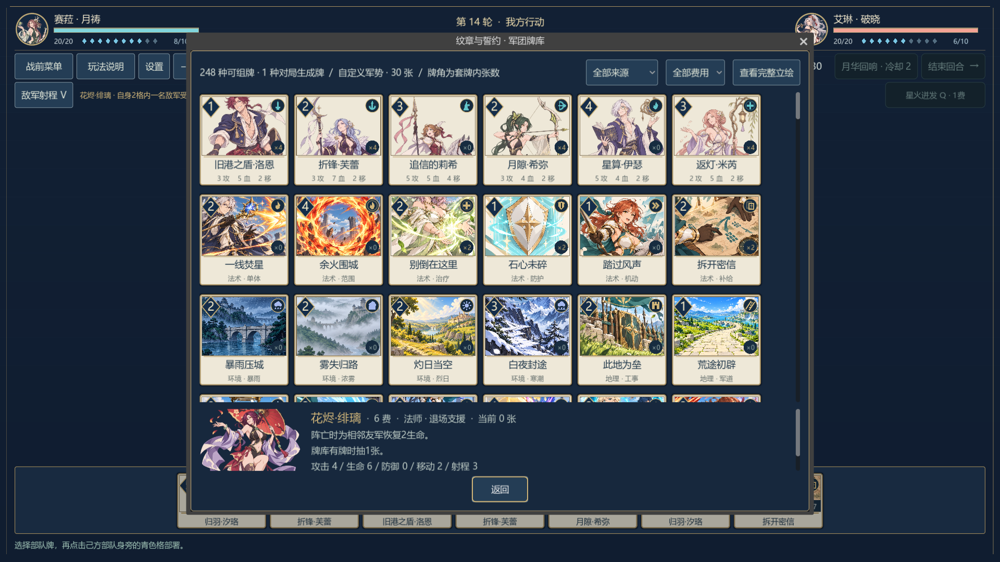
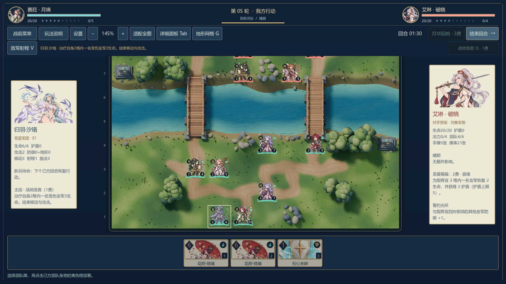

# 0.63 · 群像重绘与新牌名

81 张部队牌与 3 位指挥官全部重新设计，提供 84 张成年角色完整立绘和 84 个对应的 Q 版战场人物。卡牌、人物档案和对白使用成年比例立绘，棋盘使用独立绘制的小比例人物。男性角色、女性角色、发色、服装和武器按同一个角色编号对应。

本版以已经认可的白羽医师、花伞法师为基准，统一细线、平涂和淡紫阴影。人物采用站立、侧身、拉弓、骑乘、坐姿和跃起等不同构图，成年角色的服装包含露肩、露腰与高开衩设计。姿态研究参考[《梦幻模拟战》皮肤一览](https://wiki.biligame.com/langrisser/皮肤一览)，交付图像在本项目中重新生成，参考站的角色原图没有加入游戏资源。

[全部 84 组总览](cast-v063.webp) · [完整 PNG 目录](../../assets/art/characters/v3/full) · [提示词、生成文件名与 SHA-256](../../assets/art/characters/v3/production.json)

249 张牌全部重新命名，包括部队、法术、陷阱、环境牌和对局生成牌。可构筑的仍为 248 种，另外 1 种在对局中生成。费用、属性、效果、牌组数量和稳定编号保持原值。

| 旧名 | 新名 | 类别 |
| --- | --- | --- |
| 河岸随军医 | 归羽·汐珞 | 部队 |
| 灰烬见证人 | 花烬·绯璃 | 部队 |
| 撑渡枪夫 | 老渡鸦·杭铎 | 部队 |
| 晨曦祷言 | 别倒在这里 | 治疗法术 |
| 乘势追击 | 今夜不收刀 | 续攻法术 |
| 伪灯诱撤 | 那盏灯是假的 | 陷阱 |

[249 张命名对照表](card-names-v063.md)。教程、规则说明、战前预组介绍、战役简报和选牌提示同步采用新名称。旧战斗存档仍按原编号恢复，通用部队名更新为新牌名，剧情专名保留。

在游戏中打开 **牌库**，点选部队卡，再点 **查看完整立绘**。插图以完整比例适配窗口；1008×700 的原生渲染检查也已通过。三位指挥官及六位主角的完整形象还可在 **共誓档案** 查看。

实机取景从正常战前菜单进入双桥河谷，使用包含两张示范角色的自定义军势。第 32 个合法行动部署归羽·汐珞，第 65 个行动部署花烬·绯璃，随后各自使用主动技能。手牌、悬停肖像、战场棋子与读档后的身份保持对应。

| 验证内容 | 结果 |
| --- | --- |
| 84 个角色的卡面、完整立绘、Q 版映射及双方合法部署 | 993 项，0 失败 |
| 战斗存档、历史版本续战、名称迁移与教程命名 | 838 项，0 失败 |
| 原生菜单、合法对局、249 张详情、81 张完整立绘和小窗口 | 874 项，0 失败 |
| 原生攻击、援护、反击和退场时序 | 139 项，0 失败 |
| 原生兵种、指挥官和法术施法时序 | 221 项，0 失败 |
| 原生特效来源、命中、退场与真实费用/名称 | 153 项，0 失败 |
| 人物档案目录、文字、图片与模态暂停 | 118 项，0 失败 |
| 原生主界面、牌库筛选、费用预览与窗口布局 | 497 项，0 失败 |
| 战役难度及历史战中档 | 331 项，0 失败 |
| 教程、设置与引导流程（无界面模式） | 91 项，0 失败 |
| 六组扩展卡规则及历史存档 | 1,422 项，0 失败 |
| 卡牌数据逐字段比较 | 249 个名称改变，其他卡牌字段不变 |

Q 版人物沿用移动、冲刺、受击、回位和退场的整体动画，施法继续使用现有特效；本版没有新增逐帧角色动作。上述检查验证资源对应、规则与界面行为，没有把这次美术更新称为新的数值平衡验证。

[5,677 项检查记录](qa-v063.json) · [原生验收脚本](../../tools/verify_reference_art.gd) · [资源准备脚本](../../tools/prepare_character_redraw.py) · [内容披露](steam/content-disclosure.md) · [Windows 便携包、安装程序和校验值](https://github.com/yifanchen12/sigils-and-oaths/releases/tag/v0.63.0-dev)
