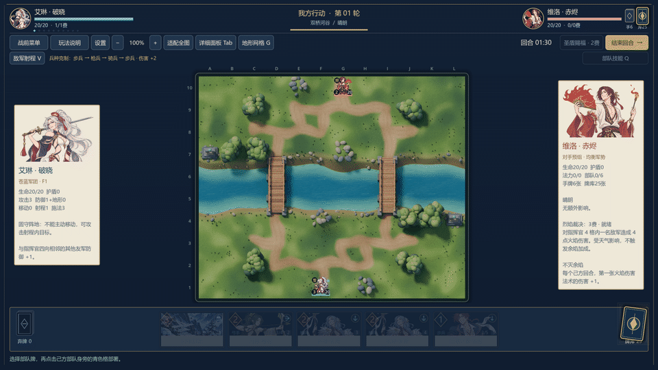
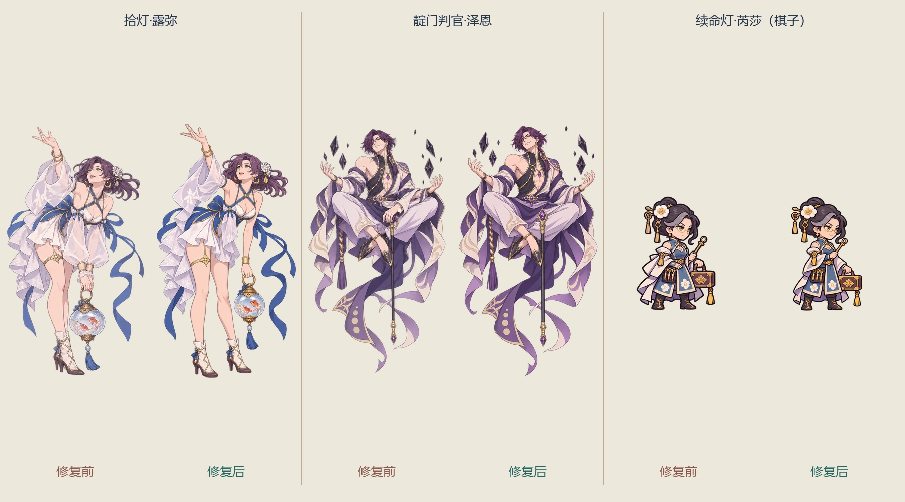
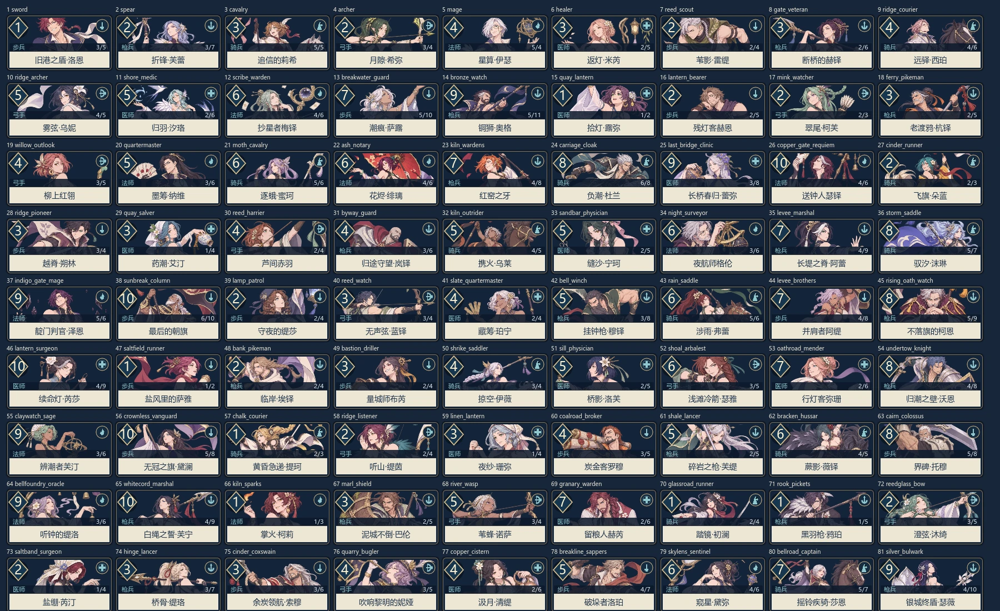
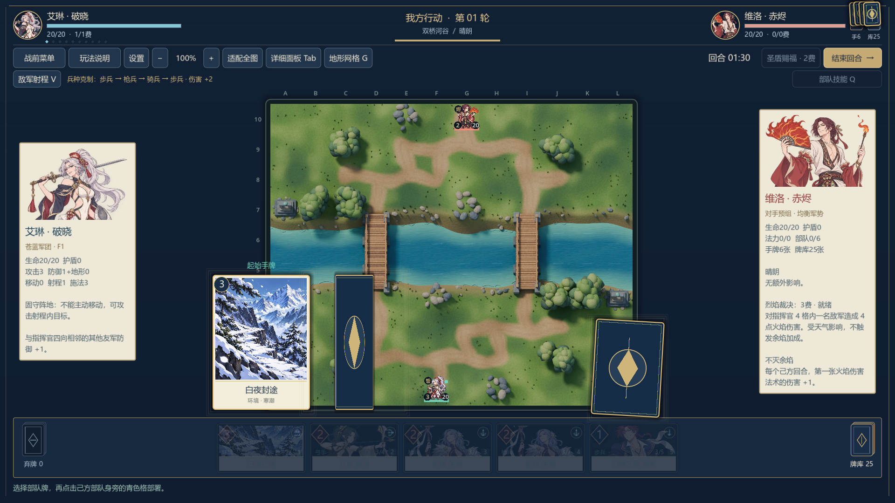
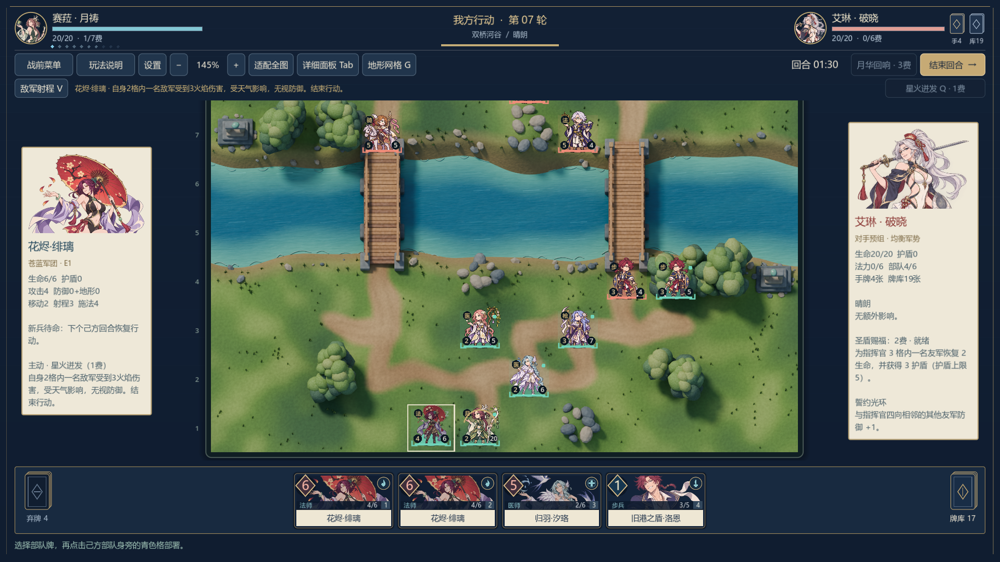
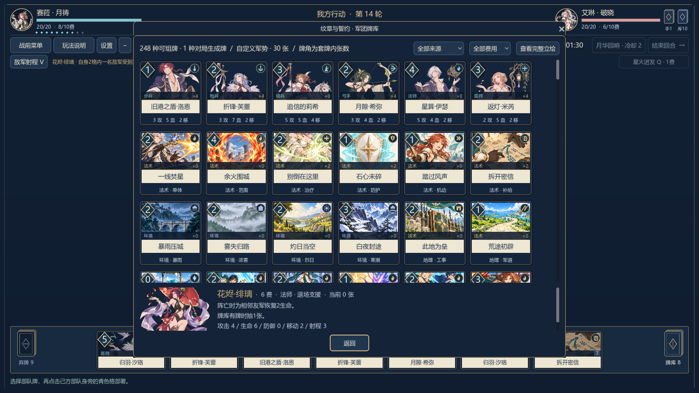

# 0.64 · 立绘修正、抽牌演出与界面

本版先逐张复查 84 张成年角色完整立绘和 84 个 Q 版战场人物，修正三幅图中明确的多余手臂，再加入实际抽牌过程的卡背飞出、翻面和落牌演出。战场、牌库和卡面采用一致的深蓝、纸白与金色界面，81 张部队牌分别调整人物取景，缩小窗口后八张手牌也能完整排入显示区域。

动图来自正常战前菜单进入双桥河谷后，己方五张、敌方六张起始手牌的实际演出。42 帧由原生渲染视口采集，再缩小至 960×540；画面中的卡牌与这次开局的真实手牌对应。

## 角色肢体与卡面取景

成年立绘继续使用细线、平涂和淡紫阴影，棋盘保留对应的小比例人物。

| 角色 | 修正位置 | 修正结果 |
| --- | --- | --- |
| 拾灯·露弥（`quay_lantern`） | 完整立绘与对应卡面 | 移除重复的提灯手臂，保留一只抬起的手和一只提灯手 |
| 靛门判官·泽恩（`indigo_gate_mage`） | 完整立绘与对应卡面 | 移除膝上多出的扶杖手，两只展开的手继续施法，法杖独立悬浮 |
| 续命灯·芮莎（`lantern_surgeon`） | Q 版战场人物 | 移除腰间多出的第三只手，保留一手持杖、一手提药箱 |

[逐图目视检查记录](anatomy-v064.json) · [修正后的全部 84 组角色](cast-v064.webp) · [完整立绘目录](../../assets/art/characters/v3/full) · [生成及修正记录](../../assets/art/characters/v3/production.json)

资源准备时同步清理完全透明像素中残留的颜色。其余 82 张完整立绘在忽略透明区域后，可见像素与上一版一致；这项处理没有改变这些角色的造型。角色编号与卡面、完整立绘、Q 版棋子的对应关系保留，142 项运行时人物图像的制作清单校验值已刷新。

验收角色时，打开 **牌库**，按来源、费用筛选或浏览卡牌，选择角色后点 **查看完整立绘**。在棋盘部署相应卡牌，可对照 Q 版人物。修正集中在肢体结构和透明图像清理；逐图目视检查不等于每一处手指、关节和遮挡关系都已达到最终美术质量。

81 张部队卡各自设置人物取景高度，普通卡面与紧凑手牌共用同一角色焦点。逐张查看实际 `CardView` 渲染后，81 张紧凑卡面的主脸均可见，没有被费用菱形、兵种图标或属性横条整体挡住。非部队卡保留原来的插画取景。

## 抽牌演出

- 起手直接呈现已经发到手中的牌；普通回合抽牌、法术连抽、定向补给与退场触发的抽牌，根据实际牌区变化播放，不再次执行抽牌规则。
- 己方卡牌由牌库飞出，翻面短暂停留，再落入对应的手牌位置。八张手牌已满时，新抽到的牌飞向弃牌堆，并显示弃置提示。
- 敌方抽牌与溢出始终显示卡背，演出事件不携带敌方卡名、编号或卡牌定义。敌方满手牌的溢出使用独立弃牌位置。
- 演出期间可以立即选牌或使用可直接结算的卡牌。打开菜单或确认窗、胜负结算和重开都会清理未结束的演出；恢复已有战斗不会重复播放起手。
- **减弱动态** 将移动与翻面改为最终位置的短暂静态提示。演出不额外扣费，不推进随机数，也不改变 90 秒回合规则。

生成手牌、从弃牌堆回收、单位返回手牌和从牌库直接征召到棋盘，各自保留原有规则，不会误播为从牌库抽牌。

## 战场与牌库界面

新版界面统一按钮、面板、卡牌边框和选中反馈，突出结束回合等主要操作。战场两种布局都显示己方牌库、弃牌堆，以及敌方牌库和手牌数量，抽牌从这些实际牌堆位置出发。牌库保留来源、费用筛选与完整立绘浏览。

修复了打开大窗口后再缩小窗口时，手牌区域沿用旧宽度、把界面撑出边界的问题。实际 Windows 窗口由 1920×1080 缩到 1008×700 后，八张手牌与两侧面板仍在可见区域内；已打开的卡牌窗口也会重新排布、缩放并居中。

战场截图来自脚本按规则推进的 65 次合法行动，用于展示实际棋局和界面，不作为正常难度完整通关或长期平衡结论。

## 本版源码验证

以下是本次稳定源码的实际检查结果，各项均为 **0 失败**。 [可下载的检查记录](qa-v064.json)

| 检查范围 | 通过项数 | 本轮覆盖 |
| --- | ---: | --- |
| 立绘与资源独立原生检查 | 874 | 当前角色资源、卡面与完整立绘的加载和对应 |
| 正常开局抽牌独立原生检查 | 300 | 实际起手、敌方信息隔离、状态与随机数不变、42 帧画面、三尺寸六布局 |
| 原生界面回归 | 495 | 本轮使用无截图模式运行 UI 检查；公开截图另行采集 |
| 原生抽牌与窗口专项 | 166 | 连抽、溢出、取消、减弱动态、立即交互与真实窗口缩小 |
| 纯战斗回归 | 76 | 包括 12 局 AI 对局，检查本次修改后的规则运行 |
| 战斗快照回归 | 838 | 状态保存、恢复及后续行为 |
| 人物身份对应回归 | 993 | 卡牌与人物资源的稳定对应 |
| 既有施法演出回归 | 133 | 本版抽牌及界面修改后的施法演出兼容性 |

独立抽牌检查按项目的画布拉伸规则映射三种输出尺寸：1008×700、1440×1000 和 1920×1080，各检查标准与大地图布局。真实 Windows 缩窗另由抽牌与窗口专项覆盖。逐图目视检查、布局检查和这些规则回归分别记录，不将其合并成美术质量评分或整体平衡评分。

本页列出源工程已完成的检查。Windows 发行包的原生复验和实际资源来源，见 GitHub Release 随附的 [release-verification-v064.json](https://github.com/yifanchen12/sigils-and-oaths/releases/download/v0.64.0-dev/release-verification-v064.json) 与 [packed-sources-v064.json](https://github.com/yifanchen12/sigils-and-oaths/releases/download/v0.64.0-dev/packed-sources-v064.json)；下载文件可用 [SHA256SUMS.txt](https://github.com/yifanchen12/sigils-and-oaths/releases/download/v0.64.0-dev/SHA256SUMS.txt) 核对。

[Windows 下载与发行附件](https://github.com/yifanchen12/sigils-and-oaths/releases/tag/v0.64.0-dev) · [内容披露](steam/content-disclosure.md) · [资源准备脚本](../../tools/prepare_character_redraw.py) · [独立抽牌验证脚本](../../tools/verify_draw_presentation.gd)
