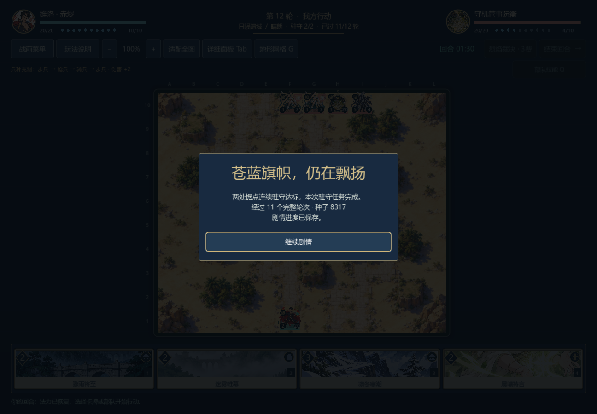
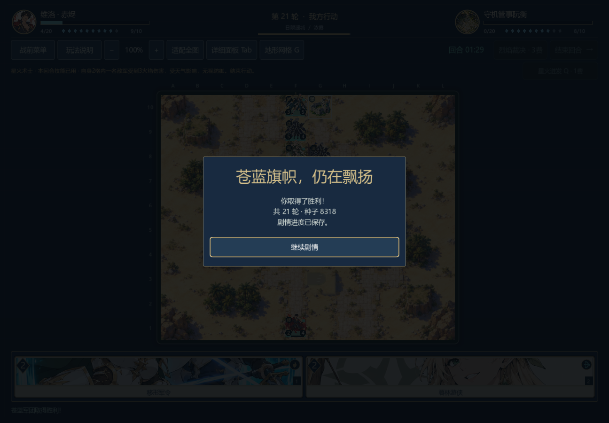
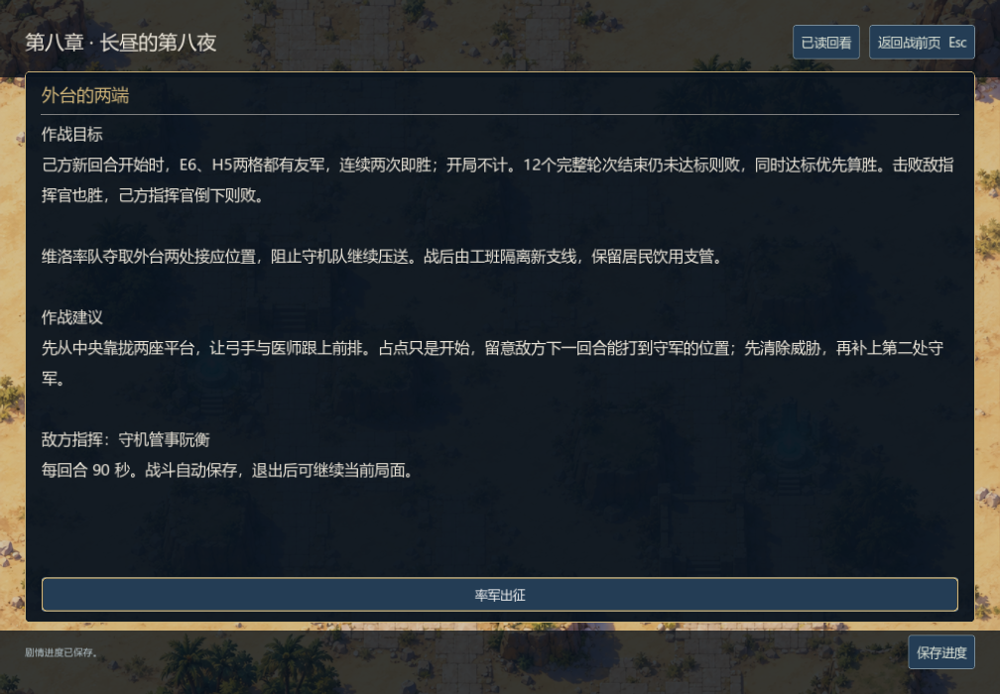

# 日陨两关：中央集结、原生获胜与退出续战

0.26.0-dev，2026-11-06。两条路线都已从正式开局资源打赢，并各经过两个独立原生进程的保存、退出与续战。生产敌军自主行动；没有修改兵种数值、套牌、牌序、初始兵力、90秒时限或驻守期限。

## 从四败到两条获胜路线

0.25的生产/谨慎测试玩家四场都败，完整记录仍保留。回放中，隔离路线曾取得1/2驻守，守点骑兵随后被击破；缓压路线前排与支援分散，敌军最终突破己方指挥官。新测试玩家沿中央两座平台集结，对可见伤兵、敌方医师及可以合力击破的目标提高优先级，同时按完整移动范围估计风险。该策略使用自己的手牌和公开棋盘，没有读取敌方手牌或未来牌序，也没有按某个回合写死操作。

| 关卡 | 实际结果 | 完整合法行动 | 结束时刻 | 正式种子 |
| --- | --- | ---: | --- | ---: |
| 隔离新支线 | 两点连续驻守2/2，双方指挥官存活 | 108 | 第12轮开始，内部turn23；经过11完整轮 | 8317 |
| 冷却池缓压 | 击败敌方指挥官 | 266 | 第21轮己方行动，内部turn41 | 8318 |

这是同一测试策略在两张固定开局中的存在性证据，不是人类胜率或全局难度结论。缓压局仍需21轮，己方指挥官最终只剩4/20生命；操作容错、人工游玩时长和疲劳感尚需评估。未把先前四败删去或混成另一种胜率；完整374行动、牌序、随机数、计时及最终状态独立重放761项通过，旧四败另重放1,294项通过。

## 真正退出后继续

隔离关第23行动、缓压关第24行动都在内部turn8、敌方尚未行动时打开菜单保存，并通过真实窗口关闭处理退出。另起Godot进程，从磁盘恢复剩余时钟和完整战局，再点击“继续战役”；敌方现场AI继续行动，玩家通过实际手牌、棋盘、技能与结束回合按钮完成对局。

隔离关写入76项、读取续战250项；缓压关写入77项、读取续战677项，合计 **1080项原生检查通过**。两关真实胜利后均点击继续剧情到`c08.after.01`，`pressure_plan`保持所选方案，`sunspire_stable`才变为真；独立会话再次读盘仍在战后，没有重发结果。此前七章使用叙事胜利夹具进入，不能据此声称十战连续通关。





[隔离退出前](screenshots/v026-c08_isolate-before-exit.png) · [隔离战后](screenshots/v026-c08_isolate-story.png) · [缓压退出前](screenshots/v026-c08_buffer-before-exit.png) · [缓压战后](screenshots/v026-c08_buffer-story.png)

## 战前页先显示目标

新增两段可操作的建议：中央集结、让支援跟上、观察下一敌方回合的射程，避免急着占点或单兵深追。第一次小窗口截图发现建议把目标挤到下方，因此战前页改为展开阅读区并把胜负条件放在第一段。普通对白的插画与人物区域保持原有布局。

两种1008×700战前页的目标、建议、敌将、时限和出征按钮已逐张查看，均直接可读。最终八章原生页面回归 **10,806项通过**，覆盖1,023段对白、8段章末、实际选择/跨章/读盘和旧界面。八张本轮实机图均检查；旧截图还原，不覆盖历史版本证据。



[缓压战前页](screenshots/v026-c08_buffer-briefing.png)

## 策略边界与回归

`sunspire_focus_pilot.gd`只用于测试玩家，复用已有公开目标集火评分，并以两座平台的中线作软性集结偏好；不替换游戏内敌方AI，也不为真人自动出牌。32个真实玩家回合开局逐一检查选择不改局面，改动敌方手牌、双方未来牌序与随机种子后选择保持相同，163项通过。这个检查加上第八章1,135、剧情引擎381、会话204、存储31，合计 **1,914项模型检查**；模型与三组完整重放合计 **3,969项**。

正文没有增加，仍为八章加档案60,703个去重汉字；原生逐页检查与正常连续通关分开计量。其余关卡的当前版本验证、完整十战连续路线、分层平衡、外部试玩、后两章/侧支/结局、美术、音频设置和独立发行仍需继续。

[源码、完整行动与检查摘要](sunspire-playthrough-v026.json) · [上一轮四败](sunspire-diagnostics-v025.json)

```sh
godot --headless --path . --script tests/benchmark_campaign.gd -- --sunspire-player
godot --headless --path . --script tests/test_sunspire_pilot.gd
godot --headless --path . --script tests/test_campaign_replays.gd -- --fixture=res://tests/fixtures/campaign_v026_sunspire.json
godot --path . --script tests/test_campaign_playthrough_ui.gd -- --scenario=c08_isolate --write
godot --path . --script tests/test_campaign_playthrough_ui.gd -- --scenario=c08_isolate --read
godot --path . --script tests/test_campaign_playthrough_ui.gd -- --scenario=c08_buffer --write
godot --path . --script tests/test_campaign_playthrough_ui.gd -- --scenario=c08_buffer --read
```

原生写入/读取需按上面顺序串行运行，两条路线共用测试存档。所有测试输出与临时存档写入已排除的工具目录。
