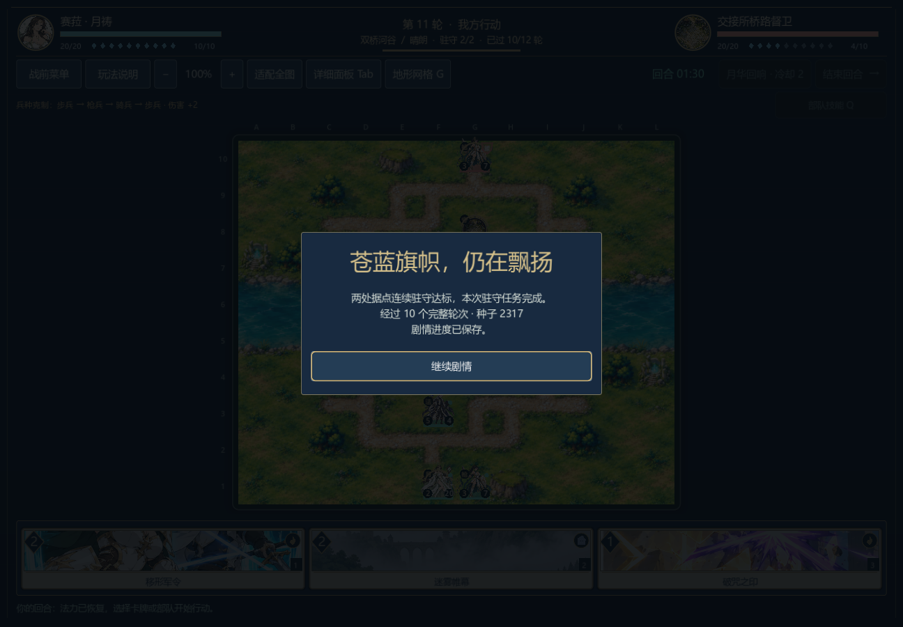
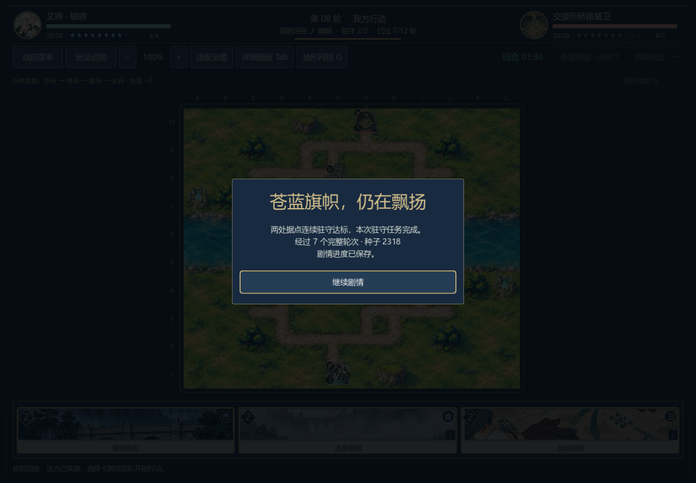
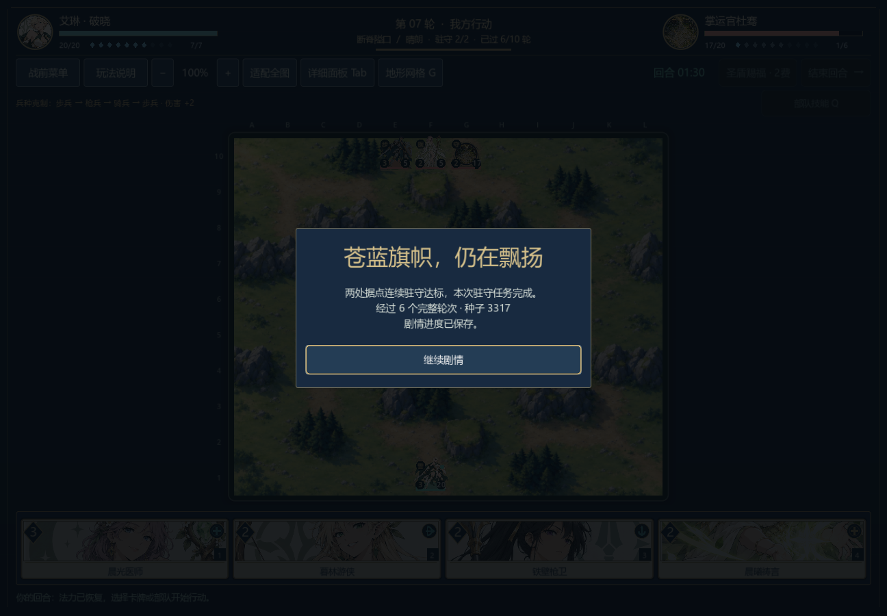

# 部队生存与第二章守桥验证

本文保留对应版本的历史原生记录。0.23.0-dev已更新生产AI，旧动作不保证继续被现场AI选出；[当前策略与新的种粮续战验证](ai-occupancy.md)单独记录。

本文保留0.18.0-dev历史诊断。0.19.0-dev已补充[首章桥关合法胜利与原生续战](bridge-playthrough.md)，旧失败数据仍保留；本文八关不包含后来增加的两场港口战。

0.18.0-dev，2026-11-06。本轮修复两类决策缺陷：新兵部署只看推进距离，忽略敌军射程；医师可能先造成一点非致命伤害，耗掉原本可以恢复三点生命的行动。卡牌数值、初始资源、牌序、地形、90秒行动回合和据点期限未修改。

## 行为与局限

`tactical_ai.gd`只从公开单位和地形估计风险。下次敌方回合的新兵/已行动状态恢复、定身剩余时间、移动费用、地形射程和当前护盾进入评分；敌方手牌、未来抽牌与隐藏牌序不进入计算。潜在移动攻击按0.45权重处理，眼前射程按1处理；这只是行动价值权重，不是命中概率或精确敌方回合伤害。一次决策内缓存同一候选位置的风险，新动作后重新生成，避免复用过期局面。

这不是完整战术搜索。多名敌军是否能同时进入同一个狭口、援护者承伤后阵亡、天气在回合开始散去、骑兵额外再动及下一张敌方手牌等组合不由该估计精确求解；真实行动仍全部交给`Battle`检查与结算。战斗伤害、援护和法术预估本身未改动。

医师的有价值治疗现在可以排在一点非致命攻击之前；真正击破或指挥官终结仍有独立优先级。12项新检查覆盖安全部署、原地与移动威胁、山地/地形费用、定身消退、新兵下一回合行动、公开信息隔离、只读决策以及治疗实际消耗。

## 诊断分组

以下使用正式关卡初始资源、合法行动与固定种子。两组不能混成一个胜率，也不代表真人体验。

| 关卡 | 双方生产AI | 谨慎玩家策略对生产AI |
| --- | --- | --- |
| 首章军道 | 败，327行动 | 未测 |
| 首章河岸 | 败，435行动 | 未测 |
| 首章桥关 | 败，451行动 | 本轮开发探针仍败，441行动 |
| 救济优先 | 期限失败，152行动 | 驻守胜，第11轮开始，124行动 |
| 种粮优先 | 期限失败，160行动 | 驻守胜，第8轮开始，77行动 |
| 交接所 | 败，347行动 | 未测 |
| 风口接应 | 驻守胜，第7轮开始，56行动 | 期限失败，108行动 |
| 山脊押运 | 败，416行动 | 未测 |

正式保存的两组分别为八关2,344行动、1胜7败，三目标关309行动、2胜1败。首章桥关的额外开发探针不计入三目标关统计。谨慎玩家使用`tests/fixtures/campaign_pilot.gd`：把潜在移动风险权重设为1，其余评估与生产AI共享，不改变敌方AI，不读取敌方牌。它是复现合法打法的测试工具，游戏中没有自动替玩家操作的功能。

首轮把所有移动威胁按满权重用于双方，产生过度退避、较长对局和风口失败，已舍弃。最终策略仍有长局问题：八关同策略行动总数由0.17.0-dev的1,576增至2,344，玩家侧胜局由3减为1。阵容、先后手、策略和固定种子混杂，不能据此判断“更平衡”或“更难就更好”；首章桥关与普通战斗节奏需继续处理。当前只确认两条第二章目标关存在可复现的合法胜利，不宣称三章连续通关。

本机最终八关单次决策峰值338.36ms，三目标组306.54ms，仍需优化原生响应及更广泛种子样本。原始完整动作/最终快照分别在`tests/fixtures/campaign_v018_selfplay.json`、`campaign_v018_cautious.json`；紧凑结果及UTF-8/LF源文件SHA256在`campaign-ai-v018.json`。

## 规则与复现

相关规则271项、新两组重放4,721+631项，合计5,623项通过。另重放旧版记录3,185项，确认规则仍能重现旧行动。每组核对覆盖范围内所有关卡恰好出现一次，包含失败局；核对逐步合法性、计时、回合、牌序、单位、RNG、目标和最终存档，不能只改胜负标签。

三场原生验证分别启动写入和读取进程，在第8行动回合的敌方行动前开菜单、正常关闭；重开后通过真实「继续战役」按钮读盘，再以真实点击操作到胜利。救济路线63+292项、种粮路线84+163项、风口87+117项，共806项通过。实际时钟精确恢复，完整战局与独立重放一致，战果只结算一次；前两条保留`priority`事实进入`c02.bridge_after.01`，风口写入检修廊补给事实进入`c03.vent_after.01`。







截图来自当前原生渲染；菜单、胜利和战后对白各留一张。截图复查发现救济菜单的肖像淡入尚未结束，辅助脚本等待0.25秒后重采并复验暂停与续战，没有修改产品动画。早期章节入口仍由叙事夹具到达，这806项不能代替完整战役通关。

```powershell
godot --headless --path . --script tests/test_tactical_ai.gd
godot --headless --path . --script tests/benchmark_campaign.gd
godot --headless --path . --script tests/benchmark_campaign.gd -- --cautious-player --objectives-only
godot --headless --path . --script tests/test_campaign_replays.gd -- --fixture=res://tests/fixtures/campaign_v018_selfplay.json
godot --headless --path . --script tests/test_campaign_replays.gd -- --fixture=res://tests/fixtures/campaign_v018_cautious.json
```

诊断输出位于忽略的`.tools/`，需先创建该目录；干净工程先运行`godot --headless --path . --import`。八关默认输出与谨慎玩家输出分别保存，不相互覆盖。

原生续战脚本支持`c02_relief_bridge`、`c02_seed_bridge`、`c03_vent`。按同一关卡先写入再读取，不能并行覆盖测试存档。它使用独立测试槽；此前章节用叙事夹具到达，目标战斗本身从正式初始状态进行。

```powershell
godot --path . --audio-driver Dummy --script tests/test_campaign_playthrough_ui.gd -- --write --scenario=c02_relief_bridge
godot --path . --audio-driver Dummy --script tests/test_campaign_playthrough_ui.gd -- --read --scenario=c02_relief_bridge
```
